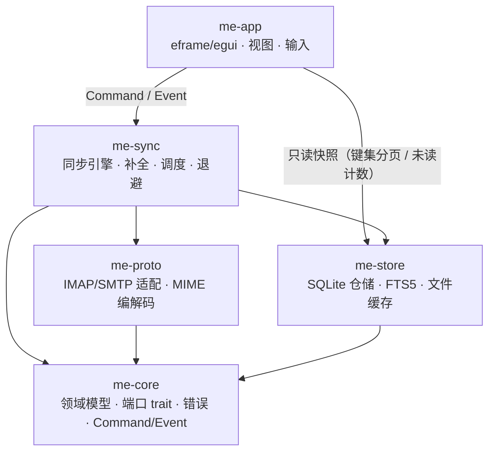

# MyEmail v0.1 架构设计

> **历史视图**：本文描述 v0.1 的实现范围；v0.2 的 OAuth2、IDLE、草稿双向同步与 HTML 渲染器 v2 见 [v02架构设计.md](v02架构设计.md) 与 [README.md](../../README.md)。
>
> 依据：[项目大纲.md](../项目大纲.md) v0.4、[项目架构.md](../项目架构.md)、[数据结构.md](../数据结构.md)、[技术栈选用.md](../技术栈选用.md)、[可行性分析.md](../可行性分析.md)（2026-11-01）
> 版本：v0.1（首个可用版本）　|　编写日期：2026-11-02
> 修订：2026-11-02 审查修复（接口契约补齐、UI 写路径澄清、依赖与职责收口、缓存清理语义、SQL 多值绑定）。
> 定位：把既有文档落成可开工的视图——**v0.1 功能边界、crate 与文件级结构、数据结构、每个文件的作用**。
> 冲突处理：功能与决策以 [项目大纲.md](../项目大纲.md) 为准；DDL 以 [数据结构.md](../数据结构.md) §4.2 为唯一事实源。本文是汇总视图，**不新增产品决策**。

---

## 目录

1. v0.1 功能范围
2. 总体架构
3. 工程结构与文件职责
4. 数据结构
5. 关键流程
6. 并发、错误与可观测性
7. 测试落点
8. 事实源与维护约定

---

## 1. v0.1 功能范围

### 1.1 定位

**多账户统一收发 + 本地全量缓存 + 离线全文检索的原生桌面邮件客户端。**

- 形态：egui / eframe 原生 GUI，纯 Rust，单二进制，跨平台。
- 协议：IMAP 收信、SMTP 发信。
- 存储：SQLite 全量摘要 + 正文/原始邮件/附件文件缓存；摘要随同步入库，正文后台补全。
- 检索：SQLite FTS5（`trigram`），头部即时可搜，正文随补全增量可搜。

### 1.2 功能清单

| 模块 | v0.1 能力 | 关键边界 |
| --- | --- | --- |
| 账户 | 增 / 删 / 改；IMAP 与 SMTP 端点、端口、TLS 模式、用户名、认证方式；连接测试（IMAP + SMTP 各一次）；多账户在线与同步状态展示 | 仅密码 / 授权码（SASL PLAIN、LOGIN）；Gmail / Outlook 因禁用基础认证**不支持**；删除仍有草稿的账户默认拒绝，二次确认“连同草稿删除”后才级联 |
| 凭证 | 存入系统密钥库（Windows Credential Manager，经 `keyring`） | keyring 不可用时仅“本次会话记忆”（进程内存）或取消，**不落盘明文** |
| 收信 | 文件夹树同步；`SPECIAL-USE` 优先 + 名称启发式（中英文别名）+ 用户手动指定角色；启动同步与手动刷新；增量同步；已读/星标/删除标志；`BODYSTRUCTURE` 附件标记；未读计数；按时间倒序列表 | 仅启动 + 手动触发，**不做定时轮询与 IDLE**；首同步全量、分页、可中断；不按天数截断 |
| 读信 | 打开即本地置已读并异步回写 `\Seen`；正文按需下载；优先 `text/plain`，仅有 HTML 时经 `html2text` 转纯文本；提供“标记为未读” | 不做完整 HTML 渲染；正文索引与展示文本一致 |
| 发信 | 纯文本撰写（UTF-8、`text/plain`）；收件人 / 抄送 / 密送；多附件；发送前写本地草稿并固定 `Message-ID`；SMTP 投递；成功后 `APPEND` 到 Sent；失败保留草稿并提示 | **不排队、不自动重试**；重发前确认“可能已发送”；服务器草稿仅手动镜像，本地为唯一事实来源 |
| 附件 | 解析 multipart，展示名称 / 类型 / 大小；按需下载、另存为、系统默认程序打开；打开前风险提示 | 单文件 ≤ 25 MB，单封附件总量 ≤ 25 MB；草稿附件复制到应用托管目录 |
| 搜索 | 头部字段（主题 / 发件人 / 收件人）同步后立即可搜；正文在后台补全完成后写入 FTS；按账户 / 文件夹 / 时间范围 / 是否含附件过滤；显示“正文索引覆盖 N/M 封” | 查询词 ≥ 3 字符命中正文；1～2 字符仅匹配头部（trigram 限制，界面提示） |
| 通用 | 离线读取已缓存邮件；首次启动 / 空列表 / 同步中 / 离线 / 错误五类界面状态；本地明文缓存告知；缓存清理；深浅色跟随系统；日志按天滚动保留 7 天 | 本地缓存不加密、不承诺合规存储；离线发信直接提示并保存草稿 |

### 1.3 明确不做（v0.1 非目标）

- PGP / S-MIME 加解密与签名
- 邮件规则引擎、日程（iCal / CalDAV）、联系人同步
- SMTP / IMAP 服务端实现
- 移动端
- 多设备自建同步（本地缓存仅本机）
- 服务器草稿双向同步
- 完整 HTML 正文渲染与内联图片 `cid:` 解析
- 富文本 / HTML 撰写
- 定时轮询与 IDLE 实时推送
- OAuth2（v0.2 首项）
- 邮件会话聚合、退信解析、地址簿、导入导出、搜索语法

### 1.4 全局技术约束

| 约束 | 内容 |
| --- | --- |
| 语言 / 运行时 | Rust（2024 edition）+ tokio（`rt-multi-thread`、`macros`、`fs`、`time`） |
| GUI | `eframe` / `egui`，列表使用 `egui_extras` 虚拟滚动，文件对话框用 `rfd` |
| 协议库 | `async-imap`（IMAP）、`lettre`（SMTP）、`mail-parser`（MIME） |
| 存储 | `rusqlite`（bundled，≥ SQLite 3.43）+ `r2d2` / `r2d2_sqlite` |
| TLS | 统一 `rustls`；隐式 TLS / STARTTLS 默认可用；**明文 TLS 默认禁止**，仅“高级”勾选风险确认后可选，账户列表常驻风险标记 |
| 同步触发 | 仅启动时自动同步 + 用户手动刷新 |
| 身份模型 | 单账户单身份，不做签名与发信别名 |
| 明文缓存 | SQLite 与正文/原始邮件/附件均为明文；首次启动与设置页明确告知 |

---

## 2. 总体架构

### 2.1 分层与依赖方向



- **UI 不直接碰网络**：只发 `Command`、消费 `Event` 与只读查询结果。
- **UI 可读库但不能写库**：唯一例外是 `me-app → me-store` 的只读路径，仅限键集分页与未读计数，单次 `LIMIT ≤ 200`，禁止全表扫描、FTS 检索与任何写操作；搜索经 `Search` 命令异步返回，写操作一律走 `Command`。
- **me-core 是唯一汇点**：不依赖 tokio / rusqlite / 任何协议库，保证领域规则可脱离运行时单测。
- **me-proto 与 me-store 互不依赖**：二者只通过 `me-core` 的类型通信。
- **me-proto 隔离上游库**：`async-imap`、`lettre` 的 error 类型不得出现在 `me-proto` 之外。

### 2.2 crate 一览

| crate | 类型 | 职责 | 依赖 | 明确禁止 |
| --- | --- | --- | --- | --- |
| `me-core` | lib | 领域模型、端口 trait、错误、`Command` / `Event` | serde、serde_json、thiserror、chrono、tracing | tokio、rusqlite、协议库 |
| `me-proto` | lib | IMAP / SMTP 会话、认证、MIME 解析与构建、modified UTF-7 | `me-core`、async-imap、lettre、mail-parser、html2text、tokio、rustls、webpki-roots / rustls-native-certs、tracing | 直接触库、直接发事件 |
| `me-store` | lib | SQLite 仓储、FTS5、文件缓存、迁移 | `me-core`、rusqlite、r2d2、r2d2_sqlite、flate2、dirs、serde_json、tracing | 网络访问、业务规则判断 |
| `me-sync` | lib | 任务编排、同步、后台补全、退避、事件发送 | `me-core`、`me-proto`、`me-store`、keyring、tokio、tokio-util、serde_json、tracing | 直接操作 egui 类型 |
| `me-app` | bin | eframe 应用、视图、输入、文件对话框 | `me-core`、`me-store`（只读）、`me-sync`、eframe、egui_extras、rfd、fs2、anyhow、serde_json、tracing、tracing-appender | 协议库、写连接 |

> 依赖表只列**直接依赖**；`serde_json` 用于 JSON 数组列与事件载荷，`tracing` 用于结构化日志，`tracing-appender` 仅 `me-app` 初始化日志。

### 2.3 依赖硬规则

1. 依赖只能按 §2.1 箭头方向，**不得成环**。
2. `me-app` 不得 `use` `async-imap`、`lettre`、`rusqlite` 的任何符号——违规在编译期暴露，不靠自觉。
3. `me-app` 只持有 `me-store` 的只读句柄；写句柄只交给 `me-sync`。schema 初始化在 `Store::open()` 内、句柄拆分前完成；设置经 `SetTheme` / `SetBodyBackfill` 命令写入。
4. 端口 trait 使用 **`async fn` in trait（RPITIT）**，不引入 `async-trait`。
5. 事件载荷是**结果快照**而非引用，UI 无需回查即可渲染常见场景。

### 2.4 运行时与线程模型

| 执行体 | 职责 | 禁止 |
| --- | --- | --- |
| 主线程（eframe） | 事件循环、布局与绘制、UI 状态更新、只读短查询 | 网络与磁盘 IO、`await`、写库、全表扫描与 FTS 查询 |
| tokio 运行时（独立线程，multi-thread） | 网络 IO、同步任务、SMTP 投递、正文补全 | 持有或修改 `me-app` 的视图状态 |
| DB 工作线程 | 单写连接；异步侧经 `spawn_blocking` 访问 | 跨线程持有事务；事务内做网络 IO |

**每帧主循环**

```
update():
  1. event_rx.try_recv() 循环抽取，直到空或达到每帧上限（建议 256 条）
  2. 若本帧收到影响列表的事件 → 标记该视图需要重新查询（懒加载，不立即查）
  3. 渲染
  4. 若仍有未处理事件 → ctx.request_repaint()
```

**通信方式**

| 方向 | 类型 | 容量 | 满时行为 |
| --- | --- | --- | --- |
| UI → 后端 | `Command` | 无界（`UnboundedSender`） | 用户操作稀疏，无堆积风险 |
| 后端 → UI | `Event` | 有界 1024（`mpsc::channel`） | 先丢最旧的可合并进度事件；关键事件不得丢弃 |

- **可合并事件**：`SyncProgress`、`IndexProgress`，每 ≥ 200 ms 或每 50 封最多发一次。
- **关键事件不丢弃**：`AccountsLoaded`、`AccountAdded`、`AccountUpdated`、`AccountRemoved`、`AccountStatus`、`ConnectionTested`、`FoldersUpdated`、`MessagesAppended`、`FlagsChanged`、`MessageBodyLoaded`、`AttachmentDownloaded`、`SearchResults`、`IndexRebuilt`、`DraftSaved`、`SendCompleted`、`SendFailed`、`CacheCleared`、`Error` 必须送达；通道满时先丢进度事件，仍满则合并同类事件后重试。
- 后端每次发送事件后触发唤醒回调（由 `me-app` 注入，内部调用 `ctx.request_repaint()`），保证空闲窗口也能刷新；`me-sync` 不依赖 egui。
- **事件不是真相**：真相在数据库。事件只表示“某事已完成 / 状态已变化”，合并与丢弃不影响数据正确性，只影响刷新及时性。

---

## 3. 工程结构与文件职责

### 3.1 目录树

```
MyEmail/
├─ Cargo.toml                         # workspace
├─ rust-toolchain.toml                # 固定工具链
├─ deny.toml                          # cargo-deny 策略
├─ assets/
│  ├─ fonts/cjk-subset.ttf            # CJK 字体子集（思源黑体）
│  └─ icons/app.ico                   # 应用图标
├─ crates/
│  ├─ me-core/
│  │  ├─ Cargo.toml
│  │  └─ src/
│  │     ├─ lib.rs
│  │     ├─ model.rs
│  │     ├─ port.rs
│  │     ├─ command.rs
│  │     └─ error.rs
│  ├─ me-proto/
│  │  ├─ Cargo.toml
│  │  └─ src/
│  │     ├─ lib.rs
│  │     ├─ imap.rs
│  │     ├─ smtp.rs
│  │     ├─ mime.rs
│  │     └─ utf7.rs
│  ├─ me-store/
│  │  ├─ Cargo.toml
│  │  └─ src/
│  │     ├─ lib.rs
│  │     ├─ db.rs
│  │     ├─ migrations.rs
│  │     ├─ accounts.rs
│  │     ├─ folders.rs
│  │     ├─ messages.rs
│  │     ├─ attachments.rs
│  │     ├─ drafts.rs
│  │     ├─ pending.rs
│  │     ├─ search.rs
│  │     └─ cache.rs
│  ├─ me-sync/
│  │  ├─ Cargo.toml
│  │  └─ src/
│  │     ├─ lib.rs
│  │     ├─ engine.rs
│  │     ├─ indexer.rs
│  │     ├─ tasks.rs
│  │     └─ events.rs
│  └─ me-app/
│     ├─ Cargo.toml
│     └─ src/
│        ├─ main.rs
│        ├─ app.rs
│        ├─ state.rs
│        └─ views/
│           ├─ mod.rs
│           ├─ accounts.rs
│           ├─ mailbox.rs
│           ├─ reader.rs
│           ├─ compose.rs
│           └─ settings.rs
├─ tests/
│  ├─ common/mod.rs
│  ├─ fixtures/*.eml
│  ├─ store_schema.rs
│  ├─ proto_mock.rs
│  └─ e2e_docker.rs
└─ doc/                               # 既有 5 份文档 + 本文
```

> `me-store/attachments.rs`、`me-store/pending.rs` 与 `views/mod.rs` 已回写到 `项目架构.md` 的工程结构；不改变分层与依赖规则。

### 3.2 根级文件

| 文件 | 作用 | 关键内容 |
| --- | --- | --- |
| `Cargo.toml` | workspace 定义 | `resolver = "2"`；members 为 5 个 crate；统一 `workspace.dependencies`；`[profile.release] lto = "thin"`、`codegen-units = 1` |
| `rust-toolchain.toml` | 固定工具链 | 指定 channel 与 components（rustfmt、clippy），避免本机与 CI 漂移 |
| `deny.toml` | 供应链策略 | 许可证白名单（MIT / Apache-2.0 / BSD / ISC / MPL-2.0）、漏洞公告、重复版本检查 |
| `assets/fonts/cjk-subset.ttf` | 中文字体 | 思源黑体子集，约 3～6 MB；egui 默认字体无 CJK |
| `assets/icons/app.ico` | 应用图标 | 窗口与安装包图标 |

### 3.3 me-core（领域层，无运行时依赖）

| 文件 | 作用 | 关键内容 | 约束 |
| --- | --- | --- | --- |
| `crates/me-core/src/lib.rs` | crate 根 | `pub mod model / port / command / error`；公共类型 re-export | 只做装配与导出，不放逻辑 |
| `crates/me-core/src/model.rs` | 领域模型与纯规则 | `AccountId / FolderId / MessageId / DraftId` newtype；`Account / Endpoint / TlsMode`；`Folder / FolderRole`；`MessageSummary / MessageBody / Attachment / Draft / OutgoingMessage`；`Address`；`DateSource`；`Flags / FlagOp`；`SearchQuery`；IMAP 标志 ↔ 位掩码转换；`make_snippet`（前 200 字符）；`effective_date`（Date 头失败回退 INTERNALDATE）；附件 25 MB 上限校验；`LogSafeMessageSummary`（去掉 `snippet`、地址脱敏） | 无 IO、无 tokio、无 rusqlite；时间在边界转 unix 秒 |
| `crates/me-core/src/port.rs` | 端口 trait | `ImapPort`、`SmtpPort`、`MessageRepo`、`FolderRepo`、`AttachmentRepo`、`DraftRepo`、`PendingRepo`、`SearchRepo`、`MetaRepo`、`ReadOnlyRepo`；`MetaRepo` 由 `migrations.rs`、`ReadOnlyRepo` 由 `db.rs` 实现 | `async fn` in trait；不出现 `async-imap` / `lettre` / `rusqlite` 类型 |
| `crates/me-core/src/command.rs` | UI ↔ 后端契约 | `Command`、`Event`、`TaskId`、`ConnectionState`、`SendFailureKind`、`ErrorScope`、`AccountDraft` | 事件载荷为快照；可 serde 序列化，便于测试与日志 |
| `crates/me-core/src/error.rs` | 错误模型 | `CoreError { Network { retryable }, Protocol { code, detail }, Auth, Storage, Parse, Limit(LimitKind), Cancelled }`；`is_retryable()`；用户可读消息 | 不携带正文与凭证；协议文本先脱敏 |

### 3.4 me-proto（协议适配层）

| 文件 | 作用 | 关键内容 | 约束 |
| --- | --- | --- | --- |
| `crates/me-proto/src/lib.rs` | 模块装配与会话工厂 | `SessionFactory::imap()` / `smtp()`；`Capabilities` re-export；上游错误 → `CoreError` 的统一入口 | 唯一允许 `use async_imap / lettre` 的 crate |
| `crates/me-proto/src/imap.rs` | IMAP 适配 | TLS 建连；`CAPABILITY`；登录后发送 `ID`（QQ / 163 需要，失败不阻断）；`LIST`（请求 `SPECIAL-USE`）；`SELECT` 读 `UIDVALIDITY` / `UIDNEXT`；头部 + `BODYSTRUCTURE` 批量 `FETCH`；分页 `UID FETCH 1:* (FLAGS)`；`STORE`；`APPEND`；`MOVE`，不支持时 `COPY + \Deleted`；仅 `UIDPLUS` 下 `UID EXPUNGE`；`UID SEARCH HEADER Message-ID`；`BODY.PEEK[]` | 能力探测结果在会话内缓存；禁止用 `BODY[]`；不在此层做业务决策 |
| `crates/me-proto/src/smtp.rs` | SMTP 投递 | `lettre` transport；隐式 TLS / STARTTLS；SASL PLAIN / LOGIN；信封生成与投递（RFC822 由 `mime.rs` 构建）；单封 25 MB 拦截；SMTP 错误翻译 | 不重试、不排队；不在数据库事务内调用 |
| `crates/me-proto/src/mime.rs` | MIME 解析与构建 | 头部 → `MessageSummary` 字段；RFC822 → 正文文本 + 附件元数据（`part_index`、`is_inline`、`content_id`）；`text/plain` 优先，仅有 HTML 时走 `html2text`；`OutgoingMessage` → RFC822；保留固定 `Message-ID` | 单封隔离解析，panic 降级为 `CoreError::Parse`；解析设大小上限 |
| `crates/me-proto/src/utf7.rs` | modified UTF-7 | 文件夹名编解码（RFC 3501）；往返测试 | 只在文件夹名边界使用；库内一律存解码后的 UTF-8 |

### 3.5 me-store（存储层）

| 文件 | 作用 | 关键内容 | 约束 |
| --- | --- | --- | --- |
| `crates/me-store/src/lib.rs` | 存储门面 | `Store::open()`；`WritableStore`（只交给 me-sync）；`ReadOnlyStore`（交给 me-app，实现 `ReadOnlyRepo`）；repo 构造 | `me-app` 只能拿到只读句柄 |
| `crates/me-store/src/db.rs` | 连接管理 | 单写连接 + 读连接池；每次取连接执行四条 PRAGMA；启动 `PRAGMA quick_check`；WAL > 64 MB 执行 `wal_checkpoint(TRUNCATE)`；剩余磁盘 < 500 MB 上报暂停补全；实现 `ReadOnlyRepo`（键集分页、未读计数） | 全局单写者；写事务不跨网络 |
| `crates/me-store/src/migrations.rs` | 版本、迁移与 meta | `meta.schema_version` 读写；v1 初始化；迁移框架（发布前为空）；实现 `MetaRepo`（`schema_version` 与用户设置） | 每个迁移独立事务；失败不写版本号 |
| `crates/me-store/src/accounts.rs` | 账户仓储 | 账户 CRUD；`email` 唯一；端点 / 认证方式读写；删除时依赖外键级联草稿 | 不存密码（凭证只在 keyring） |
| `crates/me-store/src/folders.rs` | 文件夹仓储 | upsert、角色、`uid_validity` / `last_uid`、改名只 `UPDATE name`、`deleted_on_server`、trash 唯一约束 | 角色判定在 sync/proto，存储只落库 |
| `crates/me-store/src/messages.rs` | 邮件摘要仓储 | 摘要事务编排：批量插入 + 调用 `search.rs` 写 FTS 头部 + 调用 `folders.rs` 更新 `last_uid` 同事务；按 `(folder_id, message_id)` 去重补 UID；键集分页；未读计数；标志更新（调用 `pending.rs` 合并目标态）；`body_path` / `snippet`；永久删除（调用 `pending.rs` 入队后删行） | 一批完整写入后才推进 `last_uid` |
| `crates/me-store/src/attachments.rs` | 附件元数据 | 按邮件 upsert、`local_path` 回填、列表查询 | 只存元数据，文件在 `cache.rs` |
| `crates/me-store/src/drafts.rs` | 草稿仓储 | 草稿 CRUD；`status` / `last_error` / `server_uid`；孤儿目录查询 | `raw_path` 是唯一不可重建的数据 |
| `crates/me-store/src/pending.rs` | 待同步队列 | 唯一负责 `pending_flags` / `pending_ops` 的 SQL 与状态迁移：UPSERT / 合并 / 清除 / `attempts`；入队、取待办、确认完成、失败重试、源文件夹消失时清理 | 标志存**目标态**；操作独立于本地行 |
| `crates/me-store/src/search.rs` | 全文检索 | 唯一负责 `messages_fts` 的 SQL（插入 / `body` 更新 / 删除 / 重建）与 `MATCH` 构建、转义、< 3 字符 `LIKE`、过滤、覆盖率；由 `messages.rs` 在事务内调用 | FTS 写入与 `body_path` 同事务 |
| `crates/me-store/src/cache.rs` | 文件缓存 | `bodies/`、`raw/*.eml.gz`、`attach/`、`drafts/` 路径与读写；`safe_name` 清洗；gzip；清理缓存（语义见 §4.8）；孤儿草稿目录清理；占用统计 | 文件名一律用本地 `messages.id` / `drafts.id` |

### 3.6 me-sync（编排层）

| 文件 | 作用 | 关键内容 | 约束 |
| --- | --- | --- | --- |
| `crates/me-sync/src/lib.rs` | 服务门面 | `SyncService::start(runtime, store, events, wake)`；Command 接收循环；依赖注入 | 不依赖 egui；不持有 UI 状态 |
| `crates/me-sync/src/engine.rs` | 同步主流程 | 文件夹差异合并与改名识别；`UIDVALIDITY` 变化重建；`UIDNEXT <= last_uid + 1` 判空；增量 `FETCH`；去重补 UID；标志回拉；本地移动 / 永久删除的服务器执行与重试；账户状态事件 | 每个文件夹开始前、每批 FETCH 后、退避前为取消点 |
| `crates/me-sync/src/indexer.rs` | 正文后台补全 | 按 `(folder_id, uid)` 升序取队列；每文件夹 `SELECT` 后批量 `BODY.PEEK[]`；解析、落盘、写 FTS、生成 `snippet`；发送合并后的 `IndexProgress` | 断网 / 手动同步 / 退出即暂停；进度由 `body_path` 天然持久 |
| `crates/me-sync/src/tasks.rs` | 任务治理 | `TaskId` 注册表；`CancellationToken`；连接信号量（全局 2、单账户 1）；优先级抢占（发信 > 手动同步 > 补全）；退避 30s → 2min → 5min；磁盘保护 | 取消后保留已写入数据、清理临时文件 |
| `crates/me-sync/src/events.rs` | 事件发送 | 有界通道 1024；进度事件合并（≥200 ms 或 50 封）；关键事件不丢弃；唤醒回调 | 不持有 egui 类型 |

### 3.7 me-app（表现层）

| 文件 | 作用 | 关键内容 | 约束 |
| --- | --- | --- | --- |
| `crates/me-app/src/main.rs` | 启动装配 | `fs2` 单实例锁；日志初始化（按天滚动、保留 7 天）；打开库（`Store::open()` 内完成 schema 初始化）；创建 tokio 运行时线程；建立 Command / Event 通道；注入唤醒回调；启动 eframe | 窗口必须在 1 秒内可见，不等待网络 |
| `crates/me-app/src/app.rs` | 主循环 | `update()`：抽取事件（每帧 ≤ 256）、视图脏标记、渲染、`request_repaint`、Command 分发 | 主线程不做阻塞 IO |
| `crates/me-app/src/state.rs` | UI 状态 | 当前账户 / 文件夹、分页游标、选中项、对话框、撰写缓冲、状态条 | 退出即丢；未保存草稿先经 `SaveDraft` 落库并等待 `DraftSaved` 再退出 |
| `crates/me-app/src/views/mod.rs` | 视图框架 | 页面导航、共享控件、整体布局 | 只读取快照与只读查询 |
| `crates/me-app/src/views/accounts.rs` | 账户页 | 账户列表 / 编辑；TLS 高级选项与风险标记；连接测试；删除账户的草稿确认；keyring 降级选择 | 明文 TLS 默认不显示，需展开并勾选确认 |
| `crates/me-app/src/views/mailbox.rs` | 邮件列表页 | 文件夹树与未读计数；虚拟滚动邮件列表；搜索栏与过滤；同步状态 / 进度 / 错误；空态与离线提示 | 分页查询走只读句柄，`LIMIT ≤ 200` |
| `crates/me-app/src/views/reader.rs` | 阅读页 | 正文展示；已读 / 未读切换；星标；附件列表、下载、另存为、系统打开（含风险提示）；移入废件箱 | 打开即置已读；不自动打开附件 |
| `crates/me-app/src/views/compose.rs` | 撰写页 | 纯文本正文；收件人 / 抄送 / 密送；附件选择与拖拽；25 MB 校验；保存草稿；保存到服务器草稿；发送；重发确认；失败提示与“重试归档” | 不支持富文本；不自动重试 |
| `crates/me-app/src/views/settings.rs` | 设置页 | 主题；后台补全开关；缓存占用与清理；重建索引；打开日志目录；明文缓存告知 | 主题 / 补全开关经 `SetTheme` / `SetBodyBackfill` 写入 `meta`；清理与重建走 `ClearCache` / `RebuildIndex` |

### 3.8 assets 与 tests

| 路径 | 作用 |
| --- | --- |
| `assets/fonts/cjk-subset.ttf` | 内嵌 CJK 字体子集，构建时打包进二进制 |
| `assets/icons/app.ico` | 窗口/安装包图标 |
| `tests/common/mod.rs` | 测试公共设施：临时目录、初始化临时库、`.eml` 夹具加载、mock 服务器 |
| `tests/fixtures/*.eml` | MIME 夹具：纯文本、multipart、仅 HTML、带附件、中文主题、缺失 Date、空 `Message-ID`、畸形样本 |
| `tests/store_schema.rs` | `me-store` 集成：schema 初始化、外键级联、索引、FTS 增删改与重建、`pending_ops` 在 `messages` 删除后仍存活 |
| `tests/proto_mock.rs` | `me-proto` 协议时序：`UIDNEXT` 判空、`UID > last_uid` 过滤、标志回拉分页、`BODYSTRUCTURE`、`MOVE` 回退、`BODY.PEEK[]` 不改变已读 |
| `tests/e2e_docker.rs` | 端到端：Docker 起 GreenMail / Dovecot，跑“加账户 → 收信 → 读信 → 回信 → 删除 → 搜索”全链路（默认忽略，需环境变量启用） |

### 3.9 模块间调用关系

```
启动：
  me-app/main.rs
    → me-store::Store::open()            （拿到只读 + 写句柄）
    → me-sync::SyncService::start()      （写句柄、事件通道、唤醒回调）
    → eframe 窗口（只读句柄）

用户操作：
  views/* → Command → me-sync/lib.rs → engine.rs / indexer.rs
                              ├→ me-proto::imap / smtp   （网络）
                              └→ me-store（写句柄）        （持久化）
  me-sync → Event → me-app/app.rs → 视图刷新（必要时只读查询 me-store）

读信 / 搜索：
  views/reader.rs / mailbox.rs → me-store::ReadOnlyStore（键集分页、未读计数）
  搜索 → Command::Search → me-store::search.rs → Event::SearchResults（含摘要）
```

---

## 4. 数据结构

### 4.1 领域模型（Rust）

```rust
// crates/me-core/src/model.rs

pub struct AccountId(pub i64);
pub struct FolderId(pub i64);
pub struct MessageId(pub i64);   // = messages.id，本地主键
pub struct DraftId(pub i64);

pub enum FolderRole { Inbox, Sent, Drafts, Trash, Junk, Archive, Other }

pub struct Address {
    pub name: Option<String>,    // 显示名，可为空
    pub addr: String,
}   // 序列化为 { "name": "...", "addr": "..." }

pub struct Account {
    pub id: AccountId,
    pub email: String,
    pub display_name: Option<String>,
    pub imap: Endpoint,
    pub smtp: Endpoint,
    pub auth_user: String,
}

pub struct Endpoint { pub host: String, pub port: u16, pub tls: TlsMode }

pub enum TlsMode { Implicit, StartTls, None }   // None 默认不可选

pub struct Folder {
    pub id: FolderId,
    pub account: AccountId,
    pub name: String,                 // 解码后的 UTF-8
    pub delimiter: Option<char>,
    pub role: FolderRole,
    pub uid_validity: u32,
    pub last_uid: u32,
    pub deleted_on_server: bool,      // 服务器已删除、本地待确认
}

pub struct MessageSummary {
    pub id: MessageId,
    pub account: AccountId,
    pub folder: FolderId,
    pub uid: Option<u32>,             // None = 本地已移动、服务器身份待确认
    pub message_id: Option<String>,
    pub subject: Option<String>,
    pub from: Option<Address>,
    pub to: Vec<Address>,
    pub cc: Vec<Address>,
    pub date: Option<i64>,            // unix 秒
    pub date_source: DateSource,
    pub size: Option<u32>,
    pub flags: Flags,
    pub snippet: Option<String>,      // 补全完成时由正文前 200 字符生成
    pub has_attachment: bool,         // 来自 BODYSTRUCTURE
    pub body_cached: bool,            // ⇔ body_path.is_some()
}

pub enum DateSource { Header, Internal }

pub struct Flags(pub u32);            // 位掩码，见 §4.5

pub enum FlagOp { Set(Flags), Clear(Flags) }

pub struct Attachment {
    pub part_index: u32,
    pub filename: Option<String>,
    pub mime_type: Option<String>,
    pub size: Option<u32>,
    pub is_inline: bool,
    pub content_id: Option<String>,
    pub local_path: Option<std::path::PathBuf>,   // None = 未下载
}

pub struct MessageBody {
    pub message: MessageId,
    pub text: String,                 // text/plain，或 html2text 转换结果
    pub attachments: Vec<Attachment>,
    pub raw_cached: bool,             // raw/*.eml.gz 是否存在
}

pub struct Draft {
    pub id: DraftId,
    pub account: AccountId,
    pub message_id: String,           // 首次保存生成并固定
    pub subject: Option<String>,
    pub to: Vec<Address>,
    pub status: DraftStatus,          // draft | sent
    pub server_uid: Option<u32>,
    pub last_error: Option<String>,
    pub updated_at: i64,
}

pub enum DraftStatus { Draft, Sent }

pub struct OutgoingMessage {
    pub account: AccountId,
    pub draft_id: Option<DraftId>,
    pub message_id: String,           // 重发复用
    pub from: Address,
    pub to: Vec<Address>,
    pub cc: Vec<Address>,
    pub bcc: Vec<Address>,
    pub subject: String,
    pub body_text: String,            // UTF-8 text/plain
    pub attachments: Vec<std::path::PathBuf>,
}

pub struct SearchQuery {
    pub text: String,
    pub accounts: Vec<AccountId>,
    pub folders: Vec<FolderId>,
    pub since: Option<i64>,
    pub until: Option<i64>,
    pub has_attachment: Option<bool>,
    pub limit: u32,                   // 分页大小
    pub cursor: Option<(i64, i64)>,   // (date, id) 键集游标
}
```

**纯规则（均放 `model.rs`，只此一处实现）**

| 规则 | 说明 |
| --- | --- |
| 标志位转换 | IMAP `\Seen` / `\Answered` / `\Flagged` / `\Deleted` / `\Draft` ↔ 位掩码 |
| `make_snippet` | 取正文前 200 字符；仅在补全完成时调用 |
| `effective_date` | `Date` 头解析失败或缺失时回退 `INTERNALDATE`，并置 `date_source` |
| 附件上限 | 单文件 ≤ 25 MB、单封总量 ≤ 25 MB，超限返回 `CoreError::Limit` |
| 地址脱敏 | `a***@domain`，供日志使用 |

### 4.2 Command / Event（接口契约）

```rust
// crates/me-core/src/command.rs
use std::path::PathBuf;

pub struct TaskId(pub u64);

pub enum Command {
    AddAccount(AccountDraft),
    UpdateAccount { id: AccountId, draft: AccountDraft },
    DeleteAccount { id: AccountId, delete_drafts: bool },
    TestConnection(AccountId),
    SyncAccount(AccountId),                     // 启动同步与手动刷新共用
    SyncFolder { account: AccountId, folder: FolderId },
    CancelSync(AccountId),
    OpenMessage(MessageId),                     // 触发按需下载正文并置已读
    DownloadAttachment { message: MessageId, part_index: u32 },
    SetFlags { ids: Vec<MessageId>, flags: FlagOp },
    MoveToTrash(Vec<MessageId>),
    EmptyTrash(FolderId),
    SaveDraft(OutgoingMessage),
    SaveDraftToServer(DraftId),
    Send(OutgoingMessage),
    RetryArchive(DraftId),
    Search(SearchQuery),
    SetTheme(ThemeMode),
    SetBodyBackfill { enabled: bool },
    RebuildIndex,
    ClearCache(Option<AccountId>),
}

pub enum Event {
    AccountsLoaded { accounts: Vec<Account> },
    AccountAdded { account: Account },
    AccountUpdated { account: Account },
    AccountRemoved { id: AccountId },
    AccountStatus { id: AccountId, status: ConnectionState },
    ConnectionTested { account: AccountId, imap_ok: bool, smtp_ok: bool, detail: Option<String> },
    FoldersUpdated { account: AccountId, folders: Vec<Folder> },
    MessagesAppended { folder: FolderId, messages: Vec<MessageSummary> },
    FlagsChanged { items: Vec<(MessageId, Flags)> },
    MessageBodyLoaded { id: MessageId, body: MessageBody },
    AttachmentDownloaded { message: MessageId, part_index: u32, local_path: PathBuf },
    SearchResults { query_id: u64, messages: Vec<MessageSummary>, total: u32, body_indexed: u32, body_total: u32 },
    SyncProgress { folder: FolderId, done: u32, total: Option<u32> },
    IndexProgress { account: AccountId, indexed: u32, total: u32 },
    IndexRebuilt { indexed: u32 },
    DraftSaved { id: DraftId, synced_to_server: bool },
    SendCompleted { draft: DraftId, archived: bool, archive_error: Option<String> },
    SendFailed { draft: DraftId, reason: SendFailureKind },
    CacheCleared { account: Option<AccountId>, freed_bytes: u64 },
    Error { scope: ErrorScope, message: String },
}

// 契约附带类型
pub struct AccountDraft {
    pub email: String,
    pub display_name: Option<String>,
    pub imap: Endpoint,
    pub smtp: Endpoint,
    pub auth_user: String,
    pub auth_secret: Option<String>,   // Add 时必须 Some；Update 时 None = 保留现有凭证
    pub auth_method: AuthMethod,
    pub plaintext_tls_ack: bool,       // TLS 为 None 时必须为 true
}

pub enum AuthMethod { Password, AppPassword }   // OAuth2 于 v0.2 引入
pub enum ThemeMode { System, Light, Dark }

pub enum ConnectionState {
    Disconnected,
    Connecting,
    Online,
    Syncing,
    Backoff { retry_at: i64 },
    Error { detail: String },
}

pub enum SendFailureKind {
    NetworkUnreachable,
    Timeout,
    Rejected { code: Option<u16>, detail: String },
    Tls { detail: String },
    Auth { detail: String },
}

pub enum ErrorScope {
    Global,
    Account(AccountId),
    Folder(FolderId),
    Message(MessageId),
    Draft(DraftId),
}
```

| Command | 幂等 | 可取消 | 备注 |
| --- | --- | --- | --- |
| `AddAccount` / `UpdateAccount` / `DeleteAccount` | 否 | — | 账户编辑页触发；删除有草稿账户默认拒绝，`delete_drafts=true` 才级联 |
| `TestConnection` | 否 | — | 结果经 `ConnectionTested` 返回 |
| `SyncAccount` / `SyncFolder` | 是 | 是 | 同步中重复触发合并为一次 |
| `CancelSync` | 是 | — | 取消点见 §5.2 |
| `OpenMessage` | 是 | 是 | 正文已缓存则直接返回 `MessageBodyLoaded`，不发网络请求 |
| `DownloadAttachment` | 是 | 是 | 已缓存则直接发 `AttachmentDownloaded` |
| `SetFlags` / `MoveToTrash` / `EmptyTrash` | 是 | 否 | 本地先写，服务器异步 |
| `SaveDraft` | 否 | — | 保存本地草稿 |
| `SaveDraftToServer` | 是 | 是 | 本地草稿为唯一事实来源，成功后记录 `server_uid` |
| `Send` | 否 | 不可取消 | 复用固定 `Message-ID`；结果经 `SendCompleted` / `SendFailed` |
| `RetryArchive` | 是 | 是 | 仅用于 `status=sent` 且归档失败 |
| `Search` | 是 | 是 | 结果经 `SearchResults` 返回（含摘要），`query_id` 覆盖旧查询 |
| `SetTheme` / `SetBodyBackfill` | 是 | `SetBodyBackfill` 可取消 | 写 `meta`；补全开关即时暂停 |
| `RebuildIndex` | 是 | 是 | 完成后发 `IndexRebuilt` |
| `ClearCache` | 是 | 是 | 不删摘要与标志；完成后发 `CacheCleared` |

### 4.3 SQLite DDL

> 以下 DDL 与 [数据结构.md](../数据结构.md) §4.2 / §4.3 一致；如有差异，以该节为准。

```sql
CREATE TABLE accounts (
    id            INTEGER PRIMARY KEY,
    email         TEXT NOT NULL UNIQUE,
    display_name  TEXT,
    imap_host     TEXT NOT NULL,
    imap_port     INTEGER NOT NULL,
    imap_tls      TEXT NOT NULL,        -- implicit | starttls | none
    smtp_host     TEXT NOT NULL,
    smtp_port     INTEGER NOT NULL,
    smtp_tls      TEXT NOT NULL,
    auth_user     TEXT NOT NULL,
    auth_method   TEXT NOT NULL DEFAULT 'password',  -- password | app_password | oauth2
    created_at    INTEGER NOT NULL
);

CREATE TABLE folders (
    id           INTEGER PRIMARY KEY,
    account_id   INTEGER NOT NULL REFERENCES accounts(id) ON DELETE CASCADE,
    name         TEXT NOT NULL,         -- 服务器原名（modified UTF-7 解码后）
    delimiter    TEXT,
    role         TEXT NOT NULL DEFAULT 'other'
                 CHECK (role IN ('inbox','sent','drafts','trash','junk','archive','other')),
    uid_validity INTEGER NOT NULL DEFAULT 0,
    last_uid     INTEGER NOT NULL DEFAULT 0,
    deleted_on_server INTEGER NOT NULL DEFAULT 0,
    UNIQUE(account_id, name)
);
CREATE UNIQUE INDEX idx_folders_trash ON folders(account_id) WHERE role = 'trash';

CREATE TABLE messages (
    id             INTEGER PRIMARY KEY,
    account_id     INTEGER NOT NULL REFERENCES accounts(id) ON DELETE CASCADE,
    folder_id      INTEGER NOT NULL REFERENCES folders(id) ON DELETE CASCADE,
    uid            INTEGER,             -- NULL = 本地已移动、服务器身份待确认
    message_id     TEXT,
    subject        TEXT,
    from_addr      TEXT,
    from_name      TEXT,
    to_addrs       TEXT,                -- JSON 数组
    cc_addrs       TEXT,                -- JSON 数组
    date           INTEGER,             -- unix 秒
    date_source    TEXT NOT NULL DEFAULT 'header',
    size           INTEGER,
    flags          INTEGER NOT NULL DEFAULT 0,
    snippet        TEXT,
    has_attachment INTEGER NOT NULL DEFAULT 0,
    body_path      TEXT,                -- NULL = 正文未缓存；非 NULL = 已写入 FTS
    UNIQUE(folder_id, uid)
);
CREATE INDEX idx_messages_folder_date ON messages(folder_id, date DESC);
CREATE INDEX idx_messages_account ON messages(account_id);
CREATE INDEX idx_messages_body_pending ON messages(account_id, folder_id, uid) WHERE body_path IS NULL;
CREATE INDEX idx_messages_message_id ON messages(folder_id, message_id);

CREATE TABLE attachments (
    id         INTEGER PRIMARY KEY,
    message_id INTEGER NOT NULL REFERENCES messages(id) ON DELETE CASCADE,
    part_index INTEGER NOT NULL,
    filename   TEXT,
    mime_type  TEXT,
    size       INTEGER,
    local_path TEXT,
    is_inline  INTEGER NOT NULL DEFAULT 0,
    content_id TEXT,
    UNIQUE(message_id, part_index)
);

CREATE TABLE drafts (
    id           INTEGER PRIMARY KEY,
    account_id   INTEGER NOT NULL REFERENCES accounts(id) ON DELETE CASCADE,
    raw_path     TEXT NOT NULL,
    message_id   TEXT NOT NULL,
    subject      TEXT,
    to_addrs     TEXT,                  -- JSON 数组
    status       TEXT NOT NULL CHECK (status IN ('draft','sent')),
    server_uid   INTEGER,
    last_error   TEXT,
    updated_at   INTEGER NOT NULL
);

CREATE VIRTUAL TABLE messages_fts USING fts5(
    subject, body, from_addr, to_addrs,
    tokenize='trigram'
);

CREATE TABLE meta (key TEXT PRIMARY KEY, value TEXT);

-- 待同步标志：同一邮件的多次变更合并为最终态
CREATE TABLE pending_flags (
    message_id   INTEGER PRIMARY KEY REFERENCES messages(id) ON DELETE CASCADE,
    target_flags INTEGER NOT NULL,      -- 目标态，非增量
    attempts     INTEGER NOT NULL DEFAULT 0,
    last_error   TEXT,
    updated_at   INTEGER NOT NULL
);

-- 待同步操作：本地已生效、服务器尚未确认的移动 / 永久删除
CREATE TABLE pending_ops (
    id               INTEGER PRIMARY KEY,
    account_id       INTEGER NOT NULL REFERENCES accounts(id) ON DELETE CASCADE,
    kind             TEXT NOT NULL,     -- move_to_trash | delete_permanent | empty_folder
    message_id       INTEGER REFERENCES messages(id) ON DELETE SET NULL,
    source_folder_id INTEGER REFERENCES folders(id) ON DELETE SET NULL,
    source_folder_name TEXT,            -- 文件夹被删后仍可读
    source_uid       INTEGER,           -- 移动前所在文件夹的 UID
    target_folder_id INTEGER REFERENCES folders(id) ON DELETE SET NULL,
    attempts         INTEGER NOT NULL DEFAULT 0,
    last_error       TEXT,
    created_at       INTEGER NOT NULL
);
CREATE INDEX idx_pending_ops_account ON pending_ops(account_id, attempts);
```

**连接初始化（每次取连接后执行）**

```sql
PRAGMA foreign_keys = ON;
PRAGMA journal_mode = WAL;
PRAGMA busy_timeout = 5000;
PRAGMA synchronous = NORMAL;
```

启动时额外执行一次 `PRAGMA quick_check`；WAL 超过 64 MB 执行 `PRAGMA wal_checkpoint(TRUNCATE)`；剩余磁盘 < 500 MB 时暂停后台补全并提示。

### 4.4 字段语义与不变量

| 不变量 / 语义 | 说明 |
| --- | --- |
| 本地 ID 与服务器 ID 分离 | `messages.id` 是本地主键；`(folder_id, uid)` 是服务器身份；二者不可混用 |
| `(folder_id, uid)` 唯一 | `uid` 可空；SQLite 中 NULL 互不相等，因此多行 `uid IS NULL` 不冲突 |
| `uid IS NULL` | 本地已移入废件箱、服务器新 UID 待确认；原位置记录在 `pending_ops.source_folder_id / source_uid` |
| `body_path IS NOT NULL` | ⇔ 正文已缓存且该 `rowid` 的 FTS `body` 列已写入 |
| `snippet` | 同步阶段必为 NULL；补全完成时由正文前 200 字符生成 |
| `has_attachment` | 来自 `BODYSTRUCTURE`，对所有已同步邮件准确 |
| `date_source` | `header` / `internal`；解析失败回退 `INTERNALDATE` |
| `folders.name` | 存解码后的 UTF-8；与服务器通信时再编码为 modified UTF-7 |
| `folders.role='trash'` | 同账户唯一（部分唯一索引）；无废件箱角色时禁用删除，不退化为永久删除 |
| `folders.deleted_on_server` | 服务器已删除、本地待用户确认；未确认时保留只读缓存 |
| `last_uid` | 只在一批数据完整写入后才推进；取消或崩溃不会跳过邮件 |
| `pending_flags.target_flags` | 存目标态而非增量；多次快速切换只留最终状态 |
| `pending_ops` 生命周期 | 必须比本地邮件行活得更久；`message_id` / `source_folder_id` 用 `ON DELETE SET NULL` |
| `drafts.raw_path` | 指向 `drafts/<id>/message.eml`，是唯一不可重建的数据 |
| `drafts.status` | 仅 `draft` / `sent`；发送成功但归档失败仍为 `sent`，原因记 `last_error` |
| `to_addrs` / `cc_addrs` | `[Address]` 的 JSON 数组，避免 `Doe, John <...>` 被逗号拆分 |

### 4.5 标志位

| IMAP | 位 | 值 |
| --- | --- | --- |
| `\Seen` | 0 | 1 |
| `\Answered` | 1 | 2 |
| `\Flagged`（星标） | 2 | 4 |
| `\Deleted` | 3 | 8 |
| `\Draft` | 4 | 16 |

- 转换函数只在 `me-core/src/model.rs` 实现一处，避免两侧错位。
- `\Recent` 不入库。
- 本地改动先写 `messages.flags`，同时把**目标态**写入 `pending_flags.target_flags`；同步时以目标态覆盖服务器。
- 同步成功后清除该行；服务器侧变更绝不回写 `pending_flags`，避免回声。

### 4.6 索引与查询模式

**邮件列表（键集分页）**

```sql
-- 首页
SELECT * FROM messages
 WHERE folder_id = ?1
 ORDER BY date DESC, id DESC
 LIMIT ?2;

-- 下一页（传入上一页最后一行的 date / id）
SELECT * FROM messages
 WHERE folder_id = ?1 AND (date < ?2 OR (date = ?3 AND id < ?4))
 ORDER BY date DESC, id DESC
 LIMIT ?5;
```

用键集而非 `OFFSET`：10 万行下 `OFFSET 50000` 仍需扫描前 5 万行；索引 `idx_messages_folder_date` 直接支撑。

**未读计数**

```sql
SELECT COUNT(*) FROM messages WHERE folder_id = ?1 AND (flags & 1) = 0;
```

文件夹树上的计数按需刷新，不做实时聚合。

**正文补全队列**

```sql
SELECT id, folder_id, uid FROM messages
 WHERE account_id = ?1 AND body_path IS NULL AND uid IS NOT NULL
 ORDER BY folder_id, uid
 LIMIT ?2;
```

UID 只在文件夹内唯一且有序，不能跨文件夹混排；执行侧先按 `folder_id` 分组。

**服务器插入前去重**

```
插入 (folder_id, uid, message_id) 前：
  1. 若存在同 folder_id + 同 message_id 且 uid IS NULL 的行
     → UPDATE 该行 set uid = 新 UID，删除对应 pending_ops，不插入
  2. 否则正常 INSERT
  3. message_id 为 NULL 时不走去重（无法判定同一性）
     → 后果：无 UIDPLUS 时，移动无法经 UID SEARCH HEADER Message-ID 确认，
       该行保持 uid=NULL、pending_ops 持续等待；不进入正文补全队列

移动确认：
  1. 有 UIDPLUS → 从 COPYUID 取得目标 UID，UPDATE 本地行，删除 pending_ops
  2. 无 UIDPLUS → 对目标文件夹执行 UID SEARCH HEADER Message-ID <id>，命中后回填
  3. 目标文件夹暂不可同步 → 保持 uid=NULL，pending_ops 继续等待
```

依赖 `idx_messages_message_id(folder_id, message_id)`。

**搜索**

```sql
-- 词长 ≥ 3：FTS + 过滤
SELECT m.* FROM messages m
  JOIN messages_fts f ON f.rowid = m.id
 WHERE f MATCH ?1
   AND m.folder_id IN (SELECT value FROM json_each(?2))
   AND m.date >= ?3
   AND (?4 = 0 OR m.has_attachment = 1)
 ORDER BY m.date DESC LIMIT ?5;

-- 词长 1～2：仅头部 LIKE
SELECT * FROM messages
 WHERE (subject LIKE ?1 OR from_addr LIKE ?1 OR to_addrs LIKE ?1)
 ORDER BY date DESC LIMIT ?2;
```

`folder_ids` 以 JSON 数组绑定到 `?2`，用 `json_each` 展开；也可按数组长度生成占位符。`MATCH` 查询串需转义双引号并整体加引号，避免 `:`、`OR`、`NEAR` 被当作 FTS 语法。

### 4.7 FTS5 维护

`messages_fts` 是**普通 FTS5 表**（非 contentless / external content），`rowid` 与 `messages.id` 一一对应。

| 时机 | 操作 |
| --- | --- |
| 摘要入库 | `INSERT INTO messages_fts(rowid, subject, from_addr, to_addrs) VALUES (?,?,?,?)`，`body` 留空 |
| 正文补全完成 | `UPDATE messages_fts SET body = ? WHERE rowid = ?`（先确保行存在） |
| 删除邮件 / 清空文件夹 | `DELETE FROM messages_fts WHERE rowid IN (...)` |
| `UIDVALIDITY` 重建 | 先按 folder 查出所有 id，批量删 FTS 行，再删 `messages` |
| 兜底 | 设置页“重建索引”（`RebuildIndex`）：清空 `messages_fts`，按 `body_path` 重新导入，完成后发 `IndexRebuilt` |

**一致性保证**：FTS 写入与 `messages.body_path` 更新放在**同一事务**；任一步失败整体回滚，不产生“能搜到但打不开”的状态。

### 4.8 磁盘布局与文件命名

```
%APPDATA%/MyEmail/                 Windows；其余平台经 dirs 定位
├─ myemail.db                      SQLite 主库
├─ myemail.db-wal / -shm           WAL 附属文件（勿单独备份）
├─ bodies/{messages.id}.txt        正文纯文本（HTML 已由 html2text 转换）
├─ raw/{messages.id}.eml.gz        原始邮件（下载正文时同步留存）
├─ attach/{messages.id}/{part_index}_{safe_name}   附件缓存（按需）
├─ drafts/{drafts.id}/             草稿原文 + 托管附件
│  ├─ message.eml
│  └─ attachments/
└─ logs/                           tracing 按天滚动，保留 7 天
```

**命名规则**

| 位置 | 命名 | 说明 |
| --- | --- | --- |
| 正文 | `bodies/{messages.id}.txt` | 固定 `.txt`，UTF-8 |
| 原始邮件 | `raw/{messages.id}.eml.gz` | gzip 压缩 |
| 附件 | `attach/{messages.id}/{part_index}_{safe_name}` | `safe_name` 见下 |
| 草稿 | `drafts/{drafts.id}/` | 目录内含 `message.eml` 与 `attachments/` |

**`safe_name` 规范化**：仅保留字母、数字、`.`、`-`、`_` 与 CJK；其余替换为 `_`；去除开头的 `.`；截断到 100 字符；为空则用 `attachment`；文件名冲突时追加 `-1`、`-2`。

**为什么不用 RFC 5322 `Message-ID` 做文件名**：`Message-ID` 可为空、可重复、可能含 `/` 等非法字符，存在覆盖与路径穿越风险。

**缓存清理（`ClearCache`）**

- **保留**：`messages`、`flags`、`folders`、`drafts` 与 FTS 的头部列。
- **删除**：`bodies/`、`raw/`、`attach/` 下当前账户（或全部）的文件。
- **不变量**：同一事务把 `messages.body_path` 置 NULL、清空 `messages_fts.body`；先改库再分批删文件，文件删除失败只留孤儿文件，可在下次清理时回收。
- **后果**：清理后正文需重新下载；`raw/` 重解析兜底不再成立。
- **执行**：按账户分批，避免一次删除数万文件卡住 UI；完成后发 `CacheCleared { account, freed_bytes }`。

### 4.9 版本与迁移

- 版本号存 `meta.schema_version`；v0.1 **发布时**冻结为 `1`。
- **v0.1 发布前不写迁移**：schema 未冻结，改表直接改建表语句并删库重来（测试数据由真实账号重同步）。
- 发布时冻结为 `schema_version = 1`，此后才需要迁移代码。
- 迁移函数按序执行，每个函数独立事务；任一失败**不写版本号**，启动中止并提示“数据库升级失败”，不自动重试、不自动降级。
- 破坏性变更（改列类型、改 `CHECK`、改 `NOT NULL`、加 `UNIQUE`）在 SQLite 中需“建新表 → 拷数据 → 删旧表 → 改名”，同一事务完成，并先备份 `myemail.db.bak-{version}`；纯加列不算破坏性。
- 迁移期间 `PRAGMA foreign_keys=OFF`，结束后恢复并执行 `PRAGMA foreign_key_check`。

---

## 5. 关键流程

### 5.1 启动

```
1. 单实例检查（fs2 文件锁）→ 已有实例则激活其窗口并退出
2. 初始化日志（按天滚动，保留 7 天）
3. 打开库：PRAGMA foreign_keys / journal_mode=WAL / busy_timeout=5000 / synchronous=NORMAL
   执行一次 PRAGMA quick_check
4. 读取 meta.schema_version（schema 初始化已在 `Store::open()` 内完成）
5. 创建 tokio 运行时线程，注入 Command 接收端
6. 启动 eframe 窗口（先渲染空态，不等待网络）
7. 后台：读取账户 → 发 `AccountsLoaded` → 逐个串行 SyncAccount
```

**时序约束**：第 6 步不得等待第 7 步；窗口必须在 1 秒内可见，即使数据库为空。

### 5.2 同步（可取消）

```
SyncAccount(id)
  → 取凭证（keyring；不可用时仅会话内存）
  → IMAP 登录 → CAPABILITY →（按需）ID → LIST（请求 SPECIAL-USE）
  → 与库中 folders 差异合并：
      新增；改名按 UIDVALIDITY + delimiter + 角色匹配后只 UPDATE name；
      服务器已删除的文件夹置 deleted_on_server=1，用户确认后才清理本地
  → for folder in 需要同步的文件夹:
        SELECT → 读 UIDVALIDITY / UIDNEXT
        UIDVALIDITY 变化 → 清空本地 messages 与 FTS，last_uid=0，全量重同步
        UIDNEXT <= last_uid + 1 → 跳过头部 FETCH（标志回拉仍执行）
        否则 FETCH 头部 + BODYSTRUCTURE
        丢弃 UID <= last_uid 的结果
        去重（见 §4.6）→ 批量事务写入 messages + FTS 头部 + 更新 last_uid
        发 MessagesAppended
  → 标志回拉：分页 UID FETCH 1:* (FLAGS)
        本地有 pending_flags → 以本地目标态为准，忽略服务器值；成功后清除
        否则 → 服务器值为准，只更新 messages.flags；不回写队列
  → 结束后：若允许后台补全则移交 indexer
```

**取消点**：每个文件夹开始前、每批 FETCH 之后、每次重试退避前。取消后保留已写入数据，`last_uid` 只推进到已完整写入的位置。

**退避**：遇到限流 / `BYE` / 连接数错误时按 30s → 2min → 5min 退避，并在账户上显示“稍后重试”。

### 5.3 读信

```
OpenMessage(id)
  1. 本地立即置 \Seen 并写入 pending_flags（UI 立刻可见）
  2. 异步 STORE +FLAGS (\Seen)；失败进入待重试，不回滚本地
  3. body_path 非空 → 直接读 bodies/*.txt → 发 MessageBodyLoaded
     否则 FETCH BODY.PEEK[] → mail-parser → text/plain 或 html2text
          → 写 bodies/*.txt + raw/*.eml.gz → 更新 messages.body_path
          → 写 FTS body → 发 MessageBodyLoaded
```

“标记为未读”走同一标志队列，回写 `STORE -FLAGS (\Seen)`。

### 5.4 正文后台补全

```
1. 同步结束后，若设置允许且在线：
     按文件夹取 body_path IS NULL AND uid IS NOT NULL，按 (folder_id, uid) 升序排队
2. 每个文件夹先 SELECT，再批量 FETCH BODY.PEEK[]（禁止 BODY[]）
3. 每封：解析 → 写 bodies/*.txt + raw/*.eml.gz → 更新 body_path + FTS body + snippet
4. 每完成一封发 IndexProgress（合并发送）
```

- 跨账户并发 2、每账户 1 条连接；断网、用户手动同步或应用退出时暂停；下次启动继续。
- 进度天然持久：`body_path` 非空即已完成。
- 用户可在设置中关闭“后台补全正文”；关闭后只有打开过的邮件可搜正文。

### 5.5 发信

```
Send(OutgoingMessage)
  1. 写本地 drafts（若尚无 Message-ID 则生成并固定，status=draft）
  2. SMTP 投递（失败不重试，发 SendFailed，按类型提示并保留草稿）
  3. 成功 → IMAP APPEND 到 Sent
       ├─ 成功 → status=sent，发 SendCompleted { archived: true }
       └─ 失败 → status=sent + last_error，发 SendCompleted { archived: false, archive_error }
                 提示“已发送，但未保存到已发送文件夹”，提供“重试归档”
  4. 若存在 server_uid → 尝试删除服务器草稿副本，失败仅提示
  5. 清理本地临时文件（正文、附件副本保留至草稿清理）
```

**保存到服务器草稿（手动）**

```
SaveDraftToServer(id)
  → IMAP APPEND 到 Drafts
  → 成功：记录 server_uid，发 DraftSaved { synced_to_server: true }
  → 失败：记录 last_error，发 Error（Draft 作用域）
```

**重试归档**

```
RetryArchive(id)
  → 仅 status=sent 且归档失败时可用
  → APPEND 到 Sent：成功清除 last_error，发 SendCompleted { archived: true }
                   失败更新 last_error，发 SendCompleted { archived: false, archive_error }
```

**失败分类**

| 失败类型 | 提示 | 草稿 |
| --- | --- | --- |
| 网络不可达 | “无网络连接，已保存到草稿箱” | 保留，原 `Message-ID` |
| SMTP 拒绝 / 超时 | “发送失败：<原因>，已保存到草稿箱” | 保留，原 `Message-ID` |
| 用户重发 | 发送前确认“该邮件可能已发送，确定重发？” | 复用原 `Message-ID` |

### 5.6 删除与废件箱

```
MoveToTrash(ids)
  → 校验账户存在 trash 角色；不存在则禁用并提示（不退化为永久删除）
  → 本地移动：folder_id 指向 Trash、uid 置 NULL，原位置写 pending_ops
  → 异步服务器执行：
       支持 MOVE → MOVE
       否则 COPY + STORE \Deleted
       有 UIDPLUS 时追加 UID EXPUNGE；否则不 EXPUNGE
       成功后：有 UIDPLUS → COPYUID 回填新 UID
               无 → UID SEARCH HEADER Message-ID 定向补齐
       确认后删除 pending_ops
  → 失败 → 记入待重试，UI 显示“同步中 / 待重试”，不静默丢失
  → v0.1 不提供从废件箱恢复；界面提示移回需在服务器端或其他客户端操作

永久删除 / 清空废件箱
  → 仅当服务器通告 UIDPLUS 时可用（UID STORE \Deleted + UID EXPUNGE）
  → 否则禁用并说明原因
  → 先写 pending_ops，再删本地 messages 行（SET NULL 保证操作存活）
```

### 5.7 搜索

```
Search(query)
  → 词长 ≥ 3：FTS5 MATCH（subject / body / from_addr / to_addrs）
  → 词长 1～2：仅 LIKE 头部字段，界面提示“正文不参与”
  → 附加过滤：账户 / 文件夹 / 时间范围 / 是否含附件
  → 返回分页结果（含摘要）+ 覆盖率（body_path 非空计数 / 总数），经 SearchResults 回传
  → UI 丢弃非最新 query_id 的结果
```

### 5.8 维护操作

**附件下载**

```
DownloadAttachment { message, part_index }
  → 已存在 local_path → 直接发 AttachmentDownloaded
  → 否则 FETCH BODY.PEEK[part_index] → 写 attach/{messages.id}/...
    → 更新 attachments.local_path → 发 AttachmentDownloaded
```

**清理缓存**

```
ClearCache(account?)
  → 分账户分批：先在单事务内把 messages.body_path 置 NULL、清空 messages_fts.body
  → 再删除 bodies/、raw/、attach/ 下对应文件（失败只留孤儿文件）
  → 保留 messages / flags / folders / drafts
  → 发 CacheCleared { account, freed_bytes }
```

**重建索引**

```
RebuildIndex
  → 清空 messages_fts
  → 按 body_path 非空逐封重新导入 subject / from / to / body
  → 分账户分批重建，逐账户发 IndexProgress；完成后发 IndexRebuilt { indexed }
```

---

## 6. 并发、错误与可观测性

### 6.1 资源预算

| 资源 | 预算 | 控制点 |
| --- | --- | --- |
| 服务器连接 | 跨账户全局 2，单账户 1 | `me-sync::tasks` 信号量；发信、同步、补全共用 |
| 同步并发 | 账户串行 | 调度队列 |
| 补全并发 | 跨账户 2，每账户 1 | 同一信号量；优先级最低 |
| DB 写 | 全局 1 | 单写连接 |
| 文件句柄 | 按需 | 正文 / 附件读写用短生命周期 |

**优先级与抢占**：发信 > 手动同步 > 后台补全。发信请求到达而连接预算已满时，取消当前补全任务（可续跑），腾出连接给发信；手动同步同理。

**磁盘保护**：WAL 超过 64 MB 执行 `wal_checkpoint(TRUNCATE)`；剩余空间 < 500 MB 时暂停补全并提示。

**背压**：有界事件通道 + 进度合并；补全队列按 UID 串行推进，不一次性把 10 万条塞进内存。

### 6.2 退避、取消与磁盘保护

- **退避**：30s → 2min → 5min；触发条件为 `BYE`、连接数限制、服务商限流。账户上显示“稍后重试”。
- **取消**：`TaskId` 注册表 + `CancellationToken`；所有长循环在约定点检查；取消后保留已写入数据、清理未完成临时文件。
- **磁盘**：剩余空间不足时停止缓存并提示；WAL 超限 checkpoint。

### 6.3 错误模型

```rust
// crates/me-core/src/error.rs
pub enum CoreError {
    Network { retryable: bool, source: ... },
    Protocol { code: ..., detail: String },   // 已脱敏
    Auth { .. },
    Storage { .. },
    Parse { .. },
    Limit { what: LimitKind },                // 附件超限、体积超限
    Cancelled,
}

pub enum LimitKind { AttachmentFile, AttachmentTotal, ParseSize }
```

| 层 | 错误类型 | 处理方式 |
| --- | --- | --- |
| `me-core` / `me-proto` / `me-store` | `thiserror` 枚举 | 向上传播，保留 `source` |
| `me-sync` | `CoreError` → `SendFailureKind` / 重试决策 | 决定退避、进待重试队列、或发 `SendFailed` |
| `me-app` | `anyhow` | 仅用于顶层兜底与“可复制详情” |

### 6.4 日志与脱敏

- 分级 INFO / WARN / ERROR；必记：同步开始 / 结束（账户、文件夹、新增数、耗时）、协议错误、发送结果。
- **不记录正文与凭证**；邮箱地址按 `a***@domain` 脱敏。
- 实现约束：日志宏只接受 `LogSafeMessageSummary`（`MessageSummary` 去掉 `snippet`），正文与预览不进入日志调用点。
- 按天滚动，保留 7 天；设置页提供“打开日志目录”。

---

## 7. 测试落点

| 层级 | 测试文件 | 覆盖内容 |
| --- | --- | --- |
| 单元 | `crates/me-core/src/model.rs` 内联测试 | 标志位映射、`snippet` 截取、日期回退、附件上限 |
| 单元 | `crates/me-proto/src/mime.rs` 内联测试 | 固定 `.eml` 夹具解析、畸形样本、HTML 降级 |
| 单元 | `crates/me-proto/src/utf7.rs` 内联测试 | modified UTF-7 往返 |
| 集成 | `tests/store_schema.rs` | schema 初始化、外键级联、FTS 增删改与重建、`pending_ops` 存活、`pending_flags` 合并、缓存清理后 `body_path` / FTS 不变量 |
| 集成 | `tests/proto_mock.rs` | `UIDNEXT` 判空、`UID > last_uid` 过滤、标志回拉分页、`BODYSTRUCTURE`、MOVE 与回退、`BODY.PEEK[]` 不改变已读 |
| 端到端 | `tests/e2e_docker.rs` | GreenMail / Dovecot 全链路：加账户 → 收信 → 读信 → 回信 → 删除 → 搜索 |
| 异常注入 | 单元 / 集成内 | 断网发信、SMTP 超时、APPEND 失败、keyring 不可用、限流 `BYE`、`UIDVALIDITY` 变化 |
| UI | 可选 | `egui_kittest` 关键视图快照 |
| 性能 | 基准环境固定 | 1 万 / 10 万封摘要，冷热缓存各测 P50 / P95 |

**性能目标（M5 验收）**：1 万封头部搜索 P95 < 200 ms；正文查询 P95 < 200 ms（trigram）；10 万封正文查询 P95 < 500 ms；1 万封索引 ≤ 正文文本 3 倍，10 万封 ≤ 4 倍。

---

## 8. 事实源与维护约定

| 内容 | 事实源 |
| --- | --- |
| 功能范围、已定决策、未决事项 | [项目大纲.md](../项目大纲.md) §1 / §2 / §9 |
| DDL、字段语义、索引、FTS 维护 | [数据结构.md](../数据结构.md) §4～§8 |
| 分层规则、通信契约、关键流程 | [项目架构.md](../项目架构.md) |
| 依赖选型、替换成本、明确不引入 | [技术栈选用.md](../技术栈选用.md) |
| 工时、风险、Spike 门禁 | [可行性分析.md](../可行性分析.md) |

**维护约定**

1. 本文是汇总视图，**不单独承载决策**；任何决策变化先改事实源，再回写本文。
2. 加表 / 改列 / 改索引先改 `数据结构.md` §4.2，再同步本文 §4.3。
3. 文件拆分与职责调整只允许在 §3 内进行，不得改变 §2.1 的依赖方向与 §2.3 的硬规则。
4. v0.1 发布前 schema 未冻结；发布时冻结 `schema_version = 1`，此后变更走迁移。