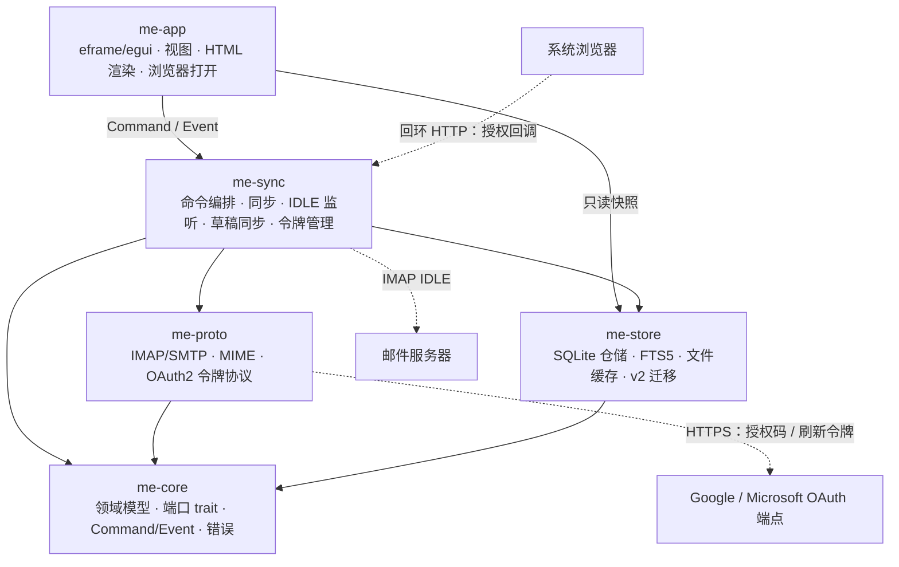
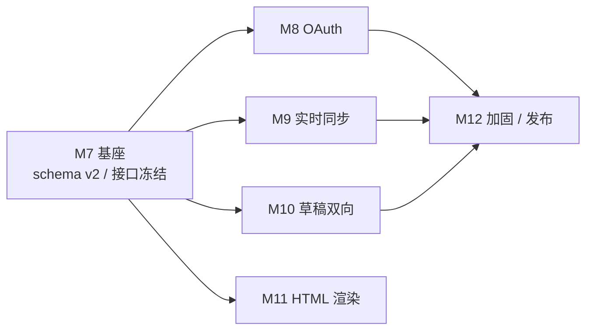

# MyEmail v0.2 架构设计

> 依据：[项目大纲.md](../项目大纲.md)（§2.3 Backlog、§9 决策）、[项目架构.md](../项目架构.md)、[数据结构.md](../数据结构.md)、[技术栈选用.md](../技术栈选用.md)、[可行性分析.md](../可行性分析.md)、[v01架构设计.md](v01架构设计.md)、[README.md](../../README.md)（2026-11-02）
> 版本：v0.2（第二个可用版本）　|　编写日期：2026-11-02
> 定位：把 v0.1 已确认的 v0.2 范围落成**可开工、可分工、可验收**的架构视图——范围、接口、数据结构、关键流程、测试、里程碑与风险。
> 修订：2026-11-02 评审后修订——补齐草稿拉取三分支与状态迁移、墓碑候选查询、迁移外键级联、轮询覆盖语义、设备码超时、旧草稿上传确认、HTML 清洗与 `@media` 口径，并统一 WBS/排期。
> 冲突处理：v0.1 的功能与既有决策以 [项目大纲.md](../项目大纲.md) 为准；本文新增的 v0.2 决策统一记录在 §9，评审通过后回写大纲与数据结构文档。
> 事实源：本文不替代 DDL 事实源。v0.2 的 DDL 变更在评审通过后回写 [数据结构.md](../数据结构.md)；迁移代码以回写后的 §4.2/§9 为准。
> 版本口径：本文中的 `v0.2` 指**产品版本**；引用文档（大纲 / 可行性分析）标题里的 `v0.3`、`v0.4` 等指该文档的**修订号**，不是产品版本。

---

## 目录

1. v0.2 目标与范围
2. 总体架构变更
3. 工程结构与文件职责
4. 数据结构与迁移
5. 关键流程
6. 并发、资源与安全
7. 测试与验收
8. 开发统筹
9. 未决事项与决策记录
10. 文档回写与维护约定

---

## 1. v0.2 目标与范围

### 1.1 版本定位

v0.1 已闭环「多账户 + 本地全量缓存 + 离线检索」的基础链路。v0.2 解决四类**上线阻塞**：

1. **Gmail / Outlook 无法接入**：两家已禁用基础认证，必须走 OAuth2（XOAUTH2）。
2. **只能手动刷新**：补上 IDLE 实时推送与轮询兜底，邮件到达延迟从「用户点刷新」降到秒级。
3. **草稿只能手动镜像**：补上服务器草稿双向同步，并修复 v0.1 不保存密送（Bcc）的已知缺口。
4. **HTML 邮件排版丢失**：把 v0.1 的 HTML 子集渲染升级为可用的邮件 HTML 渲染器（仍不引入 Web 引擎）。

四类能力共享一次 **schema v2 迁移** 与一套 **认证/连接治理**，因此 v0.2 作为一个版本统一交付，而不是四个独立补丁。发布版本号建议 `0.2.0`，数据库 `schema_version = 2`。

### 1.2 功能范围

| 能力 | v0.2 目标 | 关键边界 |
| --- | --- | --- |
| OAuth2 | Google / Microsoft 授权；PKCE 回环重定向为主、设备码为兜底；访问令牌自动刷新；失效后引导重新授权；IMAP / SMTP 统一 XOAUTH2 | 只支持 Gmail / Outlook 两家预置服务商；不支持任意 OAuth 服务商；不把令牌写入 SQLite 或日志 |
| 实时同步 | 每账户一个 IDLE 监听（默认只监听 INBOX）；29 分钟主动重连；不支持 IDLE、连接失败或超出预算时自动降级为轮询；设置页可开关与调轮询间隔 | 不做 QRESYNC / CONDSTORE；不做逐文件夹 IDLE；不做服务端推送代理 |
| 草稿双向同步 | 本地草稿变更推到服务器；服务器草稿变更导入本地；删除双向传播；冲突保留两份并提示；Bcc 随本地草稿恢复 | IMAP 没有原子替换，更新以「追加新版本 + 标记旧版本」实现；无 UIDPLUS 时明确降级提示；不承诺富文本撰写 |
| HTML 阅读 | 应用内 HTML 渲染器 v2：DOM 解析、CSS 子集、表格 `rowspan`/`colspan`、内联样式、背景色、图片、链接；无脚本、无 WebView | 不是浏览器：不执行 JS、不加载外部 CSS/字体、不做完整 CSS3、不保证浮动/绝对定位像素级还原 |
| 数据迁移 | v1 → v2 自动迁移，保留账户、邮件、标志、草稿、缓存路径 | 只升不降；v0.1 二进制遇到 v2 库会拒绝启动，降级需备份 |
| 工程质量 | schema/迁移测试、OAuth/IDLE/草稿 mock、HTML 语料回归、性能门禁、CI | Docker E2E 仍为手动/可选任务；真实 Gmail/Outlook 验收需人工账号 |

> **「完整 HTML」的口径**：本项目的 v0.2 目标是还原邮件常见结构的可用排版（表格、内联样式、背景色、图片、链接），不是浏览器级 CSS/JS 兼容。README 中「完整 HTML 渲染」按 §5.5.2 的子集口径回写，避免承诺无法兑现。

### 1.3 明确不做（v0.3+）

- 富文本 / HTML 撰写（`multipart/alternative`）
- 邮件会话（Thread）聚合、退信（DSN）解析
- 地址簿、快捷模板、全局搜索语法（`from:` / `after:` / `has:`）
- 导入 / 导出（`.eml`、mbox）、PGP / S-MIME
- 通用 OAuth 服务商自定义注册
- 逐文件夹 IDLE、QRESYNC / CONDSTORE、服务端规则同步
- 嵌入 WebView / Web 引擎
- SQLCipher 或本地缓存加密（v0.2 只做风险登记，不作为交付项）
- 多身份 / 签名、移动端、多设备自建同步

### 1.4 兼容承诺

| 项目 | 承诺 |
| --- | --- |
| v0.1 数据库 | 启动时自动迁移到 `schema_version = 2`；迁移前备份 `myemail.db.bak-v1`；失败不写版本号并中止启动 |
| v0.1 密码 / 授权码账户 | 行为不变；凭证仍在系统密钥库；无需重新添加 |
| v0.1 本地缓存 | 路径与文件命名不变；`bodies/`、`raw/`、`attach/`、`drafts/` 继续有效 |
| v0.1 草稿 | `drafts/` 原文保留；迁移后补充 `bcc_addrs` 与同步状态列；旧草稿按 `server_uid` 是否存在分别置为 `local_dirty` / `local_only`。已有服务器副本的草稿以本地内容为基线重推；从未上传过的草稿**不自动上传**，由首次启动的一次性确认决定（见 §5.4.5） |
| v0.1 搜索 | FTS 方案不变；HTML 渲染不改变索引文本（仍为 `text/plain` 或 html2text 结果） |
| 降级 | v0.2 写出的 v2 库不能被 v0.1 打开；发布说明必须写明「降级前先恢复备份」 |

### 1.5 范围门禁

| 门禁 | 时点 | 通过标准 | 未通过动作 |
| --- | --- | --- | --- |
| G0 OAuth 预检 | W2（WP-00，与 M7 并行） | 至少一家服务商的客户端注册、PKCE 授权码交换、XOAUTH2 IMAP 登录跑通（可用最小独立程序） | 先解决客户端注册/Scope 问题，不进入 M8 全量 UI |
| G1 OAuth | M8 结束 | 真实 Gmail / Outlook 完成授权、IMAP 登录、SMTP 投递；刷新令牌可复用 | 缩小到单一服务商先交付，另一家顺延；不得用密码回退冒充 |
| G2 实时 | M9 结束 | IDLE 新邮件 5 秒内可见；29 分钟重连；断线自动降级轮询；连接预算不超 | 关闭默认实时，保留轮询；在设置页说明 |
| G3 草稿 | M10 结束 | 本地改 / 服务器改 / 双方改 / 双方删 四类矩阵无数据丢失；冲突保留两份 | 暂缓自动推送，只保留手动「保存到服务器」；双向拉取仍交付 |
| G4 HTML | M11 结束 | 语料集（表格、内联样式、图片、恶意样本）通过；无 JS 执行；大正文不卡 UI | **允许整体后置到 v0.2.1**；OAuth / 实时 / 草稿三项不得后置 |
| G5 发布 | M12 结束 | 迁移、回归、性能、手工验收全过 | 不发版；只发 RC 或缩小范围 |

> G4 是唯一允许切分的门禁。原因：HTML 渲染的工作量弹性最大，且不阻塞前三项的上线价值；切分决策必须在 G4 当天记录，不得拖到发布前。

---

## 2. 总体架构变更

### 2.1 分层与依赖方向



- 依赖方向不变，仍以 `me-core` 为唯一汇点。
- **新增的外部交互**只有两类：`me-proto` 直连 OAuth 令牌端点；`me-sync` 在 `127.0.0.1` 上监听一次授权回调。二者都不绕过 `me-proto` 的协议隔离。
- `me-app` 仍不接触 `async-imap` / `lettre` / `rusqlite`；HTML 解析与绘制只在 `me-app`。

### 2.2 crate 职责变更

| crate | v0.2 新增职责 | 明确禁止 |
| --- | --- | --- |
| `me-core` | OAuth 凭证类型、`AuthCredential`、实时/草稿同步的 `Command` / `Event`、`DraftSyncState`、`ImapCapabilities.idle` | tokio / rusqlite / reqwest / 协议库 |
| `me-proto` | `oauth.rs`：服务商注册表、PKCE、授权码/设备码/刷新令牌、XOAUTH2 字符串；IMAP `AUTHENTICATE XOAUTH2` 与 `IDLE`；SMTP `XOAUTH2` | 直接触库、直接发事件、持久化令牌 |
| `me-store` | schema v2 迁移；账户 OAuth 元数据；草稿 `bcc` 与同步状态；草稿同步查询 | 网络访问、OAuth 令牌存储、业务冲突决策 |
| `me-sync` | `auth.rs` 令牌管理与单飞刷新；`watcher.rs` IDLE/轮询；`drafts.rs` 草稿双向同步与冲突；连接预算扩展 | 直接操作 egui 类型、解析/绘制 HTML |
| `me-app` | OAuth 登录/设备码/重新授权界面；HTML 渲染器 v2；草稿同步状态与冲突提示；浏览器打开 | 协议库、写连接、令牌持久化 |

### 2.3 依赖硬规则（新增）

1. **令牌只存在于两处**：系统密钥库的刷新令牌（或会话内存）与进程内的短期访问令牌。禁止写入 SQLite、日志、事件载荷、错误消息。
2. **OAuth HTTP 只在 `me-proto`**：`reqwest` 不得出现在 `me-sync` / `me-app` 的 OAuth 路径；`me-app` 现有的远程图片 HTTP 不受此条影响。
3. **授权回调监听只在 `me-sync`**：只绑定 `127.0.0.1:0`，不监听 `0.0.0.0`；浏览器打开经 `BrowserOpener` 端口注入，`me-sync` 不直接调用平台 API。
4. **HTML 解析/绘制只在 `me-app`**：`me-proto` 的 html2text 继续只服务索引与纯文本视图；不得把 HTML 塞进 `me-core` 事件。
5. **草稿冲突决策在 `me-sync`**：`me-store` 只落库，不判断「谁覆盖谁」；`me-app` 只展示与提交用户选择。
6. **IDLE 连接单独计费**：不得占用 v0.1 的「全局 2、单账户 1」操作连接预算；具体见 §6.1。

### 2.4 运行时与线程模型

| 执行体 | v0.2 职责 | 禁止 |
| --- | --- | --- |
| UI 线程（eframe） | 事件循环、布局绘制、HTML 结果的排版与绘制、只读短查询 | 网络、DB 写、OAuth 令牌交换、HTML DOM 解析 |
| tokio 运行时（独立线程，multi-thread） | 同步、SMTP、正文补全、IDLE 监听、OAuth 令牌交换、草稿同步、回环回调 | 持有或修改 `me-app` 视图状态 |
| DB 工作线程 | 单写连接；异步侧经 `spawn_blocking` 访问 | 跨线程持有事务；事务内做网络 IO |
| HTML 解析工作线程 | `spawn_blocking` 中完成 HTML 解析、CSS 计算、清洗，返回可 Send 的扁平块模型 | 不访问 DB、不发起网络请求、不持有 egui 类型 |

**HTML 渲染的线程约束（新增）**

- `MessageBodyLoaded` 只携带原始 `html` 字符串。UI 收到后把 `(message_id, html, generation)` 投递给后台解析任务，立即返回渲染循环。
- 解析任务在 `tokio::task::spawn_blocking` 中创建 DOM（可以是 `Rc` 系非 Send 结构），完成后只返回 `Send` 的 `RenderedHtml`（块、内联片段、表格网格、图片引用）。
- UI 只接收最新 `generation` 的结果；旧结果丢弃，避免用户快速切换邮件时串页。
- 超过节点/字节/时间预算时返回 `HtmlRenderError::TooLarge`，UI 自动回退到纯文本或 v0.1 子集渲染。

**每帧主循环**与 v0.1 一致：抽取事件（≤256）→ 脏标记懒加载 → 渲染 → 分发 Command；新增的实时/草稿/OAuth 事件同样进入该队列。

### 2.5 通信契约变更

| 方向 | 类型 | 变更 |
| --- | --- | --- |
| UI → 后端 | `Command` | 新增 OAuth、实时开关、草稿同步/冲突处理命令 |
| 后端 → UI | `Event` | 新增 OAuth 流程、实时状态、草稿同步状态/冲突事件 |
| 后端 → UI | 进度事件 | `IndexProgress` / `SyncProgress` 规则不变；草稿同步不产生高频进度事件 |
| UI 内部 | `HtmlRenderJob` / `HtmlRenderResult` | `me-app` 内部通道，不进入 `me-core` 契约 |

### 2.6 依赖新增

| 依赖 | 使用方 | 用途 | 备注 |
| --- | --- | --- | --- |
| `reqwest`（rustls） | `me-proto` | OAuth 令牌端点 | workspace 已有；禁用默认 TLS，沿用 rustls |
| `rand` | `me-sync` / `me-proto` | PKCE verifier、state | 只用于密码学随机数 |
| `sha2` | `me-proto` / `me-sync` | PKCE S256、草稿规范化哈希 | RustCrypto，MIT/Apache |
| `base64` | `me-proto` / `me-sync` | PKCE、XOAUTH2、哈希编码 | workspace 已有 |
| `scraper` / `html5ever` | `me-app` | HTML5 DOM 解析与选择器 | MIT/Apache；不引入 JS 引擎 |
| `cssparser` | `me-app` | `<style>` 与内联样式声明解析 | MPL-2.0，`deny.toml` 已允许 |
| `url` | `me-app` | 链接/图片 URL 策略校验 | 与 `reqwest` 共用版本 |

> `deny.toml` 的许可证白名单已含 MIT / Apache-2.0 / MPL-2.0；新增依赖不得引入 OpenSSL / native-tls。引入前跑 `cargo deny check`。
>
> `reqwest` 沿用 workspace 的 `default-features = false`（不自动使用系统代理）。若 OAuth 在代理环境不可用，再单独评估 `system-proxy` feature；不得因此把远程图片路径改成默认跟随代理而不做说明。

---

## 3. 工程结构与文件职责

### 3.1 目录树增量

```text
MyEmail/
├─ doc/
│  ├─ v01架构设计.md
│  └─ v02架构设计.md                 # 本文
├─ crates/
│  ├─ me-core/src/
│  │  ├─ model.rs                    # + OAuthProvider / AuthCredential / DraftSyncState / Bcc
│  │  ├─ command.rs                  # + OAuth/实时/草稿同步 Command/Event
│  │  ├─ port.rs                     # + AuthCredential / IDLE / DraftRepo 扩展
│  │  └─ error.rs                    # + OAuth 错误、reauth 标记
│  ├─ me-proto/src/
│  │  ├─ oauth.rs                    # 新增：服务商、PKCE、令牌、设备码
│  │  ├─ imap.rs                     # + XOAUTH2 / IDLE / capabilities.idle
│  │  ├─ smtp.rs                     # + XOAUTH2
│  │  ├─ mime.rs                     # + 草稿导入解析辅助
│  │  └─ lib.rs
│  ├─ me-store/src/
│  │  ├─ migrations.rs               # + migrate_v1_to_v2
│  │  ├─ accounts.rs                 # + oauth_provider / needs_reauth 等
│  │  ├─ drafts.rs                   # + bcc / sync_state / 冲突查询
│  │  └─ ...
│  ├─ me-sync/src/
│  │  ├─ auth.rs                     # 新增：令牌管理与单飞刷新
│  │  ├─ watcher.rs                  # 新增：IDLE + 轮询
│  │  ├─ drafts.rs                   # 新增：草稿双向同步
│  │  ├─ engine.rs                   # 修改：跳过 Drafts 邮件同步，接入草稿同步
│  │  ├─ lib.rs                      # 修改：新命令分发、凭证类型
│  │  └─ tasks.rs                    # 修改：监听连接预算
│  └─ me-app/src/
│     ├─ browser.rs                  # 新增：BrowserOpener 实现
│     ├─ views/html/
│     │  ├─ mod.rs                   # 渲染器入口
│     │  ├─ dom.rs                   # HTML5 DOM 与清洗
│     │  ├─ css.rs                   # CSS 选择器与计算样式
│     │  ├─ layout.rs                # 块/行内/表格布局
│     │  └─ tests.rs                 # 语料回归
│     ├─ views/accounts.rs           # + OAuth 登录/设备码/重新授权
│     ├─ views/reader.rs             # + 新渲染器 / 浏览器打开
│     ├─ views/compose.rs            # + Bcc 恢复 / 草稿同步状态
│     ├─ views/settings.rs           # + 实时同步 / 轮询 / 草稿同步开关
│     ├─ state.rs                    # + OAuth/实时/冲突 UI 状态
│     └─ app.rs                      # + 新事件处理
├─ tests/                            # 跨 crate 规划位置；实际仍落在 crates/*/tests
├─ .github/workflows/ci.yml          # 可选：Windows runner（或等价的 CI 脚本）
└─ scripts/
   ├─ e2e.sh                         # 扩展：Dovecot IDLE / 草稿场景
   └─ oauth-mock.py                  # 可选：手工联调；自动化测试用 §7.2 的 Rust mock
```

> 与 v0.1 一致：Cargo 集成测试必须位于各 crate 下；`tests/` 只放跨 crate 的 docker-compose 与共享夹具。

### 3.2 me-core

| 文件 | v0.2 变更 | 约束 |
| --- | --- | --- |
| `model.rs` | `AuthMethod` 增加 `OAuth2`；`OAuthProvider`；`AuthCredential`（Debug 脱敏）；`DraftSyncState`；`Draft.bcc` / `DraftContent.bcc`；`Account.oauth_provider` / `oauth_subject` / `token_expires_at` / `needs_reauth` / `idle_enabled` / `poll_interval_secs: Option<u32>`；`ImapCapabilities.idle` / `xoauth2` | 纯数据与纯规则；不引入 `reqwest` / `tokio` |
| `command.rs` | 新增 `StartOAuth`、`CancelOAuth`、`SetRealtimeSync`、`SetAccountRealtime`、`SetPollInterval`、`SetDraftServerSync`、`SetHtmlRenderer`、`DeleteDraft`、`RetryDraftSync`、`ResolveDraftConflict`、`ResolveDraftDeletion`、`ConfirmDraftBulkUpload`；新增对应 Event | 事件载荷是快照；不得携带令牌原文 |
| `port.rs` | `ImapSessionFactory::connect(account, &AuthCredential)`；`SmtpSender::send(account, &AuthCredential, ...)`；`ImapSession::wait_for_changes` / `search_all_uids`；`BrowserOpener`；`DraftRepo` 草稿同步方法 | 不出现上游库类型 |
| `error.rs` | 新增 `CoreError::OAuth { error_code, detail, reauth_required }`；`is_retryable` 区分瞬时令牌端点错误与 `invalid_grant`；`user_message` 在 `reauth_required` 时提示重新登录，否则提示授权失败 | 错误消息不得含 token / authorization code；`error_code` 只允许 OAuth 错误码（如 `invalid_grant`） |

**新增领域类型（建议签名）**

```rust
pub enum AuthMethod { Password, AppPassword, OAuth2 }

pub enum OAuthProvider { Google, Microsoft }

impl OAuthProvider {
    pub fn as_str(self) -> &'static str;
    pub fn parse(value: &str) -> Option<Self>;
    pub fn label(self) -> &'static str;
    pub fn default_imap(self) -> Endpoint;
    pub fn default_smtp(self) -> Endpoint;
    pub fn userinfo_url(self) -> &'static str;
    /// 没有标准撤销端点时返回 `None`，删除账户只删本地令牌。
    pub fn revoke_url(self) -> Option<&'static str>;
    /// 是否提供设备码授权；Gmail 视客户端类型，默认 `false`。
    pub fn supports_device_code(self) -> bool;
}

/// 进程内凭证。`Debug` 必须输出 `<redacted>`，不得派生默认 Debug。
pub enum AuthCredential {
    Password { secret: String },
    OAuth2 {
        email: String,
        access_token: String,
        expires_at: i64,
    },
}

pub enum DraftSyncState {
    LocalOnly,
    Synced,
    LocalDirty,
    Conflict,
    DeletedLocal,
    DeletedServer,
}
```

**端口扩展（建议签名）**

```rust
pub trait BrowserOpener: Send + Sync {
    /// 只接受 http/https；由 me-app 注入系统浏览器实现。
    fn open(&self, url: &str) -> Result<(), CoreError>;
}

pub trait ImapSession: Send {
    // ... v0.1 方法不变 ...
    fn search_all_uids(&mut self) -> impl Future<Output = Result<Vec<u32>, CoreError>> + Send;
    fn wait_for_changes(
        &mut self,
        timeout: std::time::Duration,
    ) -> impl Future<Output = Result<IdleOutcome, CoreError>> + Send;
}

pub enum IdleOutcome {
    Changed { exists: Option<u32>, recent: Option<u32> },
    Timeout,
    ManualInterrupt,
}

pub struct DraftSyncItem {
    pub id: DraftId,
    pub message_id: String,
    pub server_uid: Option<u32>,
    pub server_uid_validity: Option<u32>,
    pub local_hash: Option<String>,
    pub server_hash: Option<String>,
    pub state: DraftSyncState,
    /// `deleted_at IS NOT NULL`：墓碑行，只参与服务器删除确认。
    pub deleted: bool,
    pub sync_attempts: u32,
}

pub trait DraftRepo {
    // ... v0.1 方法不变 ...
    /// 返回活动候选与删除墓碑；用 `DraftSyncItem.deleted` 区分两类（查询见 §4.6）。
    fn list_draft_sync_candidates(&self, account: AccountId) -> Result<Vec<DraftSyncItem>, CoreError>;
    fn find_draft_by_server_uid(&self, account: AccountId, uid_validity: u32, uid: u32)
        -> Result<Option<Draft>, CoreError>;
    fn find_drafts_by_message_id(&self, account: AccountId, message_id: &str)
        -> Result<Vec<Draft>, CoreError>;
    fn mark_draft_synced(
        &self,
        id: DraftId,
        server_uid: Option<u32>,
        uid_validity: Option<u32>,
        local_hash: &str,
        server_hash: &str,
    ) -> Result<(), CoreError>;
    fn set_draft_sync_state(
        &self,
        id: DraftId,
        state: DraftSyncState,
        error: Option<&str>,
    ) -> Result<(), CoreError>;
    /// 失败计数 +1，返回新的计数；达到 3 后 `me-sync` 停止自动重试。
    fn bump_draft_sync_attempt(&self, id: DraftId, error: &str) -> Result<u32, CoreError>;
    /// 推送成功或用户手动重试时清零。
    fn clear_draft_sync_attempts(&self, id: DraftId) -> Result<(), CoreError>;
    fn create_conflict_copy(&self, source: DraftId, content: &DraftContent)
        -> Result<DraftId, CoreError>;
    fn tombstone_draft(&self, id: DraftId) -> Result<(), CoreError>;
    fn finalize_deleted_draft(&self, id: DraftId) -> Result<(), CoreError>;
}
```

> `DraftSyncItem` 是 `me-core` 内的纯数据结构（草稿 id、服务器身份、两个基线与状态），不暴露 SQL 行。`search_all_uids` 用于 Drafts 全量扫描；邮件同步仍用 v0.1 的 `UIDNEXT` 增量路径。
>
> `DraftRepo::delete_draft` 只做物理删除：用于墓碑确认完成后，或从未上过服务器的 `LocalOnly` 草稿；有服务器身份的删除必须先走 `tombstone_draft`，不得直接调用。
>
> `NewDraft` 与 `DraftRepo::update_draft` 增加 `bcc: &[Address]` 参数；`cc` 仍从草稿原文解析，`bcc` 只存 `bcc_addrs` 列。

**`AccountDraft` 变更**

```rust
pub struct AccountDraft {
    // ... v0.1 字段不变 ...
    pub oauth_provider: Option<OAuthProvider>, // Add 时 OAuth2 必须 Some
    pub oauth_subject: Option<String>,         // 由授权结果填充；仅 OAuth2 使用
}
```

- OAuth 账户的 `auth_secret` 为 `None`；令牌由 OAuth 流程写入 keyring，不经过 `AccountDraft`。
- OAuth 新增账户时，IMAP/SMTP 端点由服务商默认值填充；用户可在高级选项覆盖主机/端口，但不能把 TLS 改为明文。
- 密码/授权码账户的 `oauth_provider` 为 `None`。

### 3.3 me-proto

| 文件 | v0.2 变更 | 关键点 |
| --- | --- | --- |
| `oauth.rs`（新增） | 服务商注册表；PKCE S256；授权码交换；刷新令牌；设备码；XOAUTH2 字符串 | 令牌端点响应按 `expires_in` 计算绝对时间；`invalid_grant` 映射为 `reauth_required`；响应体截断并脱敏；client secret / token 不参与 Debug 与日志 |
| `imap.rs` | `connect_imap` 按 `AuthCredential` 选择 `LOGIN` 或 `AUTHENTICATE XOAUTH2`；能力探测增加 `AUTH=XOAUTH2`、`IDLE`；实现 `wait_for_changes` | `IDLE` 走 `Session::idle()`；`ImapConnection.session` 改为 `Option<Session>`，`wait_for_changes` 取走 → `init` → `wait` → `done` → 放回；超时/取消后必须 `DONE` 或丢弃连接；XOAUTH2 首次挑战返回 `user=...`，错误挑战返回空串并映射 `Auth`；`BODY.PEEK[]` 规则不变 |
| `smtp.rs` | `build_transport` 按凭证选择 `Mechanism::Plain` / `Mechanism::Xoauth2` | SMTP 认证失败不自动重试，避免重复投递 |
| `mime.rs` | 增加草稿导入辅助：解析服务器草稿为 `DraftContent` 可用的字段，并提供**已解码附件字节**（v0.1 的 `ParsedBody.attachments` 只有元数据） | 不改变 `build_rfc822` 不输出 `Bcc` 的规则；附件仍受 25 MB 上限约束 |
| `lib.rs` | re-export `oauth` 公共函数 | 不暴露 `reqwest` 类型 |

**OAuth 服务商注册表（默认值）**

| 字段 | Google | Microsoft |
| --- | --- | --- |
| 授权端点 | `https://accounts.google.com/o/oauth2/v2/auth` | `https://login.microsoftonline.com/common/oauth2/v2.0/authorize` |
| 令牌端点 | `https://oauth2.googleapis.com/token` | `https://login.microsoftonline.com/common/oauth2/v2.0/token` |
| 设备码端点 | `https://oauth2.googleapis.com/device/code` | `https://login.microsoftonline.com/common/oauth2/v2.0/devicecode` |
| Scope | `openid email https://mail.google.com/` | `openid profile email offline_access https://outlook.office.com/IMAP.AccessAsUser.All https://outlook.office.com/SMTP.Send` |
| IMAP | `imap.gmail.com:993` 隐式 TLS | `outlook.office365.com:993` 隐式 TLS |
| SMTP | `smtp.gmail.com:465` 隐式 TLS | `smtp.office365.com:587` STARTTLS |
| 用户信息端点 | `https://openidconnect.googleapis.com/v1/userinfo` | `https://graph.microsoft.com/oidc/userinfo` |
| 撤销端点 | `https://oauth2.googleapis.com/revoke` | 无标准撤销端点，只删本地令牌（可选 `.../oauth2/v2.0/logout`） |
| 设备码 | 视客户端类型，默认不提供 | 支持 |
| 额外参数 | `access_type=offline`、`prompt=consent` | `response_mode=query` |

> 服务商端点可能调整；注册表集中在一处，升级时不改业务代码。客户端 ID/密钥来源见 §9 O1。上表的差异（设备码、用户信息、撤销）由 `OAuthProvider::supports_device_code()` / `userinfo_url()` / `revoke_url()` 暴露，UI 不显示不可用入口。
>
> `ProviderConfig` 的端点字段可由测试注入本地 mock URL；生产路径使用上表默认值。授权 URL 组装、令牌交换与刷新函数都接受配置参数，不在函数内硬编码域名。
>
> 令牌 HTTP 客户端固定：TLS 走 rustls、**禁止重定向**、连接/总超时 20s、固定 User-Agent；响应体上限 64 KB，避免恶意/错误响应拖垮进程。

### 3.4 me-store

| 文件 | v0.2 变更 | 约束 |
| --- | --- | --- |
| `migrations.rs` | 新增 `migrate_v1_to_v2`；新库直接建 v2；迁移前备份（版本常量 `me-core::SCHEMA_VERSION` 改为 2） | 每步独立事务；失败不写版本号；迁移后 `foreign_key_check` |
| `accounts.rs` | 读写 `oauth_provider`、`oauth_subject`、`token_expires_at`、`needs_reauth`、`idle_enabled`、`poll_interval_secs` | 不存 access/refresh token |
| `drafts.rs` | 读写 `bcc_addrs`、`server_uid_validity`、`server_hash`、`local_hash`、`sync_state`、`sync_attempts`、`conflict_of`、`last_synced_at`、`deleted_at`；按服务器身份/Message-ID 查找；冲突副本创建；普通列表过滤墓碑 | 冲突决策不在本层；只做存取与约束 |
| `messages.rs` | 迁移一次性清理 Drafts 文件夹下的历史 `messages` 行（见 §4.4） | 保留本地草稿与服务器草稿的重新导入能力 |
| `search.rs` | 不变 | HTML 渲染不改变索引文本 |
| `cache.rs` | 草稿附件导入/导出的写入辅助；冲突副本沿用 `drafts/<id>/` | 文件命名仍用本地 id |

### 3.5 me-sync

| 文件 | v0.2 变更 | 关键点 |
| --- | --- | --- |
| `auth.rs`（新增） | `TokenManager`：keyring 读取刷新令牌、内存访问令牌、到期前 60s 刷新、单飞锁、失效标记、重新授权事件；`OAuthFlowRegistry`：flow_id、取消令牌、按模式计算的截止时间（回环 5 分钟；设备码取服务商 `expires_in` + 30s 余量） | 同一账户并发请求只刷新一次；刷新失败不得循环重试；流程结束必须清理 registry |
| `watcher.rs`（新增） | `WatchRegistry`：每账户监听任务、IDLE 循环、29 分钟重连、事件去抖、轮询兜底、状态事件 | 只监听 INBOX；连接预算独立；取消即退出并 logout |
| `drafts.rs`（新增） | 草稿双向同步：拉取、导入、推送、删除、冲突、UIDVALIDITY 重置、无 UIDPLUS 降级 | 不静默覆盖；冲突保留两份；每次同步全量扫描 Drafts（数量小） |
| `engine.rs` | 邮件同步跳过 `FolderRole::Drafts`（头部与标志回拉都跳过）；同步尾部调用 `sync_drafts`；同步完成后启动/刷新 watcher | Drafts 不再作为 `messages` 同步；正文补全跳过 Drafts |
| `lib.rs` | 凭证类型改为 `AuthCredential`；新命令分发；OAuth 流程编排；实时/草稿开关；注入 `BrowserOpener` | 所有网络操作经令牌管理器取凭证；`SyncService::new` 增加浏览器端口参数 |
| `tasks.rs` | 新增 `WatchGovernor`：全局监听许可、每账户监听锁；操作 `Governor` 保持全局 2 / 单账户 1 | 监听与操作连接分开计费；获取顺序固定，避免死锁 |
| `indexer.rs` | 不改主流程；跳过 Drafts 文件夹 | 正文补全不处理草稿 |

**装配变化**：`me_sync::start_native(store, paths, events, browser)` 增加 `Arc<dyn BrowserOpener>`；`me-app/main.rs` 注入 `SystemBrowser`。测试注入 mock，不启动真实浏览器。

### 3.6 me-app

| 文件 | v0.2 变更 | 关键点 |
| --- | --- | --- |
| `browser.rs`（新增） | `SystemBrowser` 实现 `BrowserOpener`；按平台调用默认浏览器 | 只接受 `http/https`；打开前校验 URL |
| `views/html/*`（新增） | HTML DOM/CSS/布局/清洗；块模型与 v0.1 `richtext` 解耦 | 无脚本、无外部 CSS/字体；解析在后台线程 |
| `views/accounts.rs` | 服务商登录按钮；设备码对话框；重新授权入口；密码/授权码入口保留 | OAuth 账户隐藏密码字段；端点默认值自动填充 |
| `views/reader.rs` | Rich 模式使用新渲染器；保留 Plain / Markdown；新增「在浏览器中打开」 | 新渲染器失败自动回退；远程图片策略不变 |
| `views/compose.rs` | 重新打开草稿恢复 Bcc；显示服务器同步状态与冲突；手动「保存到服务器」保留；移除 v0.1「密送无法恢复」提示 | Bcc 不写入 RFC822；冲突未解决时提示 |
| `views/settings.rs` | 实时同步开关、轮询间隔、草稿自动同步开关、旧草稿批量上传确认、HTML 渲染模式 | 写入走 Command，UI 不直接写库 |
| `state.rs` | OAuth 流状态、实时状态、草稿冲突状态、HTML 渲染缓存 | 令牌不进入 UI 状态；只保存流程 id 与展示信息 |
| `app.rs` | 处理新增事件；HTML 后台解析任务的结果回收 | 每帧事件上限不变 |

---

## 4. 数据结构与迁移

### 4.1 领域模型增量

```rust
// me-core/src/model.rs（节选）
pub enum AuthMethod { Password, AppPassword, OAuth2 }

pub enum OAuthProvider { Google, Microsoft }

pub struct Account {
    pub id: AccountId,
    pub email: String,
    pub display_name: Option<String>,
    pub imap: Endpoint,
    pub smtp: Endpoint,
    pub auth_user: String,
    pub auth_method: AuthMethod,
    pub oauth_provider: Option<OAuthProvider>,
    /// 服务商稳定用户标识；OAuth2 账户可选。
    pub oauth_subject: Option<String>,
    pub needs_reauth: bool,
    pub idle_enabled: bool,
    /// `None` = 跟随全局 `meta.poll_interval_secs`。
    pub poll_interval_secs: Option<u32>,
    /// 仅用于展示/诊断，不参与令牌有效性判断。
    pub token_expires_at: Option<i64>,
}

pub struct Draft {
    pub id: DraftId,
    pub account: AccountId,
    pub message_id: String,
    pub subject: Option<String>,
    pub to: Vec<Address>,
    pub bcc: Vec<Address>,                 // 新增：仅本地保存，不写入 RFC822
    pub status: DraftStatus,
    pub server_uid: Option<u32>,
    pub server_uid_validity: Option<u32>,  // 新增
    pub sync_state: DraftSyncState,        // 新增
    pub conflict_of: Option<DraftId>,      // 新增：冲突副本指向原草稿
    pub last_synced_at: Option<i64>,       // 新增
    pub last_error: Option<String>,
    pub updated_at: i64,
}

pub struct DraftContent {
    pub account: AccountId,
    pub draft_id: DraftId,
    pub message_id: String,
    pub subject: String,
    pub to: Vec<Address>,
    pub cc: Vec<Address>,
    pub bcc: Vec<Address>,                 // 新增：从本地草稿列恢复
    pub body_text: String,
    pub attachments: Vec<PathBuf>,
}

pub enum DraftSyncState {
    LocalOnly,     // 从未上服务器
    Synced,        // 本地与服务器基线一致
    LocalDirty,    // 本地有未推送修改
    Conflict,      // 双方都改过，保留两份
    DeletedLocal,  // 本地已删，待服务器删除确认
    DeletedServer, // 服务器已删，本地保留副本待用户决定
}
```

> `DraftStatus` 仍只有 `Draft` / `Sent`；同步状态是独立维度，避免把「发送状态」和「同步状态」混在一个枚举里。

### 4.2 Command / Event 增量

```rust
pub enum Command {
    // ... v0.1 命令保持不变 ...

    /// 开始 OAuth 授权。`account = Some(id)` 表示重新授权。
    StartOAuth {
        provider: OAuthProvider,
        mode: OAuthFlowMode,
        account: Option<AccountId>,
        email_hint: Option<String>,
    },
    CancelOAuth { flow_id: u64 },

    /// 全局实时同步开关与默认轮询间隔。
    SetRealtimeSync { enabled: bool },
    SetPollInterval { secs: u32 },
    /// 单账户覆盖：是否启用 IDLE / 该账户的轮询间隔。
    /// `poll_interval_secs = None` 表示清除账户覆盖、跟随全局默认。
    SetAccountRealtime {
        account: AccountId,
        enabled: bool,
        poll_interval_secs: Option<u32>,
    },
    SetDraftServerSync { enabled: bool },
    SetHtmlRenderer { mode: HtmlRendererMode },

    /// 删除本地草稿（同时按同步状态传播到服务器）。
    DeleteDraft { id: DraftId },
    /// 手动重试某条草稿的服务器同步。
    RetryDraftSync { draft: DraftId },
    /// 冲突处理；v0.2 默认「保留两份」，该命令用于用户显式选择。
    ResolveDraftConflict {
        draft: DraftId,
        resolution: DraftConflictResolution,
    },
    /// 处置「服务器已删除、本地保留」的草稿。
    ResolveDraftDeletion {
        draft: DraftId,
        resolution: DraftDeletionResolution,
    },
    /// 迁移后一次性确认是否上传从未上传过的旧草稿（作用于所有账户）。
    ConfirmDraftBulkUpload { accept: bool },
}

pub enum OAuthFlowMode { Loopback, DeviceCode }

pub enum DraftConflictResolution { KeepLocal, UseServer, KeepBoth }

pub enum DraftDeletionResolution { KeepLocal, DeleteLocal }

pub enum Event {
    // ... v0.1 事件保持不变 ...

    OAuthFlowStarted {
        flow_id: u64,
        provider: OAuthProvider,
        verification_uri: String,
        user_code: Option<String>,
        expires_at: i64,
    },
    OAuthCompleted {
        flow_id: u64,
        account: Account,
        created: bool,
    },
    OAuthFailed {
        flow_id: u64,
        message: String,
        reauth_required: bool,
    },
    OAuthReauthRequired { account: AccountId },
    /// 刷新令牌无法写入 keyring；UI 让用户选择「仅本次会话」或取消添加。
    CredentialNotPersisted {
        flow_id: u64,
        account: Account,
        created: bool,
    },

    RealtimeStatus {
        account: AccountId,
        mode: RealtimeMode,   // Idle | Polling | Off
        connected: bool,
        last_event_at: Option<i64>,
    },

    DraftSyncStateChanged {
        draft: DraftId,
        state: DraftSyncState,
        error: Option<String>,
    },
    DraftConflictDetected {
        draft: DraftId,
        conflict_copy: DraftId,
    },
}

pub enum RealtimeMode { Idle, Polling, Off }

pub enum HtmlRendererMode { Enhanced, Legacy }
```

> 事件载荷**不得包含** access token、refresh token、authorization code、device code 等敏感值；`verification_uri` 可以包含授权 URL（含 `state` / PKCE challenge，不含 verifier），`user_code` 是给用户看的短期码，可以出现在事件与 UI 中，但两者都不得写日志。
>
> v0.1 的 `SettingsLoaded` 扩展为 `{ theme, body_backfill, remote_images, realtime_sync, poll_interval_secs, draft_server_sync, draft_bulk_upload_pending, html_renderer }`；UI 启动时一次性拿到全部设置，`draft_bulk_upload_pending` 用于触发旧草稿上传的一次性确认。

### 4.3 SQLite DDL 增量（v2）

> 以下为 v1 → v2 的**纯加列 + 新索引**。新库不走迁移：`SCHEMA_DDL` 直接包含 v1 全部列与本节新增列，创建后写 `schema_version = 2`。不在 v0.2 改列类型、改 `CHECK`、改 `NOT NULL`；`sync_state` 的取值由 `me-store` 写入前校验。

```sql
-- accounts：OAuth 元数据与非敏感设置
ALTER TABLE accounts ADD COLUMN oauth_provider TEXT;          -- google | microsoft
ALTER TABLE accounts ADD COLUMN oauth_subject TEXT;           -- 服务商稳定用户标识（可选）
ALTER TABLE accounts ADD COLUMN token_expires_at INTEGER;     -- unix 秒，仅展示/诊断
ALTER TABLE accounts ADD COLUMN needs_reauth INTEGER NOT NULL DEFAULT 0;
ALTER TABLE accounts ADD COLUMN idle_enabled INTEGER NOT NULL DEFAULT 1;
ALTER TABLE accounts ADD COLUMN poll_interval_secs INTEGER;            -- NULL = 跟随全局默认；非 NULL 时必须 60～3600

-- drafts：Bcc 与服务器同步状态
ALTER TABLE drafts ADD COLUMN bcc_addrs TEXT;                 -- JSON 数组；不写入 RFC822
ALTER TABLE drafts ADD COLUMN server_uid_validity INTEGER;
ALTER TABLE drafts ADD COLUMN server_hash TEXT;               -- 上次同步的服务器规范化哈希
ALTER TABLE drafts ADD COLUMN local_hash TEXT;                -- 上次同步的本地规范化哈希
ALTER TABLE drafts ADD COLUMN sync_state TEXT NOT NULL DEFAULT 'local_only';
ALTER TABLE drafts ADD COLUMN conflict_of INTEGER;            -- 冲突副本指向原草稿（逻辑外键）
ALTER TABLE drafts ADD COLUMN last_synced_at INTEGER;
ALTER TABLE drafts ADD COLUMN sync_attempts INTEGER NOT NULL DEFAULT 0;  -- 连续失败次数；成功后清零
ALTER TABLE drafts ADD COLUMN deleted_at INTEGER;             -- 本地删除墓碑

CREATE INDEX idx_drafts_account_state ON drafts(account_id, sync_state);
CREATE UNIQUE INDEX idx_drafts_server_identity
    ON drafts(account_id, COALESCE(server_uid_validity, 0), server_uid)
    WHERE server_uid IS NOT NULL AND deleted_at IS NULL;
CREATE INDEX idx_drafts_message_id ON drafts(account_id, message_id);
```

**为什么不用 `CHECK` / 外键**

- SQLite 的 `ALTER TABLE ADD COLUMN` 对 `CHECK`、`REFERENCES` 的支持存在版本与约束差异；v0.2 要保证「纯加列」迁移的确定性。
- `sync_state` 的合法值在 `me-store` 写入前校验，并配单元测试；`conflict_of` 作为逻辑外键，删除原草稿时由 `me-sync` 清理或置空。
- 后续若需要数据库级约束，走 v3 的「建新表 → 拷数据 → 改名」破坏性迁移，不在 v0.2 冒险。

**meta 新增键**

| key | 值 | 说明 |
| --- | --- | --- |
| `schema_version` | `2` | 迁移后写入 |
| `realtime_sync` | `true` / `false` | 全局实时开关 |
| `poll_interval_secs` | 整数 | 默认 300，范围 60～3600 |
| `draft_server_sync` | `true` / `false` | 草稿自动镜像开关 |
| `draft_bulk_upload_pending` | `true` / `false` | 迁移产生：存在从未上传过的 v1 草稿时置 `true`，用户一次性确认后清除 |
| `html_renderer` | `enhanced` / `legacy` | 新渲染器开关；默认 `enhanced` |
| `oauth_client_google` | JSON（client_id，可选 tenant） | 非敏感客户端配置；无则用构建期默认。`client_secret` 不写库，见 §6.3 |
| `oauth_client_microsoft` | JSON（client_id，可选 tenant） | 同上 |

### 4.4 迁移 v1 → v2

**版本与入口**

```rust
// me-core/src/lib.rs
pub const SCHEMA_VERSION: u32 = 2;

// me-store/src/migrations.rs
fn migrate_v1_to_v2(conn: &mut Connection) -> Result<(), CoreError> {
    // 1. 纯加列：accounts / drafts（poll_interval_secs 保持 NULL，表示跟随全局）
    // 2. 建索引（含 COALESCE 的服务器身份唯一索引）
    // 3. 初始化旧草稿的 sync_state（有 server_uid → local_dirty，无 → local_only）
    //    若存在 server_uid IS NULL 的草稿，写 meta.draft_bulk_upload_pending = true
    // 4. 一次性清理 Drafts 文件夹下的历史 messages 行与 FTS（v0.1 曾把草稿当普通邮件同步）
    // 5. 写 meta.schema_version = 2
}
```

**执行顺序（`Store::open` 内）**

1. 打开库、执行 PRAGMA；读取 `meta.schema_version`。
2. 若版本为 2：正常启动。
3. 若版本为 1：
   - 执行 `PRAGMA wal_checkpoint(TRUNCATE)`；
   - 关闭当前连接，复制 `myemail.db` 为 `myemail.db.bak-v1`（WAL/SHM 不单独备份，复制前已 checkpoint）；
   - 重新打开，**保持** `PRAGMA foreign_keys = ON`：本迁移不是「建新表」式重建，清理 Drafts 的 `messages` 行依赖 `ON DELETE CASCADE` 同步删除 `attachments` / `pending_flags`，`pending_ops.message_id` 由 `ON DELETE SET NULL` 保留；
   - 单事务执行 `migrate_v1_to_v2`；
   - `PRAGMA foreign_key_check` 无结果后提交；
   - 任一步失败：回滚、不写版本号、返回 `CoreError::Storage("数据库升级失败…")`，启动中止；
   - 启动日志记录迁移耗时与备份路径。
4. 若版本高于 2：拒绝启动，提示升级应用。

**外键与级联**：不得在删除 Drafts `messages` 的窗口里关闭外键。若确需关闭，必须先显式删除 `attachments`、`pending_flags`，并把 `pending_ops.message_id` 置 NULL；否则 `foreign_key_check` 会因悬空子行失败、迁移回滚并中止启动。迁移测试必须覆盖「Drafts 邮件带附件 / 待同步标志」的用例。

**旧草稿的初始同步状态**

```sql
-- v0.1 草稿没有同步基线：有服务器 UID 的按本地优先重推，没有的等待首次确认
UPDATE drafts
   SET sync_state = CASE WHEN server_uid IS NULL THEN 'local_only' ELSE 'local_dirty' END
 WHERE status = 'draft';

-- 已发送记录不参与草稿同步
UPDATE drafts
   SET sync_state = 'local_only'
 WHERE status = 'sent';

-- 存在从未上传过的草稿时，要求首次启动一次性确认，避免静默上传本地草稿
INSERT INTO meta(key, value)
SELECT 'draft_bulk_upload_pending', 'true'
 WHERE EXISTS (
   SELECT 1 FROM drafts
    WHERE status = 'draft' AND server_uid IS NULL AND deleted_at IS NULL
 )
ON CONFLICT(key) DO UPDATE SET value = excluded.value;
```

- 旧行 `server_uid_validity` / `server_hash` / `local_hash` 为 NULL；已有服务器副本的旧行首次以本地内容推送并建立基线；从未上传过的旧草稿等 §5.4.5 的一次性确认后再推送。任何情况下都不把「基线缺失」误判为服务器修改。

**Drafts 历史数据清理**

v0.1 的普通邮件同步会把 Drafts 文件夹里的服务器草稿写成 `messages` 行。v0.2 起草稿由 `drafts` 表承载，因此迁移时：

```sql
DELETE FROM messages_fts
 WHERE rowid IN (
   SELECT m.id FROM messages m
     JOIN folders f ON f.id = m.folder_id
    WHERE f.role = 'drafts'
 );
DELETE FROM messages
 WHERE id IN (
   SELECT m.id FROM messages m
     JOIN folders f ON f.id = m.folder_id
    WHERE f.role = 'drafts'
 );
```

- 删除的只是**服务器草稿的本地摘要副本**；本地草稿（`drafts` 表 + `drafts/` 目录）不受影响。
- 外键保持开启：`attachments` / `pending_flags` 随 `messages` 级联删除，`pending_ops.message_id` 置 NULL；不得在这段删除里临时关闭外键。
- 服务器草稿在 v0.2 首次同步时重新导入 `drafts` 表。
- 正文/原始邮件/附件文件可能成为孤儿；由现有缓存清理与 `cleanup_orphan_*` 逻辑在后续清理，不在迁移事务内做文件 IO。
- 迁移测试必须覆盖：迁移前 Drafts 文件夹有 3 封摘要（其中 1 封带附件、1 封有 `pending_flags`）→ 迁移后 `messages` 为 0、子表无悬空行、`foreign_key_check` 为空、`drafts` 行不变、FTS 无残留。

### 4.5 字段语义与不变量（新增）

| 不变量 | 说明 |
| --- | --- |
| `accounts.auth_method = 'oauth2'` ⇔ `oauth_provider IS NOT NULL` | 写账户时校验；密码账户的 `oauth_provider` 为空 |
| OAuth 账户 TLS | `auth_method = 'oauth2'` 时 IMAP/SMTP 必须是 `implicit` 或 `starttls`；不允许 `TlsMode::None`（OAuth 令牌与邮件不得明文过网） |
| 认证方式变更 | 从密码切到 OAuth2 或反向时，必须删除/覆盖旧 keyring 条目；OAuth2 账户必须有 `oauth_provider`，否则拒绝写入 |
| 轮询间隔 | `meta.poll_interval_secs` 与账户 `poll_interval_secs`（`NULL` = 跟随全局）都必须落在 60～3600；越界拒绝写入并返回用户可见错误 |
| 令牌不落库 | `accounts` 只有 `token_expires_at` 等非敏感元数据；刷新令牌在 keyring 或会话内存 |
| `drafts.bcc_addrs` | JSON 数组；**不进入** `build_rfc822` 输出；重新打开草稿时恢复 |
| `drafts.sync_state` | 只允许六个枚举值；状态迁移由 `me-sync` 决定，`me-store` 只校验 |
| `drafts.status` 与同步 | `status = 'sent'` 的行为发送归档记录，**不参与**草稿双向同步；只有 `status = 'draft'` 的行进入同步候选 |
| `drafts.server_hash` / `local_hash` | 上次同步基线的规范化哈希；用于「哪一侧变了」，不用于跨侧相等比较 |
| `drafts.deleted_at` | 本地删除墓碑；非空行不参与普通草稿列表与自动推送，只进入「服务器删除确认」候选（见 §4.6）；确认后才物理删除。目录保留到确认，避免服务器同步失败后丢失原文 |
| `drafts(account_id, server_uid_validity, server_uid)` | 非空 `server_uid` 且未删除时唯一，唯一性按 `COALESCE(server_uid_validity, 0)` 计算（`NULL` 表示迁移遗留的未知 UIDVALIDITY）；冲突副本不得复用同一服务器身份 |
| `drafts.server_uid_validity` | `NULL` 表示服务器身份尚未建立基线（v1 迁移行或 UIDVALIDITY 重置后）；重新绑定/推送成功后写入真实值 |
| `drafts.sync_attempts` | 连续失败次数；成功或用户手动重试时清零；达到 3 后停止自动重试，保留墓碑并提示人工处理 |
| `messages` 与 Drafts | Drafts 文件夹不再写入 `messages`；v0.2 起草稿只走 `drafts` |
| `body_path` | 仍表示「正文已缓存且 FTS body 已写入」；HTML 渲染不改变该不变量 |
| `folders.last_uid` | 邮件文件夹语义不变；Drafts 文件夹的 `last_uid` 不再用于草稿增量，草稿全量扫描 |

### 4.6 索引与查询（新增）

**草稿列表**

```sql
SELECT * FROM drafts
 WHERE account_id = ?1
   AND deleted_at IS NULL
   AND conflict_of IS NULL          -- 冲突副本不混入主列表
 ORDER BY updated_at DESC
 LIMIT ?2;
```

> 冲突副本不进入主列表；「查看两份」复用 `find_drafts_by_message_id`（原草稿与副本共用 Message-ID），避免副本刷屏。

**草稿同步候选（活动）**

```sql
SELECT id, account_id, message_id, server_uid, server_uid_validity,
       server_hash, local_hash, sync_state, sync_attempts, updated_at
  FROM drafts
 WHERE account_id = ?1
   AND status = 'draft'              -- 已发送记录（status=sent）不参与草稿同步
   AND deleted_at IS NULL
   AND sync_state IN ('local_only','local_dirty','conflict')
 ORDER BY updated_at;
```

**草稿同步候选（删除墓碑）**

```sql
SELECT id, account_id, message_id, server_uid, server_uid_validity,
       server_hash, local_hash, sync_state, sync_attempts, updated_at
  FROM drafts
 WHERE account_id = ?1
   AND status = 'draft'
   AND deleted_at IS NOT NULL
   AND sync_state = 'deleted_local'
 ORDER BY updated_at;
```

**按服务器身份匹配**

```sql
SELECT * FROM drafts
 WHERE account_id = ?1
   AND server_uid_validity = ?2
   AND server_uid = ?3
   AND deleted_at IS NULL;
```

> `server_uid_validity` 为 `NULL`（v1 迁移行或 UIDVALIDITY 重置后）时不参与等值匹配：先按 Message-ID 重新绑定，绑定成功后再写入真实 UIDVALIDITY（见 §5.4.2）。

**按 Message-ID 兜底匹配**

```sql
SELECT * FROM drafts
 WHERE account_id = ?1
   AND message_id = ?2
   AND deleted_at IS NULL
 LIMIT 2;
```

> `message_id` 可能重复（用户复制草稿），命中多于 1 条时不得自动合并，转为冲突/人工处理。

### 4.7 磁盘布局

v0.2 不新增顶层目录：

```text
%APPDATA%/MyEmail/
├─ myemail.db
├─ myemail.db.bak-v1              # 迁移备份；保留到用户手动删除（不自动清理）
├─ bodies/{messages.id}.txt
├─ raw/{messages.id}.eml.gz
├─ attach/{messages.id}/{part_index}_{safe_name}
├─ drafts/{drafts.id}/
│  ├─ message.eml                 # 本地草稿原文（不含 Bcc）
│  └─ attachments/                # 托管附件
└─ logs/
```

- 服务器草稿导入后，原始 RFC822 写入 `drafts/<id>/message.eml`，附件解码到 `drafts/<id>/attachments/`。
- 冲突副本是独立 `drafts.id`，各自拥有目录，不共享文件。
- `attach/` 根目录可由用户在设置中重定位（默认不变）：生效路径存于 `meta.attachment_dir`（绝对路径，空=默认），迁移会复制附件树、重写 `attachments.local_path` 并删除旧目录。
- HTML 渲染不落盘；原始 HTML 仍在 `raw/*.eml.gz`。

### 4.8 FTS 与搜索不变

- 索引文本仍是 `MessageBody.text`（`text/plain` 或 html2text 结果）。
- HTML 渲染器只影响阅读页，不改变 `messages_fts`；搜索命中与看到纯文本一致的产品承诺保持不变。
- `RebuildIndex` 行为不变。
- 草稿不进入 FTS。

---

## 5. 关键流程

### 5.1 OAuth2 授权

**5.1.1 新增账户（回环重定向，默认）**

```text
用户点击「使用 Google / Microsoft 登录」
  → Command::StartOAuth { provider, mode: Loopback, account: None }
  → me-sync：
      1. 生成 flow_id、PKCE verifier（43～128 字符 URL-safe 随机）/ challenge（S256）、32 字节 state
      2. 绑定 127.0.0.1:0，得到随机端口
      3. 组装授权 URL（redirect_uri = http://127.0.0.1:{port}/callback）
      4. 通过 BrowserOpener 打开系统浏览器
      5. 发 Event::OAuthFlowStarted { verification_uri, user_code: None }
      6. 监听回环回调（超时 5 分钟，可通过 CancelOAuth 取消）
  → 浏览器完成登录/同意 → 回调携带 code + state
  → 校验 state（单次、常量时间比较）
     失败 → 立即关闭监听，发 OAuthFailed（不继续交换 code）
     error=access_denied / 用户取消 → OAuthFailed
     5 分钟超时 → OAuthFailed，关闭监听
  → me-proto::oauth::exchange_code(client, code, verifier, redirect_uri)
  → 得到 access_token / refresh_token / expires_in / id_token
  → 调用 userinfo 或解析 id_token 仅用于预填邮箱（不作为安全决策依据）
  → 创建账户（auth_method = oauth2，写入 provider / oauth_subject）
  → 刷新令牌写入 keyring；访问令牌只留内存
      keyring 不可用 → 令牌只在会话内存，发 Event::CredentialNotPersisted { flow_id, account, created: true }
      UI 让用户选择「仅本次会话」或「取消添加」（取消则删除账户并尽力撤销令牌）
  → 发 Event::OAuthCompleted { account, created: true }
  → 启动该账户首次同步
```

**5.1.2 设备码兜底（`DeviceCode`）**

```text
StartOAuth { mode: DeviceCode }
  → me-proto::oauth::request_device_code
  → Event::OAuthFlowStarted { verification_uri, user_code: Some(...), expires_at }
  → UI 显示「在浏览器打开该地址并输入代码」
  → me-sync 按 interval 轮询 token 端点：
       authorization_pending → 继续
       slow_down → interval += 5s
       expired_token → 失败，发 OAuthFailed
       access_denied → 失败
       成功 → 同 5.1.1 的落库与事件
```

- 设备码流程不依赖回环监听，适用于浏览器代理、端口被占或系统浏览器无法回调的环境。
- 设备码流程的超时取 `request_device_code` 返回的 `expires_in`（常见 900～1800s），**不受回环 5 分钟限制**；截止时间随 `OAuthFlowStarted.expires_at` 下发，UI 显示剩余时间。
- Google 设备码授权对客户端类型/Scope 有额外要求；若服务商拒绝，Gmail 仅提供回环模式，Microsoft 仍可用设备码。该差异由 `OAuthProvider::supports_device_code()` 控制，UI 不显示不可用入口。
- 两种模式共用同一个 `OAuthFlow` 状态机与令牌落库路径。

**5.1.3 重新授权**

```text
账户 needs_reauth = true（刷新令牌失效 / 用户撤销授权）
  → 账户列表显示「需要重新授权」
  → StartOAuth { account: Some(id), provider }
  → 成功后更新同一账户的 oauth_subject / 令牌，不发 AccountAdded
  → 清除 needs_reauth，发 OAuthCompleted { created: false }
  → 触发该账户同步
```

**5.1.4 令牌刷新（所有网络操作共用）**

```text
需要凭证
  → TokenManager：
       内存 access token 未过期（剩余 > 60s）→ 直接返回
       否则取单飞锁：
         读 keyring 刷新令牌（或会话内存）
         POST token 端点 grant_type=refresh_token
         成功：更新内存 access token + 过期时间；
               若返回新 refresh_token，原子覆盖 keyring；
               清理 needs_reauth
         失败：
           invalid_grant / 401 → needs_reauth=1，发 OAuthReauthRequired，返回 CoreError::OAuth { reauth_required: true }
           网络/5xx → 返回可重试 Network 错误；不标记 reauth
```

- **单飞**：同一账户并发的同步、补全、发信、IDLE 监听只允许一个刷新请求；其余等待结果。
- **重试边界**：IMAP 操作遇到认证错误可刷新后重试一次；SMTP 在投递过程中认证失败**不自动重试**，避免重复投递，直接发 `SendFailed` 并提示重新授权。
- **撤销**：删除账户时尽力调用 `OAuthProvider::revoke_url()`（没有标准撤销端点的服务商只删本地令牌）并删除 keyring 条目；失败只记日志，不阻断删除。

**5.1.5 Keyring 存储格式**

- 服务名：`MyEmail`；账户名：`accounts.email`（与 v0.1 一致）。
- 值：JSON 字符串，只含刷新令牌与非敏感元数据，示例：

```json
{
  "v": 1,
  "provider": "google",
  "subject": "1234567890",
  "email": "alice@gmail.com",
  "scopes": ["openid", "email", "https://mail.google.com/"],
  "refresh_token": "1//...",
  "obtained_at": 1760000000
}
```

- **不存 access token**：启动时用刷新令牌换新访问令牌；换取失败即 `needs_reauth`。
- 若服务商未返回 `refresh_token`（用户曾授权且未 `prompt=consent`），提示重新授权；不得静默降级为密码。
- Windows 凭据管理器对 blob 有大小限制，因此只存刷新令牌与短元数据；若仍超限，只保留 `provider` 与 `refresh_token`，其余从账户行恢复。
- 读取到非 JSON 的旧值（v0.1 密码）时，按 `auth_method` 判断；`oauth2` 账户解析失败即触发重新授权，不覆盖旧值。
- keyring 不可用时与 v0.1 一致：刷新令牌只留进程内存，退出即失效；UI 明确提示「本次会话有效，下次启动需重新授权」，不落盘明文。

### 5.2 启动与实时同步

```text
1. 单实例检查、日志、打开库（含 v2 迁移）
2. 读取 meta 设置（实时开关、轮询间隔、草稿同步开关、旧草稿批量上传确认、HTML 模式）
3. 创建 tokio 运行时与 Command/Event 通道
4. 启动 eframe 窗口（空态，不等网络）
5. 后台：
     读取账户 → AccountsLoaded
     逐账户串行执行首次同步（操作连接）
     首次同步完成后，为启用的账户启动 watcher（监听连接）
6. watcher 运行期间：
     IDLE 事件 → 去抖 2s → 触发 SyncAccount
     手动刷新 → 不影响 watcher 连接；走操作连接
     发信 / 补全 → 走操作连接；与 watcher 不互相取消
```

- 首次同步完成前不启动 watcher，避免同一账户同时建立两条连接导致部分服务商拒绝。
- 首次同步失败时，watcher 仍可在账户有有效凭证时启动；若认证失败，进入 `needs_reauth`，不启动。

### 5.3 IDLE 与轮询

**5.3.1 Watcher 状态机**

```text
Off
  → 用户开启实时 / 启动时默认开启
Connecting
  → 获取监听连接许可（WatchGovernor）
  → 连接 IMAP（AuthCredential）
  → SELECT INBOX
Idle
  → wait_for_changes(29 分钟)
      Changed  → 发 RealtimeStatus → 去抖 → 触发同步 → 回到 Idle
      Timeout  → 重新 IDLE（29 分钟一轮）
      Manual   → 退出
      Err      → 关闭连接 → Backoff
Backoff
  → 30s → 2min → 5min
  → 重试连接
Polling
  → 服务器不支持 IDLE / 连续多次连接失败 / 超出监听预算
  → 每 poll_interval_secs（默认 300s，±10% 抖动）触发同步
  → 成功后尝试回到 IDLE（可配置）
```

**5.3.2 监听范围与事件语义**

- 默认只 `SELECT INBOX` 并 IDLE；其他文件夹在同步时刷新。这是 v0.2 的明确边界，避免每账户多连接。
- Gmail / Outlook 的 IDLE 只对 `INBOX` 的服务器投递事件可靠；被服务端规则直接移入其他标签/文件夹的邮件，可能要等到下一次轮询或手动同步才出现。v0.2 在设置页说明这一点。
- IDLE 的 `EXISTS` / `RECENT` / `EXPUNGE` 都视为「有新变化」，不解析具体 UID；具体 UID 由随后同步的 `UIDNEXT`/`FETCH` 决定。
- 去抖窗口 2 秒，合并邮件突发到达；同步中再次触发只标记一次待同步，不排队多次。
- `wait_for_changes` 的超时与取消：
  - 超时：`DONE` 后重新 `IDLE`；
  - 取消：尽力 `logout`；若连接状态不确定，直接丢弃并重连；
  - 不得在取消后复用可能处于 IDLE 半状态的连接。

**5.3.3 轮询兜底**

- 触发条件：能力无 `IDLE`、`IDLE` 连续失败 3 次、监听许可不可用。
- 生效优先级：`meta.realtime_sync = false` → 所有账户 `RealtimeMode::Off`，只保留启动与手动同步；`true` → 按账户 `idle_enabled` 尝试 IDLE，账户关闭 IDLE 时直接 `Polling`；失败转轮询；账户 `poll_interval_secs` 为 `NULL` 时跟随 `meta.poll_interval_secs`，非 `NULL` 时覆盖全局值。
- 全局轮询间隔可配 60～3600 秒，默认 300 秒；账户行 `poll_interval_secs = NULL` 表示跟随全局，非 NULL 时覆盖。轮询带 ±10% 抖动，避免多账户同一秒打服务器。
- 设置变更即时生效：全局关闭 → 取消所有 watcher；全局开启 → 为启用账户启动 watcher；账户级变更 → 只重启该账户 watcher。重启不阻塞 UI，状态经 `RealtimeStatus` 回传。
- 轮询与手动同步共用操作连接；`SyncAccount` 的幂等合并规则不变。
- 用户完全关闭实时同步 → `RealtimeMode::Off`，只保留启动与手动同步。

**5.3.4 连接预算**

| 连接类型 | 每账户 | 全局 | 说明 |
| --- | --- | --- | --- |
| 操作连接 | 1 | 2 | 同步、补全、发信、草稿推送；沿用 v0.1 `Governor` |
| 监听连接 | 1 | 4 | IDLE；独立 `WatchGovernor` |
| 合计上限 | 2 | 6 | 低于 Gmail / Outlook / QQ 的常见并发上限 |

- 账户数超过全局监听预算时，按账户创建顺序排队；未获得监听许可的账户走轮询。
- 服务器返回 `BYE` / too many connections：监听任务释放连接、进入退避，并降级轮询；操作连接仍按 v0.1 退避。
- 若服务商只允许每账户 1 条连接：v0.2 不做自动抢占；账户设置提示用户关闭该账户的 IDLE，退化为轮询。监听连接失败时不影响操作连接，操作失败按 v0.1 退避并在 UI 显示原因。
- 获取顺序固定为「全局许可 → 账户锁」，与 v0.1 `Governor` 一致，避免环等待。

### 5.4 草稿双向同步

**5.4.1 状态与基线**

| 状态 | 含义 | 下次同步动作 |
| --- | --- | --- |
| `LocalOnly` | 仅本地存在，无服务器身份 | 自动镜像开启、且无待确认的批量上传（§5.4.5）→ APPEND 到 Drafts；否则等手动「保存到服务器」 |
| `Synced` | 本地与服务器基线一致 | 只检测服务器变化 |
| `LocalDirty` | 本地改过，未推送 | 推送新版本 |
| `Conflict` | 双方都改过，已保留两份 | 等用户处理；不再自动覆盖 |
| `DeletedLocal` | 本地已删，待服务器确认 | 删除服务器副本 |
| `DeletedServer` | 服务器已删，本地保留 | 等 `ResolveDraftDeletion`：保留 → 清服务器身份并置 `LocalOnly`，删除 → 走墓碑路径 |

- 基线由 `server_hash` 与 `local_hash` 两个独立值组成：
  - `local_hash` = 规范化本地内容（subject / to / cc / bcc / body_text / 附件名+大小+内容哈希）；
  - `server_hash` = 解析服务器 RFC822 后同一套规范化字段的哈希（Bcc 为空，因为 RFC822 不含 Bcc）。
- **不比较 local_hash 与 server_hash 是否相等**（Bcc/头部差异会造成假冲突）；只比较各自与上次基线是否变化。
- 附件内容哈希按 `(路径, 大小, 修改时间)` 缓存，文件未变时不重读，避免每次全量同步重算 500 封草稿的附件。
- 状态迁移表（v0.2 允许的全部转换；表外转换一律视为缺陷）：

| 当前状态 | 事件 | 新状态 |
| --- | --- | --- |
| — | `SaveDraft`（自动镜像开） | `LocalDirty` |
| — | `SaveDraft`（自动镜像关） | `LocalOnly` |
| `LocalOnly` | 手动「保存到服务器」/ 批量上传确认 | 推送成功后 `Synced` |
| `Synced` | 本地编辑（`SaveDraft`） | `LocalDirty` |
| `Synced` | 仅服务器内容变化 | `Synced`（本地内容被服务器覆盖） |
| `Synced` | 双方都变 | `Conflict` |
| `Synced` | 服务器 UID 消失 | `DeletedServer` |
| `LocalDirty`（有 / 无 UID） | 推送成功 | `Synced` |
| `LocalDirty` | 双方都变 | `Conflict` |
| `LocalDirty` | 服务器 UID 消失 | `LocalDirty`（按 LocalOnly 路径重新 APPEND） |
| `DeletedLocal` | 服务器删除确认完成 | 物理删除 |
| `DeletedServer` | `ResolveDraftDeletion::KeepLocal` | `LocalOnly` |
| `DeletedServer` | `ResolveDraftDeletion::DeleteLocal` | `DeletedLocal` |
| `Conflict` | `ResolveDraftConflict::KeepLocal` | 推送本地内容后 `Synced` |
| `Conflict` | `ResolveDraftConflict::UseServer` | `Synced` |
| `Conflict` | `ResolveDraftConflict::KeepBoth` | 推送本地内容后原草稿 `Synced`；冲突副本转 `LocalOnly` |

**5.4.2 拉取与导入**

```text
每次完整账户同步（启动 / 手动全量 / IDLE 触发）后执行；只同步单个非 Drafts 文件夹时跳过。
  1. 找 Drafts 文件夹；不存在 → 记日志并发 `Error { scope: Account(id) }`「账户没有草稿箱」，
     跳过本轮推送/拉取，本地草稿保留
  2. SELECT Drafts，读 UIDVALIDITY
  3. UIDVALIDITY 变化：
       只清空 server_uid / server_uid_validity / server_hash，**保留 local_hash 基线**
       全量重新导入（步骤 5 会重新绑定服务器身份）
       重新绑定后按步骤 5b 的三分支判定；本地未推送的修改必须保留
  4. 列出服务器 UID（UID SEARCH UNDELETED）
       标记为 \Deleted 的旧版本不计入列表；无 UIDPLUS 时留下的 \Deleted 副本
       因此不会被当作新草稿导入
  5. 只对**新增 UID**（不在本地 server_uid 映射中）执行：
       FETCH BODY.PEEK[]（禁止 BODY[]）
       解析 RFC822 → subject / to / cc / body_text / attachments
       计算 server_hash
       匹配本地：
         a) 本地已映射该 UID → 不会走到这里
         b) 否则按规范化 Message-ID 命中唯一草稿 → 绑定新 UID，再按基线判定：
              - 本地 local_hash 与基线一致（仅服务器变）
                    → 用服务器内容覆盖本地，刷新 server_hash / local_hash，Synced
              - 本地 local_hash 与基线不一致（双方都变）
                    → 原草稿保留本地内容并绑定新 UID，置 Conflict；
                      另建冲突副本装载服务器内容（conflict_of = 原草稿，无 server_uid），
                      同样置 Conflict；等 ResolveDraftConflict
              - 本地无基线（v1 迁移行 / UIDVALIDITY 重置后）
                    → 规范化内容与服务器一致：直接绑定并置 Synced；
                      不一致：按「双方都变」处理（Conflict），不得静默用本地覆盖服务器
              - 仅本地变（基线存在且服务器哈希未变）
                    → 保留本地内容与基线，置 LocalDirty，交给推送流程追加新版本
         c) 否则导入为新本地草稿（sync_state = Synced）
  6. 本地有 server_uid、但该 UID 已不在服务器列表（且未在步骤 5 被重新绑定）：
       - 本地 Synced → 标记 DeletedServer，保留本地副本，等 ResolveDraftDeletion
       - 本地 LocalDirty → 保留本地内容并置 LocalDirty；服务器副本已不存在，
         按 LocalOnly 路径重新 APPEND（不得声称「创建服务器副本」）
       - 本地 DeletedLocal → 服务器删除已完成，物理删除本地行与目录
```

- 导入的草稿：`raw` 写入 `drafts/<id>/message.eml`，附件解码到 `drafts/<id>/attachments/`；单封附件仍受 25 MB 上限约束。
- RFC822 不含 Bcc，导入草稿的 `bcc_addrs` 为空；UI 明确提示「服务器草稿不包含密送」。
- 服务器草稿的 `Message-ID` 可能缺失或重复：缺失时本地生成并固定一个，服务器身份仍用 UID；重复时不自动合并。
- 依赖 IMAP「UID 内容不可变」语义：已映射的 UID 不重复下载正文；其他客户端编辑草稿通常是「APPEND 新 UID + 删除旧 UID」，由新增 UID 与 Message-ID 匹配识别。若服务器违反该语义，提示用户重新同步/重建草稿映射。
- 新增 UID 没有可用 Message-ID、无法与旧 UID 匹配时：按新草稿导入，旧映射标记 `DeletedServer`；UI 显示两份并提示可能重复。不得按主题/正文模糊合并。
- **失败隔离**：草稿同步失败（Drafts 文件夹不可选、单封解析失败、推送失败）只标记该草稿 `last_error` 并发 `DraftSyncStateChanged`/`Error`，**不得**让整账户邮件同步进入退避或重试；其他草稿继续处理。

**5.4.3 推送与更新**

```text
LocalOnly，或 LocalDirty 且没有 server_uid：
  自动镜像允许时（§5.4.5）：
    build_rfc822（不含 Bcc）
    APPEND 到 Drafts，flags=\Draft
    有 UIDPLUS → 取 APPENDUID；无 → UID SEARCH HEADER Message-ID 定向查找
    写 server_uid / uid_validity / server_hash / local_hash
    sync_state = Synced，sync_attempts = 0
  自动镜像关闭或等待批量上传确认时：保持 LocalOnly，等手动「保存到服务器」

LocalDirty 且已有 server_uid：
  APPEND 新版本（新 UID）
  标记旧 UID \Deleted
  有 UIDPLUS → UID EXPUNGE 旧 UID
  无 UIDPLUS：
     有 MOVE → 将旧 UID 移入废件箱（若存在）
     否则 → 保留 \Deleted，记录 last_error「服务器不支持精确删除旧草稿」
  sync_state = Synced，sync_attempts = 0（last_error 供 UI 提示）

DeleteDraft（用户删除本地草稿）：
  无 server_uid 且 LocalOnly → 直接删除本地行与目录
  DeletedServer（服务器已删）→ 直接物理删除本地行与目录
  其余有 server_uid → 写 deleted_at，sync_state = DeletedLocal，从普通列表隐藏
  服务器删除确认后再物理删除

DeletedLocal：
  STORE 旧 UID \Deleted
  有 UIDPLUS → UID EXPUNGE
  无 UIDPLUS → 保留墓碑；每次失败 sync_attempts += 1 并按退避重试，
              sync_attempts 达到 3 后停止自动重试，保留墓碑并在 UI 提示人工处理
              不得执行整文件夹 EXPUNGE
  完成 → 删除本地 drafts 行与目录

Conflict：
  不自动推送；发 DraftConflictDetected；等 ResolveDraftConflict
  用户在 UI 选择：
    KeepLocal  → 原草稿以本地内容推送为新版本（旧 UID 标记删除，按能力降级），
                 删除冲突副本；成功后 Synced
    UseServer  → 用冲突副本内容覆盖原草稿，删除冲突副本；置 Synced
    KeepBoth   → 原草稿推送本地内容为新版本；冲突副本清除 conflict_of、
                 置 LocalOnly，成为独立本地草稿（不自动上传）
```

每次推送或删除失败都调用 `bump_draft_sync_attempt` 并写 `last_error`；成功或用户点「重试」时调用 `clear_draft_sync_attempts`。失败计数与 `last_error` 必须落库，重启后继续生效。

**5.4.4 冲突策略**

- **默认保留两份，不静默覆盖任何一方。** 这是 v0.2 的硬规则。
- 冲突副本是独立本地草稿，`conflict_of` 指向原草稿，`sync_state = Conflict`、`server_uid` 为空；标题追加 `[冲突副本]`，正文/附件来自被保留的一方（默认是服务器版本）。副本不进入普通草稿列表，由「查看两份」经 `find_drafts_by_message_id` 取出。
- UI 在草稿列表与撰写页显示冲突横幅与「查看两份 / 保留本地 / 使用服务器 / 保留两份」。
- 双方都删除：直接物理删除，无冲突。
- 本地删除、服务器修改：把服务器内容导入为独立本地草稿并提示用户，本地墓碑继续推进；不因为本地删除而丢弃服务器的新内容。
- 服务器已删除、本地保留（`DeletedServer`）：等 `ResolveDraftDeletion`；`KeepLocal` 清空 `server_uid` 并置 `LocalOnly`（自动镜像允许时下一轮重新 APPEND，受 §5.4.5 的批量确认约束），`DeleteLocal` 走墓碑路径。

**5.4.5 自动镜像开关**

- `meta.draft_server_sync` 默认 `true`：`SaveDraft` 后草稿进入 `LocalDirty`，在下一次草稿同步周期推送（不是每次击键，也不是每次保存后立即联网）。从未推送过的新草稿同样置 `LocalDirty`，推送时走「`LocalDirty` 且无 `server_uid`」分支。
- `meta.draft_bulk_upload_pending = true`（迁移产生）时，自动镜像**只推送已有服务器副本的 `LocalDirty`**；`LocalOnly` 的旧草稿等待首次启动的一次性确认（`ConfirmDraftBulkUpload`）。确认上传 → 清除标记并把候选草稿置 `LocalDirty`；拒绝 → 保持 `LocalOnly`，并提示可关闭自动镜像。
- 关闭后：本地草稿默认 `LocalOnly`；只有用户显式「保存到服务器」才推送；服务器拉取仍然生效（保证能看到其他客户端的草稿）。
- 无论开关如何，**冲突安全规则不变**。

### 5.5 HTML 阅读渲染

**5.5.1 管线**

```text
MessageBodyLoaded { html: Some(raw) }
  → me-app 投递 HtmlRenderJob { message_id, generation, raw }
  → spawn_blocking：
       1. 清洗：移除 script / iframe / object / embed / form / link / base / meta refresh /
          on* 属性；URL 属性（href / xlink:href / src / srcset / action / formaction）
          按 §5.5.2 白名单过滤
          保留 <style> 但移除 @import、外部 url()、expression()
          保留 <svg> 但移除其中的 script / foreignObject / 外部 use 引用与事件属性
       2. html5ever 解析为 DOM；节点数 ≤ 50k、深度 ≤ 128、文本 ≤ 2 MB
       3. CSS：
          内联 style + <style> 规则
          选择器：type / class / id / 后代 / 子 / 属性 / 逗号分组
          解析后的选择器按 <style> 文本缓存，避免每封重复编译
          计算样式子集（见 §5.5.2）
       4. 生成扁平 RenderedHtml：块、行内片段、表格网格、图片引用、链接
  → UI 线程：`layout.rs` 按当前宽度测量并绘制（块/行/表格单元格绝对定位）
  → 失败 / 超限：回退 v0.1 子集渲染或纯文本；toast 提示可切换模式
```

- DOM 只在阻塞线程内存在，返回的 `RenderedHtml` 必须是 `Send` 的纯数据。
- 同一邮件切换视图（Rich/Plain/Markdown）不重复解析：缓存 `RenderedHtml` 直到邮件或设置变化。
- 旧 generation 的结果直接丢弃，避免串页。
- 1 秒超时只让 UI 回退；`spawn_blocking` 任务无法强制终止，完成后按 generation 丢弃，不写入缓存。

**5.5.2 支持的 CSS / HTML 子集**

| 类别 | 支持 | 降级/忽略 |
| --- | --- | --- |
| 布局 | `display: block/inline/inline-block/none`、`width/height/min/max-width`、`margin`（含 auto 居中）、`padding`；`inline-block` 列容器按块级容器保留 | `position`、`float`、`flex`、`grid` 一律按块级文档流降级 |
| 文本 | `color`、`background-color`、`font-family/size/weight/style`、`text-align`（逐行）、`text-decoration`、`line-height`、`white-space`、`letter-spacing`；系统 UI 字体与真实粗体 | 外部字体、`@font-face` 不加载 |
| 边框 | `border-*`、`border-collapse`、`border-radius`、`table-layout` | 复杂阴影、渐变背景不还原；单边边框按整框近似 |
| 表格 | `rowspan`、`colspan`、`width`、`bgcolor`、`align`、`valign`、`cellpadding`、`cellspacing`；真实网格占位、列宽分配与跨行行高；嵌套表格逐级排版 | 极深嵌套按节点上限截断 |
| 列表 | `ul/ol/li`、`list-style-type` | 自定义 marker 图片不加载 |
| 图片 | `cid:`、`data:image`、受策略控制的 `http(s)`；`width/height/align` | CSS `background-image` 默认不加载；`file://` 禁止 |
| 兼容标签 | `<center>`、`<font>`、`<b>/<i>/<u>`、`<blockquote>`、`<pre>`、`<hr>` | `<marquee>`、`<blink>` 忽略 |
| 链接 | `http` / `https` / `mailto`，系统浏览器打开 | `javascript:`、`data:text/html`、`file:` 禁止 |

> `@media` 不支持：解析发生在后台且没有视口宽度，`max-width` 无法求值；`@media screen` 内的规则按普通规则展开，其余媒体类型忽略。`@supports`、`@keyframes`、自定义属性级联同样忽略。邮件常见的 `<style>` 布局按上述子集尽量还原，超出部分降级而不是报错。

**5.5.3 安全约束**

- 不执行任何脚本；不解释 CSS `expression()`；不加载外部 CSS、字体、iframe。
- `<base>` / `<link>` 一律移除；`srcset`、`xlink:href` 与 `src` 同等做 scheme/主机校验；内联 SVG 只保留静态图形，不执行脚本、不加载外部引用。
- 不自动打开链接、不自动下载附件；链接点击后交给系统浏览器。
- 远程图片继续使用 v0.1 `images.rs` 策略：仅 80/443/8080/8443、拒绝本机/私网/CGNAT、逐跳 DNS 校验、重定向校验、无 Cookie/Referer、大小与超时限制；设置页可整体关闭。
- `cid:` 图片只从当前邮件 `inline_images` 取；`data:` 只允许 `image/*` 且大小受限。
- 解析器用 `catch_unwind` 隔离单封异常；超限回退，不 panic UI。
- 语料中加入恶意样本：脚本、事件属性、`javascript:` 链接、外部 CSS、超大 DOM、深层嵌套、畸形标签。

**5.5.4 性能目标**

| 场景 | 目标 |
| --- | --- |
| 1 MB HTML 解析 + CSS + 扁平化 | P95 < 150 ms（开发机） |
| 首次打开 500 KB 正文 | < 300 ms 出现可读内容 |
| 10k DOM 节点滚动 | ≥ 30 fps（目标 60 fps） |
| 单封渲染内存 | < 100 MB |
| 解析失败/超时 | 1 s 内回退，不冻结 UI |

### 5.6 发信、归档与草稿

- 凭证类型从 `String` 改为 `AuthCredential`；IMAP/SMTP 适配层按类型选择认证方式。
- `Send` 前保存草稿仍复用固定 `Message-ID`；`build_rfc822` 仍不输出 `Bcc` 头。
- 草稿 `bcc` 只存本地 `drafts.bcc_addrs`，重新打开时恢复；发送时信封仍包含 Bcc 收件人。
- 发送成功后归档 Sent 的逻辑不变；若账户是 OAuth：
  - 归档使用同一 access token；
  - 归档失败保留「重试归档」，重试前刷新令牌。
- 服务器草稿副本删除（v0.1 的 `delete_server_draft`）并入草稿双向同步的 `DeletedLocal` 路径，避免两套删除逻辑。
- 手动「保存到服务器」仍保留；与自动镜像共用同一条推送路径，避免重复 APPEND。

### 5.7 错误与重试矩阵（新增部分）

| 场景 | 错误 | 重试 | UI |
| --- | --- | --- | --- |
| OAuth 令牌端点 5xx / 超时 | `CoreError::Network { retryable: true }` | 单飞刷新内有限退避 | 「授权服务暂时不可用，稍后重试」 |
| `invalid_grant` / 401 | `CoreError::OAuth { reauth_required: true }` | 不重试 | 「请重新登录」+ 重新授权按钮 |
| IMAP XOAUTH2 认证失败 | `CoreError::Auth` | 刷新后重试一次 | 同上 |
| SMTP XOAUTH2 认证失败 | `CoreError::Auth` | **不重试** | `SendFailed`，保留草稿 |
| IDLE 连接被 `BYE` | `CoreError::Network` | 退避后重连；3 次后轮询 | 状态条「实时连接已断开，改用轮询」 |
| 草稿推送无 UIDPLUS | `CoreError::Protocol` | 不阻塞其他草稿；记 last_error | 「服务器不支持精确删除旧草稿」 |
| 草稿冲突 | 非错误 | 不重试 | 冲突横幅，保留两份 |
| HTML 解析超限/异常 | 内部错误 | 不重试 | 回退纯文本 + 可切换渲染模式 |

> `me-sync::classify_send_error` 需要新增 `CoreError::OAuth` 分支：`reauth_required = true` 映射为认证类失败，提示重新授权；其余按协议/网络错误分类。SMTP 路径不因 OAuth 错误自动重试。

---

## 6. 并发、资源与安全

### 6.1 资源预算

| 资源 | v0.1 | v0.2 | 控制点 |
| --- | --- | --- | --- |
| 服务器操作连接 | 全局 2 / 单账户 1 | 不变 | `Governor` |
| IDLE 监听连接 | 无 | 全局 4 / 单账户 1 | `WatchGovernor` |
| 账户总连接 | 1 | 2（1 操作 + 1 监听） | 两个 Governor 独立计数 |
| 同步并发 | 账户串行 | 不变 | `sync_gate` |
| 草稿同步 | 无 | 每账户串行（与账户同步同一闸门） | `sync_gate` + 草稿同步锁 |
| 令牌刷新 | 无 | 每账户单飞 | `TokenManager` 锁 |
| DB 写 | 全局 1 | 不变 | 单写连接 |
| HTML 解析 | 无 | 全局并发 2，单任务不并发爆炸 | `Semaphore(2)` 限流；每封一个 `spawn_blocking`；UI 只保留最新 generation；同一邮件切换视图复用结果 |
| 文件句柄 | 按需 | 不变 | 短生命周期 |

**优先级**：发信 > 手动同步 > 草稿推送 > 正文补全 > 后台轮询。IDLE 监听是长连接，不参与抢占；发信到达时不需要取消监听。

**背压**：
- 事件通道仍为 1024；实时状态与草稿状态事件稀疏，不产生高频洪峰。
- IDLE 事件去抖 2s；同一账户同步进行中，新的 IDLE 事件只置一个「待同步」标记。
- HTML 解析任务按邮件切换覆盖旧任务，不排长队。

### 6.2 取消、退避与磁盘

- 取消点：同步文件夹开始前、每批 FETCH 后、退避前；IDLE 每轮 `wait_for_changes` 前后；草稿每封导入/推送前后。
- IDLE 取消：优先 `DONE` + `logout`；半状态连接直接丢弃，不复用。
- 退避：操作连接沿用 30s → 2min → 5min；监听连接独立退避，3 次失败后降级轮询。
- 磁盘：沿用 500 MB 阈值暂停正文补全；草稿导入同样受磁盘保护，空间不足时暂停并提示。
- WAL：沿用 64 MB checkpoint。

### 6.3 安全模型

| 面 | 措施 |
| --- | --- |
| OAuth 授权码 | PKCE S256；`state` 随机、单次、常量时间比较；回环只绑 127.0.0.1；5 分钟超时；完成后立即关闭监听 |
| OAuth 令牌 | 刷新令牌只存 keyring（或会话内存）；访问令牌只在内存；不写日志/DB/事件；`Debug` 脱敏；令牌端点只走 HTTPS |
| OAuth 客户端 | 公共客户端：`client_id` 可配置；Google 桌面客户端所需的 `client_secret` 不作为机密依赖，只允许构建期注入，不写库、不进仓库 |
| OAuth 撤销 | 删除账户时尽力调用服务商 revoke/logout；失败只记日志 |
| IMAP/SMTP | XOAUTH2 字符串不落日志；认证失败错误消息不含 token 片段 |
| HTML | 无 JS、无外部 CSS/字体、无 iframe；URL scheme 白名单；远程图片策略沿用；DOM/CSS 限额；单封异常隔离 |
| 草稿 | 冲突不静默覆盖；删除墓碑保留到服务器确认；Bcc 只在本地库，明确告知本地明文缓存 |
| 日志 | 新增字段白名单：provider、账户脱敏、flow_id、耗时、错误类别；禁止 token/code/正文/HTML |
| 依赖 | `cargo deny` 许可证/漏洞检查；新增 `scraper`/`cssparser` 按 MPL-2.0/MIT 评估 |

### 6.4 日志与可观测性

- 必记：OAuth 流程开始/成功/失败（provider、flow_id、耗时、错误类别，不含 code/token）、令牌刷新（成功/失败、到期时间）、IDLE 连接建立/断开/降级、草稿同步计数（导入/推送/冲突/删除）、迁移耗时。
- 禁止：access token、refresh token、authorization code、device code、正文、HTML 片段、完整邮箱地址。
- 邮箱仍按 `a***@domain` 脱敏。
- HTML 渲染失败只记错误类别与大小，不记 HTML 内容。

---

## 7. 测试与验收

### 7.1 测试矩阵

| 层级 | 文件 | v0.2 覆盖 |
| --- | --- | --- |
| 单元 | `crates/me-core/src/model.rs` | `AuthMethod`/`OAuthProvider` 解析、`AuthCredential` Debug 脱敏、`DraftSyncState` 合法转换、Bcc 字段 |
| 单元 | `crates/me-core/src/command.rs` | 新 Command/Event serde 往返、进度/关键事件分类 |
| 单元 | `crates/me-proto/src/oauth.rs` | PKCE S256 向量、授权 URL 参数、令牌响应解析、`invalid_grant` 分类、设备码轮询状态机、错误脱敏 |
| 单元 | `crates/me-proto/src/imap.rs` | XOAUTH2 authenticator 字符串、IDLE 结果映射、能力解析（`AUTH=XOAUTH2`/`IDLE`） |
| 单元 | `crates/me-proto/src/smtp.rs` | `Mechanism::Xoauth2` 选择、SMTP 认证失败不重试 |
| 单元 | `crates/me-app/src/views/html/*` | DOM 清洗、CSS 计算、表格网格、恶意样本、超限回退 |
| 集成 | `crates/me-store/tests/migration_v1_v2.rs` | 用冻结的 v1 DDL 造库 → 迁移 → 校验列/索引/版本/Drafts 清理；覆盖 Drafts 邮件带附件/待同步标志的级联删除、`foreign_key_check` 为空、`draft_bulk_upload_pending`；失败回滚 |
| 集成 | `crates/me-store/tests/draft_sync_store.rs` | Bcc 往返、`sync_state` 校验、服务器身份唯一（含 `COALESCE` 语义）、冲突副本、墓碑候选查询、失败计数 |
| 集成 | `crates/me-proto/tests/oauth_mock.rs` | 本地 mock token/device 端点：成功、5xx、`invalid_grant`、超时、状态码 |
| 集成 | `crates/me-proto/tests/idle_mock.rs` | mock IMAP：IDLE 事件、29 分钟超时、DONE、连接断开 |
| 集成 | `crates/me-sync/tests/draft_sync_mock.rs` | 四类冲突矩阵、UIDVALIDITY 变化、无 UIDPLUS（含 `\Deleted` 过滤）、无 MOVE、附件导入、`LocalDirty` 无 UID、重试计数 |
| 集成 | `crates/me-sync/tests/sync_mock.rs` | 现有链路回归；Drafts 不进入 messages；IDLE 触发同步 |
| 端到端 | `crates/me-sync/tests/e2e_real_imap.rs` | GreenMail/Dovecot：密码账户回归、IDLE、草稿导入/推送；OAuth 用 mock |
| 手工 | 验收清单 §7.3 | Gmail / Outlook / QQ / 163 / Dovecot |
| 性能 | 脚本/基准 | 1 万/10 万邮件列表与搜索回归；HTML 大正文；草稿 500 封 |
| UI | 可选 | `egui_kittest` 关键视图快照（账户 OAuth、冲突横幅、HTML 表格） |

### 7.2 新增 mock 与夹具

| 资源 | 用途 |
| --- | --- |
| `oauth_mock.rs` | `tokio::net::TcpListener` 手写最小 HTTP 响应，避免引入重型 mock 依赖；覆盖授权码、刷新、设备码 |
| 会话凭证注入 | 测试用 `set_session_credential(account, AuthCredential::OAuth2 { .. })` 绕过 keyring；不访问真实系统密钥库 |
| `idle_mock.rs` | 扩展 v0.1 `proto_mock`：能力含 `IDLE`，可推送 `* n EXISTS` 后断开 |
| `draft_sync_mock.rs` | mock IMAP Drafts：APPEND/APPENDUID/SEARCH/FETCH/MOVE/EXPUNGE；可配置 `UIDPLUS`/`MOVE` 缺失 |
| HTML 语料 | 真实邮件结构：newsletter 表格、内联 CSS、CID 图、data 图、中文、深层嵌套、恶意脚本、内联 SVG（含 `foreignObject`）、`<base>` / `srcset` 劫持、超大 DOM |
| v1 库夹具 | 测试内按冻结 DDL 生成，不提交二进制数据库 |

### 7.3 手工验收矩阵

| 环境 | 必测 |
| --- | --- |
| Gmail | OAuth 添加账户；收信；发信；刷新令牌重启后复用；撤销授权后引导重新授权 |
| Outlook / Microsoft 365 | 同上；租户 `common`；STARTTLS SMTP |
| QQ / 163 | 密码/授权码账户回归；IDLE 能力探测；无 IDLE 时轮询 |
| Dovecot（Docker） | IDLE 实时事件；草稿 APPEND/更新/删除；无 UIDPLUS 降级 |
| 离线 | 启动、读缓存、搜索、草稿编辑；OAuth 刷新失败不阻塞离线阅读 |
| 恶意邮件 | 脚本/iframe/外链/超大 HTML 不执行、不卡死、可回退 |
| 迁移 | 用 v0.1 库升级；草稿/邮件/标志/缓存路径保留；备份存在 |

### 7.4 性能与回归门禁

- **回归**：v0.1 现有测试全部通过；1 万封列表键集分页与搜索 P95 不退化超过 10%。
- **OAuth**：令牌刷新 P95 < 1s（不含用户交互）；授权码交换 P95 < 2s。
- **IDLE**：邮件事件到 UI ≤ 5s；29 分钟重连成功率 100%（测试环境）；监听连接内存 < 2 MB/账户。
- **草稿**：500 封草稿全量扫描 + 差异计算 ≤ 5s；冲突不冻结 UI。
- **HTML**：见 §5.5.4。
- **迁移**：10 万封 v1 库迁移 + 备份 ≤ 60s（纯加列应远低于此）。
- **二进制体积**：新增 HTML 解析/CSS 依赖后，release 体积增长 ≤ 8 MB（目标 ≤ 5 MB）。

### 7.5 完成定义（DoD）

一个工作包算完成，必须同时满足：

1. 代码 + 单元/集成测试 + 失败路径测试。
2. `cargo fmt --check`、`cargo clippy --workspace --all-targets -- -D warnings`、`cargo test --workspace`、`cargo deny check` 通过。
3. 相关文档回写（见 §10）。
4. 不含明文令牌/授权码/正文日志。
5. 在 1 个真实服务商或 Docker 环境手工验证。
6. 有明确的回退/降级路径（尤其 OAuth、IDLE、草稿、HTML）。

---

## 8. 开发统筹

### 8.1 工作分解（WBS）

| WP | 内容 | 产出 | 依赖 | 估算（人日，乐观/保守） |
| --- | --- | --- | --- | --- |
| WP-00 | OAuth 最小验证程序（G0）：客户端注册、PKCE 授权码交换、XOAUTH2 登录 | 独立 spike 程序与结论记录 | 无 | 2 / 3 |
| WP-01 | schema v2、迁移框架、v1→v2、测试 | `migrations.rs`、迁移测试 | 无 | 4 / 6 |
| WP-02 | `AuthCredential`、端口签名、令牌管理器骨架 | core/port/auth.rs | WP-01 | 4 / 6 |
| WP-03 | OAuth 服务商注册表、PKCE、授权码/刷新/设备码 | `me-proto/oauth.rs` | WP-02 | 6 / 9 |
| WP-04 | IMAP/SMTP XOAUTH2 | `imap.rs`、`smtp.rs` | WP-03 | 3 / 5 |
| WP-05 | OAuth 账户 UI、设备码、重新授权 | `accounts.rs`、state | WP-03/04 | 5 / 8 |
| WP-06 | IMAP IDLE 能力与 `wait_for_changes` | `imap.rs`、mock | WP-02 | 3 / 5 |
| WP-07 | Watcher、轮询兜底、监听预算 | `watcher.rs`、`tasks.rs` | WP-06 | 5 / 8 |
| WP-08 | 实时状态 UI、设置 | `settings.rs`、app | WP-07 | 2 / 3 |
| WP-09 | 草稿 v2 模型/仓储/迁移清理 | `drafts.rs`、store tests | WP-01 | 4 / 6 |
| WP-10 | 草稿拉取/推送/冲突/删除 | `me-sync/drafts.rs`、mock | WP-09 | 8 / 12 |
| WP-11 | 草稿 UI：Bcc 恢复、同步状态、冲突 | `compose.rs`、state | WP-10 | 4 / 6 |
| WP-12 | HTML DOM/CSS/清洗 | `views/html/dom.rs`、`css.rs` | WP-01 | 6 / 9 |
| WP-13 | HTML 布局/表格/图片/回退 | `views/html/layout.rs`、reader | WP-12 | 6 / 9 |
| WP-14 | 测试/CI/E2E/性能 | CI、scripts、fixtures | 各 WP | 6 / 10 |
| WP-15 | 文档、发布、手工验收 | README/数据结构/大纲回写、release | 全部 | 3 / 5 |
| **合计** | | | | **71 / 110** |

> 估算基准与 v0.1 可行性分析一致：1 名熟悉 Rust/异步/GUI 的开发者；含一次中等规模返工的保守值。按 20% 缓冲，单人 **85～132 人日（约 17～27 周）**；2 人并行并计入 15%～20% 联调/评审后约 **10～16 周**。

### 8.2 里程碑

| 里程碑 | 内容 | 依赖 | 门禁 |
| --- | --- | --- | --- |
| M7 基座 | WP-00（并行）/01/02；schema v2 冻结；接口冻结 | 无 | 迁移测试通过；端口签名冻结；G0 通过 |
| M8 OAuth | WP-03/04/05 | M7 | G1 |
| M9 实时 | WP-06/07/08 | M7 | G2 |
| M10 草稿 | WP-09/10/11 | M7 | G3 |
| M11 HTML | WP-12/13 | M7 | G4（允许后置） |
| M12 加固 | WP-14/15 | M8-M10（M11 后置时不阻塞） | G5 |



**关键路径**：M7 → M8 → M10 → M12（OAuth 与草稿都改 `me-sync/lib.rs` 与凭证/连接路径，联调成本高）；M9 可与 M8 并行但共享 `me-sync`；M11 独立于同步链路，可由第二名开发者并行。M11 后置到 v0.2.1 时，M12 直接由 M7–M10 汇入，不得阻塞发布；G0 由 WP-00 在 M7 期间完成，G0 未通过不得启动 M8 的全量 UI。

### 8.3 两种人力排期

**单人（约 17～27 周）**

```text
W1-W2   G0 OAuth spike（WP-00，与 M7 并行）
W1-W3   M7 基座（schema v2、认证抽象、迁移测试）
W4-W8   M8 OAuth（协议 → 适配 → UI）
W9-W11  M9 实时（IDLE → watcher → UI）
W12-W15 M10 草稿（模型 → 引擎 → UI）
W16-W21 M11 HTML（DOM/CSS → 布局 → 语料）
W22-W27 M12 加固/发布
```

**双人（约 10～16 周）**

| 周 | 开发者 A（认证/同步） | 开发者 B（存储/UI） |
| --- | --- | --- |
| W1-W2 | WP-00 G0 spike（W1）；WP-02 认证抽象（W2，与 WP-01 并行） | WP-01 schema v2、迁移测试 |
| W3-W5 | WP-03/04 OAuth 协议与适配 | WP-09 草稿存储；WP-12 HTML DOM/CSS |
| W6-W8 | WP-05 OAuth UI、WP-06/07 IDLE | WP-10 草稿引擎、WP-13 HTML 布局 |
| W9-W11 | WP-08 实时 UI、联调 | WP-11 草稿 UI、HTML 语料 |
| W12-W16 | WP-14/15 回归、发布 | 同左 |

**协作规则**

- **M7 结束冻结 schema v2**：不再修改 `migrate_v1_to_v2` 与其建表语句；发布前发现缺列，只能新增 v3 迁移并在 G5 前完成迁移测试（见 §10.3），不得改写已冻结的 v2 步骤。
- **M7 结束冻结端口签名**：`AuthCredential`、`ImapSession::wait_for_changes`、`DraftRepo` 新方法；后续变更走评审。
- **每日联调**：OAuth/IDLE/草稿三条链路都改 `me-sync/lib.rs`，冲突高发；建议 A 独占 `lib.rs` 的分发层，B 只改独立模块。
- **每周一次手工验收**：至少覆盖一个真实服务商；不能只靠 mock。
- **特性开关**：`realtime_sync`、`draft_server_sync`、`html_renderer` 可在设置中关闭，便于线上降级。

### 8.4 风险登记（v0.2 新增）

| # | 风险 | 概率 | 影响 | 缓解 | 触发后动作 |
| --- | --- | --- | --- | --- | --- |
| V1 | Google 受限 Scope 需应用验证，分发受限 | 高 | 高 | 先以测试用户/自建构建验证；文档说明；评估用户自带客户端 ID | 缩小分发范围或改为用户提供 client_id |
| V2 | Outlook 租户/重定向 URI 配置差异 | 中 | 高 | 注册 `http://localhost` 公共客户端；`common` 租户；设备码兜底 | 改租户配置或设备码 |
| V3 | 服务商 XOAUTH2 细节差异（用户名、audience） | 中 | 中 | Spike 用真实账号验证 Gmail/Outlook；错误分类 | 按 provider 分支 |
| V4 | IDLE 连接被服务商限流/代理断开 | 高 | 中 | 独立预算、退避、轮询兜底、29 分钟重连 | 默认轮询，隐藏 IDLE 开关 |
| V5 | 草稿更新在无 UIDPLUS/MOVE 时产生重复 | 中 | 中 | 追加+标记删除；UI 明示；有 MOVE 则移入废件箱 | 关闭自动推送，仅手动保存 |
| V6 | 草稿冲突策略导致用户困惑 | 中 | 中 | 默认保留两份；横幅解释；提供「查看两份」 | 提供显式解决命令 |
| V7 | HTML 渲染范围膨胀/性能不达标 | 高 | 中 | CSS 子集 + 限额 + 回退；G4 允许后置 v0.2.1 | 切回 v0.1 子集渲染 |
| V8 | 迁移损坏用户库 | 低 | 高 | 备份、单事务、foreign_key_check、迁移测试 | 保留备份，启动中止，不自动重试 |
| V9 | 令牌写入日志/错误 | 低 | 高 | `AuthCredential` 脱敏 Debug；错误消息白名单；测试断言 | 立即热修复并清理日志 |
| V10 | 双人并行改同一文件冲突 | 中 | 中 | 文件所有权、接口冻结、每日联调 | 重新划分所有权 |
| V11 | 新增依赖许可证/漏洞 | 低 | 中 | `cargo deny` 门禁；引入前评审 | 替换依赖或裁剪特性 |
| V12 | Gmail/Outlook 客户端密钥分发 | 中 | 中 | 构建期配置；不写入仓库；文档说明 | 改为用户自带 client_id |
| V13 | 迁移后把从未上传的本地草稿静默上传 | 中 | 中 | `draft_bulk_upload_pending` + 首次启动一次性确认；拒绝则保持 `LocalOnly` | 默认关闭自动镜像并提示手动操作 |

### 8.5 发布与回滚

**发布前检查**

1. `cargo fmt --check` / `clippy` / `test --workspace` / `deny check`。
2. v1 库迁移演练：备份存在、版本为 2、数据完整。
3. 回归：v0.1 密码账户收发、搜索、附件、删除。
4. 手工：Gmail、Outlook、QQ/163、Dovecot。
5. 安全检查：日志无 token/正文；HTML 恶意样本不执行；OAuth state/PKCE 测试通过。
6. 文档回写完成（§10）。

**回滚**

- v0.2 写出的 v2 库不能由 v0.1 打开；回滚必须恢复 `myemail.db.bak-v1` 或重新安装 v0.1 后重建库。
- 发布说明必须写明备份路径与降级步骤。

---

## 9. 未决事项与决策记录

### 9.1 已定决策（本文）

| # | 决策 | 理由 |
| --- | --- | --- |
| D1 | v0.2 范围 = OAuth2 + IDLE/轮询 + 草稿双向 + HTML 渲染 v2 + schema v2 | 与大纲 §2.3、README 已知缺口一致；四项共享迁移与认证骨架 |
| D2 | HTML 用应用内渲染器，不引入 WebView/Web 引擎 | 保持单二进制、跨平台与安全边界；避免 JS 攻击面与包体膨胀 |
| D3 | 草稿冲突默认「保留两份」，不静默覆盖 | 草稿是唯一不可重建的数据；丢失代价高 |
| D4 | OAuth 以回环重定向为主，设备码为兜底 | 回环体验最好；设备码覆盖代理/端口/浏览器限制 |
| D5 | 刷新令牌存 keyring，访问令牌只存内存 | 避开 Windows 凭据管理器 blob 限制；减少令牌落盘面 |
| D6 | IDLE 只监听 INBOX，独立连接预算 | 控制连接数与复杂度；其他文件夹靠同步刷新 |
| D7 | Bcc 存本地 SQLite `drafts.bcc_addrs`，不写入 RFC822 | 修复 v0.1 缺口；RFC 与服务器草稿仍不含 Bcc |
| D8 | schema v2 只用纯加列 + 索引，不加 CHECK/外键 | 迁移确定性优先；约束在应用层校验 |
| D9 | HTML 解析在阻塞线程池，UI 只绘制扁平结果 | 满足「UI 永不阻塞」；DOM 非 Send 不跨线程 |
| D10 | OAuth/IDLE/草稿均可在设置中关闭或降级 | 线上可回退；不把新链路变成单点故障 |
| D11 | 草稿自动镜像默认开；关闭后仍拉取服务器草稿 | 与 §5.4.5 一致；拉取不依赖上传开关 |
| D12 | 轮询默认 300s，全局范围 60～3600；账户级 `NULL` 跟随全局，非 NULL 覆盖 | 避免迁移默认值把全局设置架空 |
| D13 | OAuth 账户默认启用 IDLE；连接失败自动转轮询 | 体验优先，失败可降级 |
| D14 | v2 迁移只删 Drafts 的 DB 行，历史文件交给缓存清理 | 迁移事务内不做文件 IO |
| D15 | HTML 渲染结果不落盘，只在内存缓存当前邮件 | 原始 HTML 已在 `raw/*.eml.gz`，无需二次缓存 |

### 9.2 仍待确认

| # | 事项 | 建议 | 最晚决策点 |
| --- | --- | --- | --- |
| O1 | Google/Microsoft 客户端 ID 与密钥的分发方式（构建期内置 / 用户自带 / 发布者申请） | 构建期默认 + 高级设置覆盖 `client_id`；`client_secret` 仅经构建期注入（用户自带客户端需自行构建）；密钥不进仓库 | M8 开始前 |
| O2 | Gmail 受限 Scope 的应用验证与分发范围 | 先支持测试用户；公开分发前完成验证 | G5 发布前 |
| O5 | HTML 保真度验收语料与「可接受降级」清单 | 采用 §5.5.2 子集；浮动/定位不承诺 | G4 前 |
| O7 | SQLCipher / 本地加密是否进入 v0.3 | v0.2 只登记风险，不做 | v0.3 规划 |
| O8 | 是否支持通用 OAuth 服务商 | v0.2 只做 Google/Microsoft | v0.3 规划 |

> 原 O3 / O4 / O6 / O9 / O10 已在正文定稿（D11–D15），编号保留不复用；后续新增未决项从 O11 起编号。

---

## 10. 文档回写与维护约定

### 10.1 事实源

| 内容 | 事实源 |
| --- | --- |
| v0.2 功能范围、决策、未决事项 | 本文 §1 / §9；评审后回写 [项目大纲.md](../项目大纲.md) §2.3 / §9 |
| v2 DDL、迁移、字段语义 | 本文 §4；评审后回写 [数据结构.md](../数据结构.md) §4 / §9 |
| 分层规则、通信契约、关键流程 | 本文 §2 / §5；评审后回写 [项目架构.md](../项目架构.md) |
| 依赖、替换成本 | [技术栈选用.md](../技术栈选用.md) + 本文 §2.6 |
| 里程碑、风险、Spike | [可行性分析.md](../可行性分析.md) + 本文 §8 |

### 10.2 回写清单

| 文档 | 回写内容 | 责任 |
| --- | --- | --- |
| `doc/项目大纲.md` | v0.2 范围、D1-D15、O1-O8（未决编号见 §9.2） | 产品/架构负责人 |
| `doc/数据结构.md` | v2 DDL、迁移步骤、草稿同步字段、Drafts 清理 | 存储负责人 |
| `doc/项目架构.md` | 新模块、连接预算、OAuth/HTML 线程模型 | 架构负责人 |
| `doc/技术栈选用.md` | `reqwest`/`rand`/`sha2`/`scraper`/`html5ever`/`cssparser`/`url` | 架构负责人 |
| `doc/可行性分析.md` | HTML 渲染估算口径（现写 2～3 人日，与 WP-12/13 的 12～18 人日不一致）；SQLCipher 计划（R7 改为 v0.3 评估） | 架构负责人 |
| `README.md` | v0.2 已实现项、已知缺口更新（OAuth、HTML 子集口径、服务器草稿）；Bcc 表述从「安全设计不保存」改为「本地保存、不写入 RFC822」 | 发布负责人 |
| `Cargo.toml` / `deny.toml` | workspace 依赖、许可证白名单（如需要） | 构建负责人 |
| `doc/versiondoc/v01架构设计.md` | 标注「v0.1 历史视图，v0.2 见本文」 | 文档负责人 |

### 10.3 维护约定

1. 本文是 v0.2 的工作视图；新增决策先记录在 §9，评审后回写事实源。
2. schema v2 冻结后，任何列/索引变更必须走 v3 迁移，不得改 v2 迁移。
3. 接口冻结后，`AuthCredential`、`ImapSession::wait_for_changes`、`DraftRepo` 新方法的签名变更需评审。
4. 任何「完整 HTML 渲染」「草稿双向同步」的实现范围变化，必须同步修改 §1.2 与 §5，不得只改代码。
5. 安全相关变更（令牌、HTML、OAuth 回调）必须附测试与日志脱敏断言。