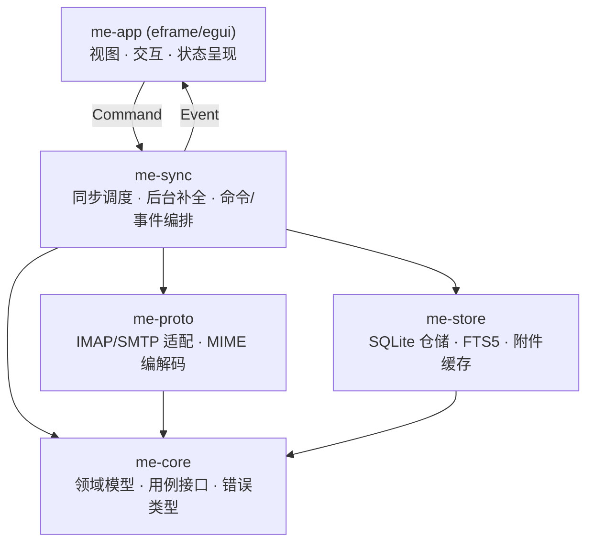

# MyEmail 项目大纲

> 基于 Rust 的邮件统一收发软件 · 架构与实施大纲
> 版本：v0.4（v0.3 基础上按 `doc/数据结构.md`、`doc/技术栈选用.md` 回写：本地移动标识、待同步队列表、文件命名、schema 约束、正文预览口径、补充依赖与 UI 只读直连）　|　更新日期：2026-11-01
> 2026-11-01 审查修订：标志回拉、删除/恢复口径、首同步全量、`SearchResults`、`BODY.PEEK[]`、统一未决清单。
> 2026-11-02 接口审查修订：补齐账户改删、附件下载、服务器草稿、重试归档、重建索引、设置写入命令；补齐账户/连接测试/发送完成/缓存清理/索引重建/附件下载事件；`SearchResults` 携带摘要；已缓存正文仍返回 `MessageBodyLoaded`。

---

## 1. 项目概述

### 1.1 目标

MyEmail 是一个用 Rust 编写的桌面邮件客户端，通过 **SMTP** 完成发信、通过 **IMAP** 完成收信，把多个邮箱账户统一到一个界面中管理，并把邮件全量缓存到本地，实现**离线可读、本地全文检索、快速打开**。

一句话定位：**多账户统一收发 + 本地全量缓存 + 离线全文检索的原生桌面邮件客户端。**

### 1.2 定稿决策

| 维度 | 决策 |
| --- | --- |
| 应用形态 | egui / eframe 原生 GUI（纯 Rust，单二进制，跨平台） |
| 数据存储 | 本地 SQLite 全量缓存；摘要随同步入库，正文后台补全 |
| 协议实现 | 成熟生态库：lettre（SMTP）+ async-imap（IMAP）+ mail-parser（MIME） |
| 正文渲染 | `html2text` 将 HTML 正文转为可读文本，v0.1 不做完整 HTML 渲染 |
| 正文搜索 | 头部字段同步后立即可搜；正文在后台补全后增量写入索引，搜索覆盖随进度增长 |
| 同步触发 | **仅启动时自动同步 + 用户手动刷新**，v0.1 不做定时轮询与 IDLE |
| 删除语义 | 删除 = 移入废件箱；v0.1 不提供一键恢复，移回需在服务器端或其他客户端操作；清空废件箱才真正 `EXPUNGE` |
| 已读语义 | 打开邮件即标记 `\Seen`，同时提供“标记为未读” |
| 发信失败策略 | 不做离线队列与自动重试：失败提示错误并保留本地草稿 |
| 账户认证 | v0.1 仅支持密码 / 授权码（SASL PLAIN、LOGIN），OAuth2 延后 |
| 接入范围 | 支持启用密码/授权码基础认证的 IMAP/SMTP 服务商；Gmail/Outlook 需 OAuth2，v0.1 不支持 |
| 撰写格式 | v0.1 纯文本正文（UTF-8，`text/plain`），不提供富文本编辑 |
| 工程结构 | Cargo workspace，按依赖方向拆 crate |
| 身份模型 | 单账户单身份，不做签名、不做发信别名 |
| v0.1 范围 | 多账户管理、收信、读信、发信、附件收发、本地全文搜索 |

### 1.3 非目标（v0.1 明确不做）

- 不实现 PGP/S-MIME 加解密与签名
- 不实现邮件规则引擎、日程（iCal/CalDAV）、联系人同步
- 不做服务器端（不实现 SMTP/IMAP 服务端）
- 不做移动端
- 不做多设备间自建同步（本地缓存仅本机）
- 不做服务器草稿的双向同步（本地草稿为准，服务器副本仅手动镜像）

---

## 2. 功能需求

### 2.1 v0.1（首个可用版本）

**账户**
- 添加/编辑/删除账户，支持启用密码/授权码认证的 IMAP + SMTP 组合
- 协议参数：服务器地址、端口、TLS 模式（隐式 TLS / STARTTLS / 明文）、用户名、密码、认证方式
- **明文 TLS 默认禁止**：默认只开放隐式 TLS 与 STARTTLS；明文仅当用户展开“高级”并勾选“我了解凭据与邮件将以明文传输”后可选，账户列表对该账户常驻显示风险标记
- 凭证存入系统密钥库（Windows Credential Manager，经 `keyring`）
- keyring 不可用时（如便携模式）提供两种选择：**仅本次会话记忆**（进程内存，不落盘）或取消添加；不提供明文持久化
- 账户连接测试（登录 IMAP + SMTP 各一次）
- 多账户在线，账户列表展示同步状态
- 删除仍有草稿的账户时默认拒绝，提示先导出或清理草稿；仅当用户在二次确认中明确选择“连同草稿一并删除”后，才级联删除本地草稿（`ON DELETE CASCADE`），并提示草稿不可恢复

**收信**
- 同步 IMAP 文件夹树，识别特殊用途文件夹（INBOX / Sent / Drafts / Trash / Junk）：优先使用 `SPECIAL-USE` 扩展，不支持时按名称启发式判断（含中英文别名），允许用户手动指定角色
- 登录后按 `CAPABILITY` 发送 `ID` 命令（QQ / 163 需要），由 `me-proto` 实现，失败不阻断登录
- 文件夹改名按 `UIDVALIDITY` + delimiter + 角色识别，命中则只更新 `folders.name`，不删建、不重建邮件与索引；服务器删除文件夹时先在树中标记“服务器已删除”，用户确认后才清理本地缓存
- 触发时机：**应用启动时同步一次 + 用户手动刷新**；不做定时轮询（IDLE 与轮询列入 v0.2）
- 增量同步：读取 `UIDNEXT`，与本地 `last_uid` 比较后决定是否拉取；返回结果再按 `UID > last_uid` 过滤
- 同步拉取头部与 `BODYSTRUCTURE`，据此写入主题、发件人、收件人、日期、大小、附件标记
- 增量拉取后更新 `last_uid`；`UIDVALIDITY` 变化时清空该文件夹本地邮件并全量重同步
- 标志位同步：已读/未读、星标、删除
- 正文在打开邮件或后台补全时下载（打开时拉取完整 RFC822；补全见 §2.2），附件按需单独下载（`BODY.PEEK[<part>]`），下载后写入正文缓存与搜索索引
- 未读计数、按时间倒序的邮件列表；列表展示主题 / 发件人 / 时间 / 附件标记，**正文预览（`snippet`）在正文补全后才有**，未补全时该列为空

**读信**
- 打开邮件即将本地标志置为已读，并异步向服务器 `STORE +FLAGS (\Seen)`；失败不回滚本地状态，记录待同步标志
- 正文展示：优先 `text/plain`；仅有 HTML 时经 `html2text` 转换后展示
- 提供“标记为未读”，回写服务器 `STORE -FLAGS (\Seen)`

**发信**
- 纯文本撰写界面（UTF-8，`text/plain`），收件人 / 抄送 / 密送，多附件
- 发送前把草稿写入本地草稿库（含固定 `Message-ID`），再投递 SMTP
- 发送成功后通过 IMAP `APPEND` 写入服务器 Sent 文件夹
- 服务器草稿：本地草稿为唯一事实来源；“保存到服务器草稿”为手动操作，成功后记录 `server_uid`
- 发送成功后若存在服务器草稿副本，尝试删除；删除失败仅提示，不阻断发送结果
- **发送失败不重试**：无网络或 SMTP 报错时提示失败原因并保留本地草稿；再次发送前提示“该邮件可能已发送”，并复用原 `Message-ID`

**附件**
- 解析 multipart，列表展示附件名、类型、大小
- 按需下载并保存到本地、另存为、用系统默认程序打开；打开前提示“附件可能包含恶意内容”
- 发送与草稿附件限制：单文件 ≤ 25 MB，单封附件总量 ≤ 25 MB；超限禁止发送并提示
- 草稿附件在保存草稿时复制到应用托管目录，不依赖原文件路径

**搜索**
- 头部字段（主题、发件人、收件人）在同步完成后立即可搜
- 正文在后台补全任务完成后写入 FTS 索引；搜索界面显示“正文索引覆盖 N/M 封”
- 查询词 ≥ 3 个字符时可命中正文；1～2 个字符仅匹配头部字段（trigram 分词限制，界面提示）
- 按账户/文件夹/时间范围/是否含附件过滤
- “是否含附件”基于同步阶段取得的 `BODYSTRUCTURE`，对所有已同步邮件均准确

**通用**
- 离线可读已缓存邮件；离线时发信直接提示“无网络连接，已保存到草稿箱”，不做排队重试
- 关键界面状态：首次启动无账户引导、空列表、同步中（进度与可取消）、离线（顶部状态条）、错误提示（可复制详情）
- 本地缓存为明文（SQLite 与正文/原始邮件文件），首次启动与设置页需明确告知，不承诺加密
- 本地缓存管理：提供“清理缓存”入口，清理后可保留摘要与标志，删除正文、原始邮件与附件文件；清理后恢复正文需重新下载
- 深色/浅色主题跟随系统

### 2.2 关键规则与口径

**同步与并发**
- 多账户默认串行同步；全局最多同时 2 条服务器连接（跨账户），单账户最多 1 条
- 连接预算优先级：发信 > 手动同步 > 后台补全；后台补全只使用空闲预算
- 首次同步为全量（分页拉取、可中断）；不做按天数截断——UID 是单点游标，后台补全也不会发现未入库的旧邮件
- 每轮同步在增量拉取后执行标志回拉：分页 `UID FETCH 1:* (FLAGS)`；本地存在待同步标志时以本地目标态为准，否则以服务器值更新 `messages.flags`，服务器侧变更不回写队列
- 遇到服务器限流/`BYE`/连接数错误时按 30s → 2min → 5min 退避，并在账户上显示“稍后重试”
- 同步可随时取消；取消后保留已写入数据，`last_uid` 只推进到已完整写入的位置

**正文后台补全与索引**
- 同步完成后启动后台补全任务：按文件夹分组、**组内按邮件时间倒序**（`folder_id, date DESC`）逐封以 `BODY.PEEK[]` 下载正文（禁止用 `BODY[]`，否则会把邮件标为已读），每封完成后解析、缓存并写入 FTS。文件夹之间仍按 id 升序（保证同一文件夹的行连续，执行侧一次 `SELECT` 批量 `FETCH`）；文件夹内部倒序，保证最近的邮件先被全文索引
- 跨账户并发 2（每账户 1 条连接）；断网、用户手动同步或应用退出时暂停；下次启动继续
- 用户可在设置中关闭“后台补全正文”；关闭后只有打开过的邮件可搜正文
- 索引文本与展示文本一致：均为 `text/plain`（HTML 已由 `html2text` 转换）
- **不额外拉取正文片段**：同步阶段只取头部与 `BODYSTRUCTURE`，`snippet` 在补全完成时由正文前 200 字符生成；补全前列表无预览，这是明确接受的取舍

**删除与废件箱**
- 删除 = 移入废件箱：优先使用 IMAP `MOVE`；服务器不支持时执行 `COPY` 到废件箱 + `STORE \Deleted`。仅当服务器支持 `UIDPLUS` 时才追加 `UID EXPUNGE` 源文件夹；否则不执行 `EXPUNGE`，避免误删其他客户端标记的邮件
- 账户没有废件箱角色时禁用“删除”并提示用户先创建废件箱或手动指定角色，不退化为永久删除
- 废件箱中的邮件再次删除 = 永久删除；仅当服务器通告 `UIDPLUS` 时执行 `UID STORE \Deleted` + `UID EXPUNGE`。没有 `UIDPLUS` 时禁用永久删除与“清空废件箱”并说明原因，避免 `EXPUNGE` 误删其他客户端标记的邮件
- “清空废件箱”需二次确认，执行后不可恢复
- 删除操作先在本地生效，再异步同步；服务器失败时标记为待重试，不静默丢失
- v0.1 不提供“从废件箱移回原文件夹”的一键恢复；界面明确提示移回需在服务器端或其他客户端完成

**已读与标志**
- 打开即已读；本地先写，服务器后有失败时进入“待同步标志”队列，下次同步重试
- 星标、未读/已读均走同一标志队列；同一邮件的标志变更合并为最终状态
- 服务器侧标志以每轮分页回拉为准；同一邮件同时存在本地待同步标志时，以本地目标态覆盖服务器，不采纳回拉值

**草稿**
- 草稿状态仅 `draft` / `sent` 两态；发送成功但归档失败时状态仍为 `sent`，并记录 `last_error`，界面提示“已发送，但未保存到已发送文件夹”
- 草稿附件在保存时复制到 `drafts/<draft_id>/` 托管；草稿行删除时一并删除该目录，启动时清理无对应行的孤儿目录
- v0.1 不做服务器草稿双向同步：其他客户端的草稿变更不会回写本地

**时间**
- 解析 `Date` 头失败或缺失时回退 `INTERNALDATE`，记录 `date_source`（`header` / `internal`）
- 列表按本地时区展示；排序以时间戳降序，时间相同以本地 `id` 降序为次级键

**错误与日志**
- 日志分级 INFO/WARN/ERROR；必须记录：同步开始/结束（账户、文件夹、新增数、耗时）、协议错误、发送结果
- 不记录正文与凭证；邮箱地址按 `a***@domain` 脱敏
- 按天滚动，保留 7 天；设置页提供“打开日志目录”

### 2.3 后续版本（Backlog）

- 定时轮询与 IDLE 实时推送
- 完整 HTML 正文渲染（保留排版）与内联图片 `cid:` 解析
- 富文本/HTML 撰写（`multipart/alternative`）
- 邮件会话（Thread）聚合
- 退信（DSN）解析
- OAuth2（XOAUTH2）支持 Gmail / Outlook —— **已确认作为 v0.2 首项**
- 服务器草稿双向同步
- 地址簿与快捷模板
- 全局搜索语法（`from:`, `after:`, `has:attachment`）
- 导入/导出（`.eml`、mbox）
- PGP 加密与签名

---

## 3. 技术选型

### 3.1 核心依赖

| 领域 | Crate | 说明 |
| --- | --- | --- |
| 异步运行时 | `tokio`（rt-multi-thread, macros, fs, time） | 网络与磁盘 IO 的公共底座 |
| GUI | `eframe` / `egui` | 立即模式 GUI，无需前端工具链 |
| SMTP | `lettre` | 支持 STARTTLS/隐式 TLS、MIME 构建、附件、SASL PLAIN/LOGIN |
| IMAP | `async-imap` | 异步 IMAP，支持 SELECT/FETCH/STORE/APPEND，MOVE 视服务器能力 |
| MIME 解析 | `mail-parser` | 解析 RFC822，抽取正文、附件、头部 |
| 数据库 | `rusqlite`（bundled，≥ SQLite 3.43）+ `r2d2` / `r2d2_sqlite` | SQLite 全量缓存与 FTS5 |
| TLS | `rustls` + `webpki-roots` / `rustls-native-certs` | 统一 TLS 栈，静态链接 |
| 凭证 | `keyring` | Windows Credential Manager / macOS Keychain |
| 序列化 | `serde` + `serde_json` | 头部结构化存储、配置 |
| 时间 | `chrono` | 邮件日期解析、时区与展示 |
| 日志 | `tracing` + `tracing-appender` | 结构化日志与按天滚动 |
| 错误 | `thiserror`（库）/ `anyhow`（应用层） | 分层错误模型 |
| 正文降级 | `html2text` | HTML 正文转纯文本，索引与展示共用 |
| 表格 / 虚拟滚动 | `egui_extras` | 邮件列表按行渲染，只构建可见行 |
| 原生文件对话框 | `rfd` | 选择附件、另存为、拖拽上传 |
| 压缩 | `flate2` | `raw/*.eml.gz` 读写 |
| 目录定位 | `dirs` | `%APPDATA%/MyEmail` 等平台路径 |
| 唯一标识 | `uuid` | 生成并固定草稿 `Message-ID` |
| 任务取消 | `tokio-util`（`CancellationToken`） | 同步与补全的可取消 |
| 单实例 | `fs2`（文件锁） | 防止多实例打开同一库 |

> 精确版本在初始化时用 `cargo add` 拉取最新稳定版并锁定到 `Cargo.lock`，本文不写死版本号。

### 3.2 选型理由

- **egui**：与 Rust 同栈、零 JS 工具链、构建快，立即模式适合邮件列表这类高频刷新的界面。
- **全部走 rustls**：避免 OpenSSL 交叉编译问题，Windows 上打包更省事。
- **SQLite 单文件**：无需外部服务，备份/迁移简单；FTS5 内建，搜索无需额外中间件。
- **async-imap + lettre 分离**：收、发协议差异大，分开选库比强行统一抽象更稳。
- **html2text 而非完整 HTML 渲染**：邮件 HTML 的表格布局与内联样式千奇百怪，v0.1 先保证“可读”而非“还原”，无需嵌入 Web 引擎。
- **workspace 起步**：`me-core` 不依赖 tokio/rusqlite，协议层与存储层可独立单测，避免单 crate 后期拆分的返工。

---

## 4. 系统架构

### 4.1 分层



- **UI 不直接碰网络**，只发 `Command`、只读 `Event` 与快照；数据库仅允许经只读连接做列表分页与未读计数（键集分页、单次行数有上限，见 `doc/项目架构.md` §2/§4），搜索经 `Search` 命令异步返回，写操作一律走 `Command`。
- **me-core** 只依赖数据结构和接口 trait，不依赖 tokio / rusqlite，方便单测。
- **me-proto** 把 `async-imap` / `lettre` 的返回类型翻译成领域模型，隔离上游库类型。
- **me-sync** 同时负责同步任务与正文补全/索引任务，两者共用连接与退避策略。

### 4.2 线程模型

| 线程 | 职责 |
| --- | --- |
| 主线程 | eframe 事件循环 + 渲染。**任何阻塞操作都不得在此发生。** |
| tokio 运行时（独立线程） | 网络 IO、同步任务、SMTP 发送、正文补全 |
| DB 工作线程 | 单一写连接 + 读连接池，避免 SQLite 并发写锁冲突；异步侧通过 `spawn_blocking` 访问 |

**通信方式**
- UI → 后端：`tokio::sync::mpsc::UnboundedSender<Command>`（用户操作稀疏，无背压风险）
- 后端 → UI：`tokio::sync::mpsc::channel(1024)`（**有界通道**），UI 每帧 `try_recv` 抽取并更新本地视图状态；发送侧遇满不得阻塞后台任务
- **进度事件合并**：`SyncProgress` / `IndexProgress` 每 ≥200 ms 或每 50 封最多发一次，避免后台补全 10 万封时事件堆积
- **关键事件不丢弃**：`AccountsLoaded`、`AccountAdded`、`AccountUpdated`、`AccountRemoved`、`AccountStatus`、`ConnectionTested`、`FoldersUpdated`、`MessagesAppended`、`FlagsChanged`、`MessageBodyLoaded`、`AttachmentDownloaded`、`SearchResults`、`IndexRebuilt`、`DraftSaved`、`SendCompleted`、`SendFailed`、`CacheCleared`、`Error` 必须送达；通道满时先丢弃最旧的可合并进度事件，仍满则合并同类事件后重试
- 后端每次发送事件后调用 `ctx.request_repaint()`，保证空闲窗口也能及时刷新

```rust
enum Command {
    AddAccount(AccountDraft),
    UpdateAccount { id: AccountId, draft: AccountDraft },
    DeleteAccount { id: AccountId, delete_drafts: bool },
    TestConnection(AccountId),
    SyncAccount(AccountId),          // 启动同步与手动刷新共用
    SyncFolder { account: AccountId, folder: FolderId },
    CancelSync(AccountId),
    OpenMessage(MessageId),          // 触发按需下载正文，并置已读
    DownloadAttachment { message: MessageId, part_index: u32 },
    SetFlags { ids: Vec<MessageId>, flags: FlagOp },
    MoveToTrash(Vec<MessageId>),
    EmptyTrash(FolderId),
    SaveDraft(OutgoingMessage),
    SaveDraftToServer(DraftId),
    Send(OutgoingMessage),
    RetryArchive(DraftId),
    Search(SearchQuery),
    SetTheme(ThemeMode),
    SetBodyBackfill { enabled: bool },
    RebuildIndex,
    ClearCache(Option<AccountId>),
}

enum Event {
    AccountsLoaded { accounts: Vec<Account> },
    AccountAdded { account: Account },
    AccountUpdated { account: Account },
    AccountRemoved { id: AccountId },
    AccountStatus { id: AccountId, status: ConnectionState },
    ConnectionTested { account: AccountId, imap_ok: bool, smtp_ok: bool, detail: Option<String> },
    FoldersUpdated { account: AccountId, folders: Vec<Folder> },
    MessagesAppended { folder: FolderId, messages: Vec<MessageSummary> },
    FlagsChanged { items: Vec<(MessageId, Flags)> },
    MessageBodyLoaded { id: MessageId, body: MessageBody },
    AttachmentDownloaded { message: MessageId, part_index: u32, local_path: std::path::PathBuf },
    SearchResults { query_id: u64, messages: Vec<MessageSummary>, total: u32, body_indexed: u32, body_total: u32 },
    SyncProgress { folder: FolderId, done: u32, total: Option<u32> },
    IndexProgress { account: AccountId, indexed: u32, total: u32 },
    IndexRebuilt { indexed: u32 },
    DraftSaved { id: DraftId, synced_to_server: bool },
    SendCompleted { draft: DraftId, archived: bool, archive_error: Option<String> },
    SendFailed { draft: DraftId, reason: SendFailureKind },
    CacheCleared { account: Option<AccountId>, freed_bytes: u64 },
    Error { scope: ErrorScope, message: String },
}

// 契约附带类型（me-core/src/command.rs）
struct AccountDraft {
    email: String,
    display_name: Option<String>,
    imap: Endpoint,
    smtp: Endpoint,
    auth_user: String,
    auth_secret: Option<String>,   // Add 时必须 Some；Update 时 None = 保留现有凭证
    auth_method: AuthMethod,
    plaintext_tls_ack: bool,       // TLS 为 None 时必须为 true
}
enum AuthMethod { Password, AppPassword }   // OAuth2 于 v0.2 引入
enum ThemeMode { System, Light, Dark }
enum ConnectionState {
    Disconnected, Connecting, Online, Syncing,
    Backoff { retry_at: i64 }, Error { detail: String },
}
enum SendFailureKind {
    NetworkUnreachable, Timeout,
    Rejected { code: Option<u16>, detail: String },
    Tls { detail: String }, Auth { detail: String },
}
enum ErrorScope { Global, Account(AccountId), Folder(FolderId), Message(MessageId), Draft(DraftId) }
```

`Search` 的结果经 `SearchResults` 返回；`query_id` 由后端生成，UI 丢弃非最新 `query_id` 的结果。

### 4.3 关键数据流

**收信同步**
1. 启动时或用户手动刷新 → 发 `SyncAccount`
2. 取凭证 → IMAP 登录 → `LIST` 文件夹树（请求 `SPECIAL-USE`）→ 与库中差异合并（改名按 `UIDVALIDITY` + delimiter + 角色识别；服务器删除的文件夹置 `deleted_on_server`，待用户确认）
3. 对每个文件夹：`SELECT` 读 `UIDVALIDITY` / `UIDNEXT`
   - `UIDVALIDITY` 变化 → 清空该文件夹本地邮件与索引，`last_uid` 置 0，全量重同步
   - 若 `UIDNEXT <= last_uid + 1` → 无新邮件，跳过 FETCH
   - 否则 `UID FETCH <last_uid+1>:* (UID FLAGS INTERNALDATE RFC822.SIZE BODY.PEEK[HEADER] BODYSTRUCTURE)`
4. 丢弃 `UID <= last_uid` 的结果，解析头部与 BODYSTRUCTURE → 批量写入 `messages` + 头部索引 → 更新 `last_uid` → 发 `MessagesAppended`
   - **去重**：插入前按 `(folder_id, message_id)` 查找 `uid IS NULL` 的本地占位行（本地已移动、服务器未确认）；命中则只补 `uid` 并清除对应 `pending_ops`，不再插入新行。`message_id` 为空时跳过去重。
   - **移动确认**：服务器支持 `UIDPLUS` 时直接用 `COPYUID` 回填目标 UID；不支持时对目标文件夹执行一次 `UID SEARCH HEADER Message-ID <id>` 定向补齐；确认后才删除 `pending_ops`
5. **标志回拉**：分页 `UID FETCH 1:* (FLAGS)`（按 UID 区间分批），与本地 diff：
   - 本地存在 `pending_flags` 的邮件以本地目标态为准，忽略服务器值；同步成功后清除该行
   - 其余邮件以服务器值为准，只更新 `messages.flags`
   - 服务器侧变更绝不写入 `pending_flags`，避免回声

**读信**
1. `OpenMessage(id)` → 本地立即置 `\Seen` 并入待同步队列 → 异步 `STORE +FLAGS (\Seen)`
2. 正文已缓存则直接读本地，同时发 `MessageBodyLoaded`
3. 未缓存 → `UID FETCH <uid> BODY.PEEK[]` → `mail-parser` 解析 → 取 `text/plain`，否则 `text/html` 走 `html2text` → 正文与附件落盘 → 写库 → 写 FTS → 发 `MessageBodyLoaded`

**正文后台补全**
1. 同步结束后，若设置允许且在线，按文件夹取 `body_path IS NULL AND uid IS NOT NULL` 的邮件，按 `(folder_id, uid)` 升序排队
2. 逐封以 `BODY.PEEK[]` 下载（禁止 `BODY[]`）、解析、缓存、写 FTS；每完成一封发 `IndexProgress`
3. 断网/取消/退出即暂停，进度持久化在 `messages.body_path` 与索引行中，可续跑

**发信**
1. 本地草稿库写入草稿（生成并固定 `Message-ID`，状态 `draft`）
2. 尝试 SMTP 投递（v0.1 不做排队与自动重试；失败发 `SendFailed`）
3. 成功 → `APPEND` 到 Sent → 草稿置 `sent` → 发 `SendCompleted { archived: true }` → 若存在 `server_uid` 则删除服务器草稿副本
   - 若 `APPEND` 失败：草稿仍置 `sent`，记录 `last_error`，发 `SendCompleted { archived: false, archive_error }`，提示“已发送，但未保存到已发送文件夹”，提供“重试归档”（`RetryArchive`）
4. 失败 → 按失败类型提示：
   - 网络不可达：“无网络连接，已保存到草稿箱”
   - SMTP 拒绝/超时：“发送失败：<原因>，已保存到草稿箱”
   - 草稿保留原 `Message-ID`；用户再次发送前弹出确认“该邮件可能已发送，确定重发？”
5. 发送成功后清理本地临时文件（正文、附件副本保留至草稿清理）

**保存到服务器草稿（手动）**：`SaveDraftToServer` → `APPEND` 到 Drafts → 记录 `server_uid` → 发 `DraftSaved { synced_to_server: true }`；失败记 `last_error` 并发 `Error`。

---

## 5. 数据模型（SQLite）

### 5.1 表结构

完整 DDL、索引与约束的**唯一事实源**是 `doc/数据结构.md` §4.2；本节只保留对象清单，避免两份 DDL 漂移。

| 对象 | 类型 | 用途 |
| --- | --- | --- |
| `accounts` | 表 | 账户、IMAP/SMTP 端点、认证方式 |
| `folders` | 表 | 文件夹、角色、`UIDVALIDITY`、`last_uid` |
| `messages` | 表 | 邮件摘要、标志、正文路径、`snippet` |
| `attachments` | 表 | 附件元数据与本地路径 |
| `drafts` | 表 | 本地草稿、固定 `Message-ID`、状态、同步基线、墓碑 |
| `pending_flags` | 表 | 待同步标志（目标态） |
| `pending_ops` | 表 | 待同步移动/永久删除（独立于本地行存活） |
| `messages_fts` | FTS5 虚表 | 全文索引，`rowid = messages.id` |
| `meta` | 表 | `schema_version` 与用户设置（含 AI 模型档案、天气 Host/Key） |
| `calendars` / `calendar_events` | 表 | 日历与事件（v0.3） |
| `calendar_event_exceptions` | 表 | 重复事件的单次例外（v0.3，仓储已备、界面未接线） |
| `calendar_reminder_fires` | 表 | 提醒去重（事件 × 发生时刻 × 提前分钟数，v0.3） |
| `weather_locations` / `weather_snapshots` | 表 | 天气地点与快照缓存（v0.3） |
| `ai_conversations` / `ai_messages` | 表 | AI 会话与消息（v0.3；v4/v5 分别加 `model_id` 与 `plan`） |
| `ai_entities` / `ai_entity_aliases` / `ai_conversation_entities` | 表 | AI 记忆实体注册表（v0.3） |

连接初始化 PRAGMA（`foreign_keys` / WAL / `busy_timeout` / `synchronous`）同样以数据结构 §4.1 为准。

### 5.2 存储布局

```
%APPDATA%/MyEmail/          (Windows，其余平台走 dirs)
├─ myemail.db               SQLite 主库
├─ bodies/<messages.id>.txt 正文纯文本缓存（HTML 已由 html2text 转换）
├─ raw/<messages.id>.eml.gz 原始邮件（下载正文时留存，供导出与重解析）
├─ drafts/<drafts.id>/      草稿原文与托管附件
├─ attach/<messages.id>/    附件缓存
└─ logs/                    tracing 按天滚动日志
```

### 5.3 约定

- **标志位**：`flags` 为 INTEGER 位掩码（`SEEN=1, ANSWERED=2, FLAGGED=4, DELETED=8, DRAFT=16`），与 IMAP `\Seen` 等一一映射。
- **外键**：所有连接初始化统一开启 `PRAGMA foreign_keys=ON`；`drafts.account_id` 使用 `ON DELETE CASCADE`，删除账户时一并删除草稿。
- **文件夹角色**：`role` 非空且取值受限；同一账户下 `role='trash'` 唯一（部分唯一索引，见数据结构 §4.2）。
- **FTS 维护**（普通 FTS5，非 contentless）：
  - 邮件摘要入库时写入 `subject/from_addr/to_addrs` 三列，`body` 留空；
  - 正文缓存完成后，按 `rowid = messages.id` 更新对应行的 `body`；
  - 删除邮件、清空文件夹、`UIDVALIDITY` 重建时，按 rowid 显式 `DELETE FROM messages_fts`；
  - 数据库提供重建索引命令，用于兜底修复。
- **索引状态**：`messages.body_path IS NOT NULL` 等价于“该邮件正文已写入索引”，搜索界面据此统计覆盖进度。
- **中文检索**：FTS5 使用 `tokenize='trigram'`；trigram 要求查询词 ≥ 3 个字符，1～2 字符查询改走头部字段 `LIKE`，正文不参与。
- **发件人/收件人存储**：`to_addrs` / `cc_addrs` 存 JSON 数组，避免 `Doe, John <...>` 这类显示名被逗号拆分。
- **时间口径**：`Date` 解析失败或缺失时使用 `INTERNALDATE`，并记 `date_source='internal'`；展示按本地时区，排序键为 `(date DESC, id DESC)`。
- **正文本地格式**：缓存统一为 `text/plain`；原邮件只有 HTML 时用 `html2text` 转换；原始 HTML 随 `raw/` 保留，供 v0.2 完整渲染。
- **原始邮件留存**：每次下载正文时同步把完整 RFC822 写入 `raw/<messages.id>.eml.gz`，使 `raw/` 的覆盖范围与正文缓存一致；不为未下载正文的邮件单独拉取原始邮件。该留存是“丢弃正文文件、从原始邮件重解析”这一磁盘兜底方案的前提。
- **文件命名**：磁盘文件名一律用本地主键 `messages.id` / `drafts.id`，不用 RFC 5322 的 `Message-ID`——后者可为空、可重复、可能含 `/` 等非法字符。附件按 `part_index` + 白名单清洗后的文件名拼接，避免路径穿越与超长文件名。
- **本地移动的标识**：本地移入废件箱后，行的 `folder_id` 改指向 Trash、`uid` 置 NULL（服务器身份待确认），原位置写入 `pending_ops.source_folder_id / source_uid`；服务器确认后按同步的去重规则补回真实 UID。
- **待同步操作的生命周期**：`pending_ops` 必须比本地邮件行活得更久。永久删除时先写 `pending_ops` 再删 `messages` 行；`message_id` / `source_folder_id` 用 `ON DELETE SET NULL`，执行时以 `source_folder_id + source_uid` 为准。
- **草稿以本地为准**：服务器 Drafts 是可选镜像；发送成功后若 `server_uid` 存在则删除服务器副本。
- **迁移**：`meta.schema_version` + 顺序迁移函数，启动时自动升级。**v0.1 发布前 schema 未冻结**——改表直接改建表语句并删库重来，不写迁移；发布时冻结为 `schema_version = 1`，此后才需要迁移代码。

---

## 6. 目录结构

```
MyEmail/
├─ Cargo.toml                  # workspace，resolver = "2"
├─ rust-toolchain.toml         # 固定工具链
├─ deny.toml                   # cargo-deny 策略
├─ doc/                        # 本目录 5 份文档
├─ crates/
│  ├─ me-core/                 # 领域模型、端口 trait、错误、Command/Event
│  │  └─ src/{model,port,command,error}.rs
│  ├─ me-proto/                # IMAP/SMTP 适配层、MIME、modified UTF-7
│  │  └─ src/{imap,smtp,mime,utf7}.rs
│  ├─ me-store/                # SQLite 仓储、FTS、附件缓存
│  │  └─ src/{db,migrations,accounts,folders,messages,drafts,search,cache}.rs
│  ├─ me-sync/                 # 同步引擎、后台补全、任务调度
│  │  └─ src/{engine,tasks,indexer,events}.rs
│  └─ me-app/                  # eframe 应用（bin）
│     └─ src/{main,app,state,views/...}
├─ assets/                     # 图标、CJK 字体子集
└─ tests/                      # 跨 crate 集成测试与 .eml 夹具
```

workspace 从一开始就建立：`me-core` 不依赖 tokio/rusqlite，保证领域逻辑可脱离运行时单测；`me-proto` 与 `me-store` 可各自独立测试；UI 层依赖 `me-core` 的 `Command`/`Event` 契约，并可经 `me-store` 只读端口做列表分页与未读计数（见 §4.1）。

---

## 7. 里程碑

| 阶段 | 交付物 | 验收标准 |
| --- | --- | --- |
| **S 技术验证** | Spike A（IMAP 兼容）、Spike B（UI 渲染）、Spike C（FTS 中文检索），详见 `doc/可行性分析.md` §7 | 结论写入 `doc/spike-*.md`；门禁点：A 在 M2 前、B 在 M4 前、C 在 M5 前通过；可与 M0/M1 并行 |
| **M0 骨架** | workspace、日志、错误模型、空窗口、SQLite schema 初始化与 `schema_version` 读写 | `cargo run` 弹出窗口；库文件可创建、`schema_version` 可读；`PRAGMA foreign_keys` 生效 |
| **M1 账户** | 账户增删改、keyring 凭证与降级、连接测试 | 能登录真实 IMAP/SMTP；keyring 不可用时可选“本次会话记忆” |
| **M2 收信** | 文件夹树、启动/手动同步、增量同步、邮件列表、未读计数、标志位 | 收件箱 1000 封同步完成且重启后无需重拉；附件标记来自 BODYSTRUCTURE；无新邮件时不产生 FETCH |
| **M3 读信** | 打开即已读、按需拉正文、html2text、附件列表与下载、正文索引 | 打开邮件 < 300ms（已缓存）/ < 2s（首次）；打开后服务器显示已读；正文搜索可命中该邮件 |
| **M4 发信** | 纯文本撰写、附件、SMTP 投递、Sent 归档、本地草稿、失败落草稿 | 带 3 个附件（≤25 MB）发往 QQ/163 正常；断网发送提示失败且草稿可找回；重发前有确认 |
| **M5 搜索** | 头部索引、正文后台补全、搜索面板、过滤条件 | 1 万封下头部搜索 P95 < 200ms；正文查询 P95 < 200ms（trigram）；10 万封下正文查询 P95 < 500ms；补全完成后正文可搜；1～2 字查询提示仅搜头部；后台补全前后未读数不变；1 万封索引 ≤ 正文文本 3 倍，10 万封 ≤ 4 倍 |
| **M6 打磨** | 界面状态、缓存清理、日志脱敏、主题、快捷键、打包（MSI/portable） | 首次启动/空列表/离线/同步中/错误五类状态可用；日志不含正文与完整地址；首次启动告知本地明文缓存；附件打开前有风险提示 |

---

## 8. 测试策略

- **单元测试**：me-core 领域逻辑、MIME 解析（固定 `.eml` 夹具）、FTS 查询构建与 `<3` 字符分支、标志位映射、时间回退、附件上限校验
- **集成测试**：me-store 对临时 SQLite 跑 schema 初始化、外键级联、FTS 增删改与重建；me-proto 对本地 mock IMAP/SMTP 服务器跑协议时序，覆盖 `UIDNEXT` 判空、`UID > last_uid` 过滤、标志回拉分页、BODYSTRUCTURE、MOVE 与回退路径、`BODY.PEEK[]` 不改变已读状态
- **端到端**：Docker 起 `greenmail` 或 `dovecot`（Windows 环境以 Docker Desktop/WSL2 为前提），跑“加账户 → 收信 → 读信 → 回信 → 删除 → 搜索”全链路
- **异常注入**：断网发信、SMTP 超时、APPEND 失败、keyring 不可用、限流 `BYE`、`UIDVALIDITY` 变化
- **UI**：`egui_kittest` 做关键视图快照测试（可选）
- **性能基准**：基准环境固定为 Windows 11 / 8 核 / 16 GB / NVMe；数据集 1 万与 10 万封摘要；分别记录冷缓存与热缓存下的 P50/P95

---

## 9. 风险与决策记录

**风险**

| 风险 | 影响 | 缓解 |
| --- | --- | --- |
| `async-imap` 维护活跃度有限 | 协议边角（QRESYNC、UTF7 文件夹名）支持不足 | 保留 `me-proto` 抽象层，必要时换 `imap` 或自研补丁 |
| 国内邮箱（QQ/163）认证要求授权码 | 用户直接用密码登录失败 | 添加账户页明确提示“请使用授权码” |
| Gmail/Outlook 已禁用基础认证 | v0.1 无法直接接入 | 账户页明确提示暂不支持；OAuth2 作为 v0.2 首项 |
| 大型邮箱首次全量同步慢 | 体验差 | 首同步只拉摘要，正文由后台补全任务逐步完成，可暂停 |
| 中文字体 | egui 默认字体无 CJK | 内嵌思源黑体子集或系统字体加载 |
| HTML 邮件排版丢失 | html2text 不保留表格/图片 | v0.1 以“可读”为标准；原始 HTML 存 `raw/`，完整渲染排 v0.2 |
| 正文索引占用磁盘 | 10 万封正文 + trigram 索引体积可观 | 设置页显示占用；提供“清理缓存”与关闭后台补全 |
| 服务器无 UIDPLUS | 永久删除与清空废件箱无法限定 EXPUNGE 范围 | 禁用这两项并提示；移入废件箱仍可用 MOVE 或 COPY + `\Deleted`（不 EXPUNGE） |

**已确认的决策**

| 日期 | 议题 | 结论 |
| --- | --- | --- |
| 2026-11-01 | OAuth2 是否进 v0.1 | 否。v0.1 只做密码/授权码认证，OAuth2 列为 v0.2 首项 |
| 2026-11-01 | 离线发件策略 | 不做队列、不做自动重试。提示失败并保存到本地草稿箱 |
| 2026-11-01 | HTML 正文处理 | 引入 `html2text` 转为纯文本展示，完整 HTML 渲染延后 |
| 2026-11-01 | 工程结构 | 直接以 workspace 起步，不采用单 crate 过渡方案 |
| 2026-11-01 | 签名 / 多身份 | 不需要。每个账户固定单一身份 |
| 2026-11-01 | 正文搜索范围 | 头部立即索引；正文后台补全后增量写入索引，搜索覆盖随进度增长 |
| 2026-11-01 | 同步触发 | 仅启动自动同步 + 手动刷新，v0.1 不做定时轮询与 IDLE |
| 2026-11-01 | 删除语义 | 移入废件箱；v0.1 不提供一键恢复；清空废件箱才 `EXPUNGE` |
| 2026-11-01 | 已读时机 | 打开即已读，并提供“标记为未读” |
| 2026-11-01 | 技术默认项 | `flags` 用 INTEGER 位掩码；FTS 用普通表并显式维护；开启外键；同步拉取 BODYSTRUCTURE；`UIDNEXT` 判空后按 UID 过滤；附件单封 ≤25 MB；Date 失败回退 INTERNALDATE |
| 2026-11-01 | 依赖补充（v0.3） | 增加 `egui_extras`（虚拟滚动表格）与 `rfd`（原生文件对话框）；`jieba-rs` 不作默认依赖，仅在 FTS 方案变更时评估 |
| 2026-11-01 | 事件通道（v0.3） | 后端→UI 由无界改为有界（容量 1024）；进度事件按 ≥200 ms 或 50 封合并；关键事件不丢弃 |
| 2026-11-01 | 原始邮件留存（v0.3） | 下载正文时同步写入 `raw/*.eml.gz`，覆盖范围与正文缓存一致，作为“丢弃正文文件”兜底方案的前提 |
| 2026-11-01 | 明文 TLS（v0.3） | 默认禁止；仅“高级”选项 + 风险确认后可启用，账户列表常驻风险标记 |
| 2026-11-01 | 搜索验收（v0.3） | M5 增加正文检索指标：1 万封 P95 < 200 ms、10 万封 P95 < 500 ms |
| 2026-11-01 | 本地移动标识（v0.4） | `messages.uid` 改为可空；本地移入废件箱后 `uid=NULL`，原位置记入 `pending_ops.source_folder_id/source_uid`；同步插入前按 `(folder_id, message_id)` 去重补 UID |
| 2026-11-01 | 待同步队列（v0.4） | 新增 `pending_flags`（存目标态、合并多次变更）与 `pending_ops`（移动 / 永久删除） |
| 2026-11-01 | 文件命名（v0.4） | 磁盘文件一律用 `messages.id` / `drafts.id`，不使用 RFC 5322 `Message-ID` |
| 2026-11-01 | 依赖补充（v0.4） | 增加 `flate2`、`dirs`、`r2d2_sqlite`、`uuid`、`tokio-util`、`fs2` |
| 2026-11-01 | UI 数据访问（v0.4） | UI 可经只读连接做列表分页与未读计数；写操作一律走 `Command`（原“UI 不直接碰数据库”收窄为“不直接碰写库”） |
| 2026-11-01 | 正文预览（v0.4） | `snippet` 不在同步阶段取；补全完成时由正文前 200 字符生成，补全前列表无预览 |
| 2026-11-01 | schema 冻结（v0.4） | v0.1 发布前不写迁移代码，改 schema 直接改建表语句并删库重来；发布时冻结为 `schema_version=1`，约束（`drafts.status` CHECK、`attachments` 唯一键）直接进初始 DDL |
| 2026-11-01 | 删除恢复（v0.4 修订） | 收回“一键恢复”承诺：删除后可在废件箱查看，移回需在服务器端或其他客户端操作 |
| 2026-11-01 | 首同步范围（v0.4 修订） | 默认全量、分页、可中断；不做按天数截断（UID 是单点游标，后台补全不补齐历史） |
| 2026-11-01 | 标志回拉（v0.4 修订） | 每轮分页 `UID FETCH 1:* (FLAGS)`；本地 `pending_flags` 优先；服务器变更不回写队列 |
| 2026-11-01 | UIDPLUS（v0.4 修订） | 无 `UIDPLUS` 时禁用永久删除与清空废件箱；移入废件箱仍走 `MOVE` 或 `COPY` 回退 |
| 2026-11-01 | 文档事实源（v0.4 修订） | DDL 以 `doc/数据结构.md` §4.2 为唯一事实源；大纲 §5.1 只保留对象清单 |
| 2026-11-02 | 接口契约补齐（审查修订） | 增补账户改删、附件下载、服务器草稿、重试归档、重建索引、设置写入命令；补齐账户/连接测试/发送完成/缓存清理/索引重建/附件下载事件；`SearchResults` 携带摘要；已缓存正文仍发 `MessageBodyLoaded` |

**未决事项（统一清单，其他文档只引用本节）**

1. 发布形态：MSI 安装包 / 便携版 zip（建议两者都出，便携版便于测试）。
2. 证书根策略：系统根优先还是内置根优先（接入自建 Dovecot 时定稿）。
3. `tokio` 与 `async-imap` 的版本兼容性（M0 首次拉依赖时验证）。
4. 每帧事件处理上限（建议 256，Spike B 实测后定稿）。
5. v0.1 发布前是否还要再调 schema（当前不预计需要；发布时冻结 `schema_version = 1`）。

---

## 10. v0.2 实现状态（2026-11-02）

> 决策与范围以 [versiondoc/v02架构设计.md](versiondoc/v02架构设计.md) §1/§9（D1–D15）为准；本节只记录落地状态，不新增决策。

| 能力 | 状态 | 落地说明 |
| --- | --- | --- |
| schema v2 + v1→v2 迁移 | 已完成 | 纯加列/索引、`myemail.db.bak-v1`、单事务、`foreign_key_check`、失败回滚；`SCHEMA_VERSION=2` |
| OAuth2 | 已完成（外部验收待执行） | PKCE/授权码/刷新/设备码/XOAUTH2、回环回调、Microsoft 设备码、重新授权、构建期 client_id/secret 注入与高级设置覆盖 |
| IDLE / 轮询 | 已完成（真实服务商待验收） | 每账户 INBOX IDLE、29 分钟重连、去抖 2s、连续失败 3 次降级轮询、监听连接独立预算、账户级覆盖 |
| 草稿双向同步 | 已完成 | 全量 UID 扫描、双基线哈希、推送/导入/删除/墓碑、冲突保留两份、无 UIDPLUS 降级、冲突与服务器删除处置 UI |
| HTML 渲染器 v2 | 已完成（子集口径） | HTML5 DOM + CSS 子集、表格 `rowspan`/`colspan`、背景/内联样式、后台解析与 generation 丢弃、超限/异常回退；行内 SVG 不渲染 |
| 发布门禁 | 部分完成 | fmt/clippy/test/release 构建通过；HTML 性能基准通过；CI 工作流已添加；真实 Gmail/Outlook G0、Docker GreenMail E2E、`cargo deny` 本地执行未完成 |

**已知外部依赖**：真实 OAuth 需要 Google/Microsoft 客户端注册与账号；Docker E2E 需要启动 Docker Desktop；`cargo-deny` 需在 CI 或本机安装后运行。

---

## 11. v0.3 实现状态（2026-11-06）

> 决策与范围以 [versiondoc/v03架构设计.md](versiondoc/v03架构设计.md) 与 [AI模块落地方案.md](AI设计/AI模块落地方案.md) 为准；本节只记录落地状态，不新增决策。

| 能力 | 状态 | 落地说明 |
| --- | --- | --- |
| schema v3–v5 + 迁移链 | 已完成 | v3 新增 11 张表（日历/天气/AI），v4 补 `ai_conversations.model_id`，v5 补 `ai_messages.plan`；迁移链 v1→v2→v3→v4→v5，`SCHEMA_VERSION=5` |
| 日历 | 已完成（两处缺口） | 月/周/议程三视图、重复规则子集展开、多个日历、最多 3 个提醒与应用内提醒去重；**缺** `.ics` 导入导出与「仅此次」编辑界面 |
| 天气 | 已完成（外部验收待执行） | 和风天气（QWeather）城市搜索/实时/24 小时/7 天、最多 8 个地点、快照缓存、按地点刷新（单飞 + 60s 间隔 + 退避 + 失败保留缓存） |
| AI 对话 | 已完成（外部验收待执行） | Anthropic / OpenAI 兼容双协议、流式、停止与重新生成、14 个工具 + 9 个权限开关、任务清单、邮件卡片、`motive` 契约；**缺** 会话滚动分页与功能开关接线 |
| 音乐 | 已完成（真机验收待执行） | 目录递归扫描、mp3/flac/wav/ogg、专辑页 + 48 柱频谱、正序/随机、切页不中断；频谱不经 Command/Event |
| v0.2 能力回归 | 已完成 | OAuth2、IDLE/轮询、草稿双向同步、HTML 渲染器 v2 在 v0.3 期间保持通过；`cargo test --workspace` 604 passed / 6 ignored |
| 发布门禁 | 已完成 | fmt/clippy/test/`cargo deny check` 通过；`dist/0.3.0/` 已打包并通过泄露自检；**未做**真实 Gmail/Outlook 授权与 IDLE、真实和风 Key、真实 AI Key、真机音频、Docker GreenMail E2E、非 1280×900 分辨率观感 |

**v0.3 未交付项**（逐项状态见 [versiondoc/v3收尾项清单.md](versiondoc/v3收尾项清单.md)）：
`.ics` 导入导出与邮件 `text/calendar` 邀请导入、系统通知（`Notifier` 未接入，只有应用内提示）、
日历「仅此次」编辑界面、四个模块的 `feature_*` 功能开关接线（`feature_calendar` / `feature_ai` 只有常量、无读取方）、
AI 会话滚动分页（当前固定拉 100 条）。

**v0.3 引入的两处明文密钥例外**（用户明确要求，与其它参数一样的保存方式）：
`meta.ai_models[].api_key` 与 `meta.weather_api_key` 明文入库，不走系统密钥库。
补偿口径只有「不进日志/事件、界面暗文、类型层 `Debug` 脱敏」三条；读得到 `myemail.db` 就读得到 key。
其余凭证（密码、授权码、OAuth 刷新令牌）仍走 keyring，访问令牌只在进程内存。

---

## 12. v0.4 实现状态（2026-11-07）

> 决策与范围以 [versiondoc/v04候选功能.md](versiondoc/v04候选功能.md)（D41–D48）与
> [versiondoc/v4开发指南.md](versiondoc/v4开发指南.md) 为准；本节只记录落地状态，不新增决策。

| 能力 | 状态 | 落地说明 |
| --- | --- | --- |
| schema v6–v7 + 迁移链 | 已完成 | v6 纯索引调整（`folder_date` / `body_pending` 补 `id DESC` + 未读表达式索引）；v7 新增 `contacts` / `saved_searches` 两表并给 `messages` 补 `in_reply_to` / `"references"`；迁移链 v1→v2→…→v7，`SCHEMA_VERSION=7` |
| C4 搜索语法与保存的搜索 | 已完成 | `from:` `to:` `subject:` `has:` `before:` `after:` `is:unread` + 条件面板 + chips；保存的搜索只存条件不作自动动作（D42），重名在仓储层翻译成可读错误 |
| C3 批量多选 | 已完成 | Ctrl 切换 / Shift 区间 / 裸点击单选；动作集为已读、未读、加星、取消加星、删除，**不含「移动到文件夹」**（D47）；集合在 5 处列表变更时清空 |
| C2 联系人自动补全 | 已完成 | 正文补全落库后与发信成功后**批量 UPSERT**；本地派生数据、永不出网、不进 AI 请求、`ClearCache` 不清；撰写页三框补全，前缀取正在输入的那一段 |
| C1 统一收件箱 | 已完成 | 侧栏虚拟项（非数据库行）；跨账户聚合在 store 层一次查完并沿用键集分页；列表多「账户」列；与文件夹选择互斥；聚合搜索不限账户 |
| C5 会话线程 | 已完成（一处缺口） | 解析 → 入库 → 读出两列；离线回填读 `raw/*.eml.gz`（不联网、不占 Governor）；列表按 `References` 折叠可展开；**缺**阅读页线程侧栏与服务器重拉 |
| 跨批次缺陷修复 | 已完成 | `handle_move_to_trash` 原为单账户实现，统一收件箱批量删除会跨账户移错文件夹；已改为按 `account_id` 分组处理，并补回归测试 |
| v0.3 能力回归 | 已完成 | 日历 / 天气 / AI / 音乐与 v0.2 邮件链路保持通过；`cargo test --workspace` **710 passed / 6 ignored** |
| 发布门禁 | 已完成（部分人工验收待执行） | fmt / clippy -D warnings / test 通过；`dist/0.4.0/` 打包并通过泄露自检；**已验收**真实天气 Key、真实 AI Key（两种协议）、真机音频；**未验收**真实 Gmail/Outlook 授权与 IDLE、Docker GreenMail E2E、多账户真实环境批量删除联调、非 1280×900 观感 |

**v0.4 未交付项**：`.ics` 导入导出与 `text/calendar` 邀请导入、系统通知、日历「仅此次」编辑界面、
四个模块的 `feature_*` 开关接线、AI 会话滚动分页、阅读页线程侧栏、线程头服务器重拉、
联系人手动编辑 / 导入、批量「移动到文件夹」。第三梯队 C6–C12 与 O30 / O32 / O34 留给 v0.5 及以后。
