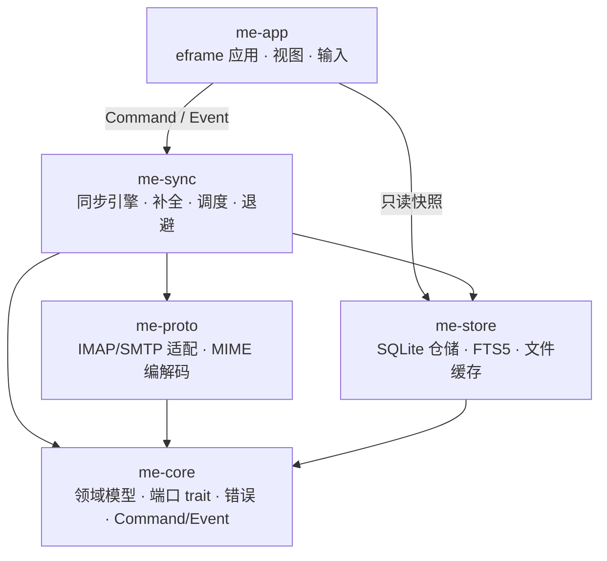

# MyEmail 项目架构

> 依据：`doc/项目大纲.md` v0.4、`doc/可行性分析.md`（2026-11-01）
> 本文细化大纲 §4（系统架构）与 §6（目录结构），**不改变任何已定决策**；与大纲冲突时以大纲为准。
> 关联文档：[技术栈选用.md](技术栈选用.md)｜[数据结构.md](数据结构.md)

---

## 1. 架构目标与约束

| 目标 | 由什么保证 | 失败代价 |
| --- | --- | --- |
| UI 永不阻塞 | 网络与磁盘全在 tokio 运行时；UI 只消费事件 | 窗口假死，体验直接崩 |
| 领域逻辑可单测 | `me-core` 不依赖 tokio / rusqlite | 核心规则只能靠端到端验证，回归成本高 |
| 协议库可替换 | `me-proto` 隔离 `async-imap` / `lettre` 的类型 | 被单一上游库绑死（已识别为中风险） |
| 离线可用 | 全量摘要 + 正文缓存 + 本地 FTS | 断网即不可用，背离产品定位 |
| 数据可修复 | 重建索引命令、缓存清理、schema 版本管理 | 一次损坏导致用户重装 |

**不追求**：插件化、多窗口、脚本扩展、服务端部署。这些在大纲 §1.3 已列为非目标，架构上不预留抽象。

---

## 2. 分层与依赖方向



**硬规则**

1. 依赖只能向上图箭头方向，**不得出现环**；`me-core` 是唯一的汇点，不依赖任何其他 crate。
2. `me-app` 不得 `use` `async-imap`、`lettre`、`rusqlite` 的任何符号——违规即在编译期暴露，不靠自觉。
3. `me-proto` 与 `me-store` 之间没有直接依赖，二者只通过 `me-core` 的类型通信。
4. 唯一的例外是图中 `me-app → me-store` 的只读路径：UI 需要分页查询列表与未读数，经 `me-store` 提供的只读端口直接取数，**不经过 `me-sync` 中转**。只读查询仅限键集分页与未读计数，单次 `LIMIT ≤ 200`，禁止全表扫描、FTS 检索与任何写操作；搜索经 `Search` 命令异步返回，结果摘要由 `SearchResults` 携带（见 §5.3）。写操作一律走 `Command`。

> 为什么允许 UI 读库：若列表分页也要走事件通道，每滚一屏就要一次往返，反而引入新的时序问题。只读直取 + 事件通知「有变化」是更简单且可测的方案。
>
> 约束：只读端口内部使用专用读连接，查询必须命中索引并在毫秒级返回；超过行数上限或需要全表扫描的查询由 `me-store` 拒绝，改走 `Command`。

---

## 3. crate 职责与接口边界

| crate | 职责 | 依赖 | 明确禁止 |
| --- | --- | --- | --- |
| `me-core` | 领域模型、端口 trait、错误、`Command`/`Event` 定义 | 无（仅 serde/thiserror 等纯类型库） | tokio、rusqlite、任何协议库 |
| `me-proto` | IMAP/SMTP 会话、认证、MIME 解析与构建 | `me-core`、`async-imap`、`lettre`、`mail-parser`、`html2text` | 直接触库、直接发事件 |
| `me-store` | SQLite 仓储、FTS5、文件缓存、迁移 | `me-core`、`rusqlite`、`r2d2` | 网络访问、业务规则判断 |
| `me-sync` | 任务编排、同步、后台补全、退避、事件发送 | 以上全部、`keyring` | 直接操作 egui 类型 |
| `me-app` | eframe 应用、视图、输入、文件对话框 | `me-core`、`me-store`（只读）、`me-sync` | 协议库、写连接 |

### 3.1 me-core

```
src/
├─ model.rs      Account / Folder / FolderRole / MessageSummary / MessageBody
│                Attachment / Draft / Flags / FlagOp / SearchQuery
├─ port.rs       ImapPort / SmtpPort / MessageRepo / FolderRepo / SearchRepo / DraftRepo
├─ command.rs    Command / Event / TaskId
└─ error.rs      CoreError（thiserror 枚举，区分 Retryable / Fatal / UserFacing）
```

- 端口 trait 用 **`async fn` in trait（RPITIT）**，不引入 `async-trait`，避免给 `me-core` 增加运行时色彩。
- `Event` 携带的是**结果快照**而非引用，保证 UI 侧无需回查即可渲染常见场景。

### 3.2 me-proto

```
src/
├─ imap.rs  连接、能力探测（CAPABILITY）、ID 命令、SELECT/FETCH/STORE/APPEND/MOVE
├─ smtp.rs  投递、TLS 模式选择、SASL PLAIN/LOGIN
├─ mime.rs  mail-parser 封装（full_encoding：按声明字符集解码头/正文）：头部→MessageSummary、RFC822→(正文, 附件列表)、OutgoingMessage→RFC822
└─ utf7.rs  modified UTF-7 编解码（文件夹名）
```

- 所有上游错误在此翻译为 `CoreError`，**`async-imap` 的 error 类型不得出现在 `me-proto` 之外**。
- 登录后按 `CAPABILITY` 发送 `ID` 命令（QQ/163 需要）；该能力由 `imap.rs` 补齐，必要时对 `async-imap` 打最小补丁（见 技术栈选用.md §3.3）。
- 服务器能力探测结果（`MOVE` / `UIDPLUS` / `SPECIAL-USE`）在会话建立时缓存，供 `me-sync` 决策回退路径。

### 3.3 me-store

```
src/
├─ db.rs          连接管理：单写连接 + 读池、PRAGMA 初始化
├─ migrations.rs  schema_version 读写（v0.1 发布前仅初始化，不含迁移）
├─ accounts.rs / folders.rs / messages.rs / attachments.rs / drafts.rs / pending.rs
├─ search.rs      FTS5 查询构建、<3 字符分支、覆盖率统计
└─ cache.rs       正文/原始邮件/附件的落盘与清理
```

- 只做「存取 + 约束」，**不判断业务语义**（例如「删除是否应移入废件箱」由 `me-core`/`me-sync` 决定）。

### 3.4 me-sync

```
src/
├─ engine.rs   同步主流程：文件夹合并 → 增量拉取 → 标志回拉
├─ indexer.rs  正文后台补全与 FTS 写入
├─ tasks.rs    TaskId 注册、取消、退避调度
└─ events.rs   事件发送（有界通道 + 合并）
```

### 3.5 me-app

```
src/
├─ main.rs  eframe 启动、单实例检查、运行时创建
├─ app.rs   update()：接收事件 → 更新视图状态 → 渲染
├─ state.rs UI 侧状态（当前账户、选中文件夹、分页窗口、对话框）
└─ views/   accounts / mailbox / reader / compose / settings
```

---

## 4. 运行时与线程模型

| 执行体 | 承担 | 禁止 |
| --- | --- | --- |
| 主线程（eframe） | 事件循环、布局与绘制、UI 状态更新、只读短查询 | 网络与磁盘 IO、`await`、写库、全表扫描与 FTS 查询；只读查询须键集分页且 `LIMIT ≤ 200` |
| tokio 运行时（独立线程，multi-thread） | 网络 IO、同步、SMTP 投递、正文补全 | 持有或修改 `me-app` 的视图状态 |
| DB 工作线程 | 单写连接；异步侧经 `spawn_blocking` 访问 | 跨线程持有事务 |

**每帧主循环**

```
update():
  1. event_rx.try_recv() 循环抽取，直到空或达到每帧上限（建议 256 条）
  2. 若本帧收到影响列表的事件 → 标记该视图需要重新查询（懒加载，不立即查）
  3. 渲染
  4. 若仍有未处理事件 → ctx.request_repaint()
```

- 每帧事件上限的意义：防止一次十万级事件涌入时单帧卡死；剩余事件留到下一帧，并主动请求重绘。
- 后台每次 `send` 事件后调用 `ctx.request_repaint()`，保证窗口空闲时也能刷新。

---

## 5. 通信契约

### 5.1 通道

| 方向 | 类型 | 容量 | 满时行为 |
| --- | --- | --- | --- |
| UI → 后端 | `Command` | 无界 | 用户操作稀疏，无堆积风险 |
| 后端 → UI | `Event` | 有界 1024 | 先丢最旧的可合并进度事件；关键事件不得丢弃 |

**可合并事件**：`SyncProgress`、`IndexProgress`（每 ≥200 ms 或每 50 封最多一次）。
**不可丢弃事件**：除 `SyncProgress`、`IndexProgress` 外的所有事件，包括 `AccountsLoaded`、`AccountAdded`、`AccountUpdated`、`AccountRemoved`、`AccountStatus`、`ConnectionTested`、`FoldersUpdated`、`MessagesAppended`、`FlagsChanged`、`MessageBodyLoaded`、`AttachmentDownloaded`、`SearchResults`、`IndexRebuilt`、`DraftSaved`、`SendCompleted`、`SendFailed`、`CacheCleared`、`Error`。

### 5.2 事件不是真相

- **真相在数据库**。事件只表示「某事已完成 / 状态已变化」，UI 可以选择用 payload 增量更新，也可以重新查询。
- 因此事件合并与丢弃不会造成数据丢失，只影响刷新及时性——这是允许丢进度事件的前提。

### 5.3 Command 语义

| Command | 幂等 | 可取消 | 备注 |
| --- | --- | --- | --- |
| `AddAccount` / `UpdateAccount` / `DeleteAccount` | 否 | — | 账户编辑页触发；删除有草稿账户默认拒绝，`delete_drafts=true` 才级联 |
| `TestConnection` | 否 | — | 结果经 `ConnectionTested` 返回 |
| `SyncAccount` / `SyncFolder` | 是 | 是 | 同步中重复触发应合并为一次 |
| `CancelSync` | 是 | — | 取消点见 §7 |
| `OpenMessage` | 是 | 是 | 正文已缓存则直接返回 `MessageBodyLoaded`，不发网络请求 |
| `DownloadAttachment` | 是 | 是 | 已缓存则直接发 `AttachmentDownloaded` |
| `SetFlags` / `MoveToTrash` / `EmptyTrash` | 是 | 否 | 本地先写，服务器异步 |
| `SaveDraft` | 否 | — | 保存本地草稿 |
| `SaveDraftToServer` | 是 | 是 | 本地草稿为唯一事实来源，成功后记录 `server_uid` |
| `Send` | 否 | 不可取消 | 复用固定 `Message-ID`；结果经 `SendCompleted` / `SendFailed` |
| `RetryArchive` | 是 | 是 | 仅用于 `status=sent` 且归档失败 |
| `Search` | 是 | 是 | 结果经 `SearchResults` 返回（含摘要），`query_id` 覆盖旧查询 |
| `SetTheme` / `SetBodyBackfill` | 是 | `SetBodyBackfill` 可取消 | 写 `meta`；补全开关即时暂停 |
| `RebuildIndex` | 是 | 是 | 完成后发 `IndexRebuilt` |
| `ClearCache` | 是 | 是 | 不删摘要与标志；完成后发 `CacheCleared` |

---

## 6. 关键流程

### 6.1 启动

```
1. 单实例检查（命名互斥量）→ 已有实例则激活其窗口并退出
2. 打开日志（按天滚动，保留 7 天）
3. 打开库：PRAGMA foreign_keys / journal_mode=WAL / busy_timeout=5000 / synchronous=NORMAL；执行一次 PRAGMA quick_check
4. 读取 meta.schema_version（schema 初始化在打开库时完成；v0.1 发布前不写迁移，见 数据结构.md §9）
5. 创建 tokio 运行时线程，注入 Command 接收端
6. 启动 eframe 窗口（先渲染空态，不等待网络）
7. 后台：读取账户 → 发 `AccountsLoaded` → 逐个串行 SyncAccount
```

**启动时序约束**：第 6 步不得等待第 7 步；窗口必须在 1 秒内可见，即使数据库为空。

### 6.2 同步（可取消）

```
SyncAccount(id)
  → 取凭证（keyring；会话内存降级）
  → IMAP 登录 → CAPABILITY → LIST（含 SPECIAL-USE）
  → 与库中 folders 差异合并：新增；改名按 UIDVALIDITY + delimiter + 角色匹配后只 UPDATE name；服务器已删除的文件夹置 deleted_on_server=1，用户确认后才清理本地
  → for folder in 需要同步的文件夹:
        SELECT → UIDVALIDITY / UIDNEXT
        UIDVALIDITY 变化 → 清空本地 + FTS，last_uid=0
        UIDNEXT <= last_uid+1 → 跳过头部 FETCH（标志回拉仍执行）
        否则 FETCH 头部 + BODYSTRUCTURE
        过滤 UID > last_uid → 批量事务写入 → 更新 last_uid
        发 MessagesAppended
  → 标志回拉：分页 UID FETCH 1:* (FLAGS)
        本地有 pending_flags → 以本地目标态为准，忽略服务器值
        否则 → 服务器值为准，只更新 messages.flags；不回写队列
  → 结束后：若允许后台补全则移交 indexer
```

**取消点**：每个文件夹开始前、每批 FETCH 之后、每次重试退避前。取消后 `last_uid` 只推进到已完整写入的位置。

### 6.3 读信

```
OpenMessage(id)
  1. 本地立即置 \Seen 并入待同步队列（UI 立刻可见）
  2. 异步 STORE +FLAGS (\Seen)；失败进入待重试，不回滚本地
  3. body_path 非空 → 直接读文件 → 发 MessageBodyLoaded
     否则 FETCH BODY.PEEK[] → mail-parser → text/plain 或 html2text
          → 写 bodies/*.txt + raw/*.eml.gz → 更新 messages.body_path
          → 写 FTS → 发 MessageBodyLoaded
```

### 6.4 正文后台补全

- 队列来源：按文件夹分组 `body_path IS NULL AND uid IS NOT NULL ORDER BY folder_id, uid`（每账户）；每个文件夹先 SELECT 再批量 FETCH。
- 每封使用 `BODY.PEEK[]`（禁止 `BODY[]`，否则会把邮件标为已读）。
- 跨账户并发 2、每账户 1 条连接；断网、手动同步、退出即暂停；进度天然持久（`body_path` 非空即已完成）。
- 与发信、手动同步共用连接预算，优先级：发信 > 手动同步 > 补全。

### 6.5 发信

```
Send(OutgoingMessage)
  1. 写本地 drafts（生成并固定 Message-ID，status=draft）
  2. SMTP 投递（失败不重试，发 SendFailed，按类型提示并保留草稿）
  3. 成功 → IMAP APPEND 到 Sent
       ├─ 成功 → status=sent，发 SendCompleted { archived: true }
       └─ 失败 → status=sent + last_error，发 SendCompleted { archived: false, archive_error }，提示「已发送，但未保存到已发送文件夹」，提供「重试归档」（RetryArchive）
  4. 若存在 server_uid → 尝试删除服务器草稿副本，失败仅提示
```

**保存到服务器草稿（手动）**：`SaveDraftToServer` → `APPEND` 到 Drafts → 记录 `server_uid` → 发 `DraftSaved { synced_to_server: true }`；失败记 `last_error` 并发 `Error`。

### 6.6 删除

```
MoveToTrash(ids)
  → 校验账户存在 trash 角色；不存在则禁用并提示（不退化为永久删除）
  → 本地移动（folder_id 指向 Trash、uid 置 NULL）并立即渲染；原位置写入 pending_ops
  → 异步：服务器支持 MOVE → MOVE
           否则 COPY + STORE \Deleted；有 UIDPLUS 时追加 UID EXPUNGE，否则不 EXPUNGE
        成功后：有 UIDPLUS → COPYUID 回填新 UID；无 → UID SEARCH HEADER Message-ID 定向补齐
        确认后删除 pending_ops
  → 失败 → 记入待重试，UI 显示「同步中/待重试」，不静默丢失
  → v0.1 不提供从废件箱恢复；UI 明确提示移回需在服务器端或其他客户端完成

永久删除 / 清空废件箱
  → 仅当服务器通告 UIDPLUS 时可用（UID STORE \Deleted + UID EXPUNGE）；否则禁用并说明原因
  → 先写 pending_ops，再删本地 messages 行（pending_ops.message_id 为 SET NULL，操作不会被级联删除）
```

### 6.7 搜索

```
Search(query)
  → 词长 ≥3：FTS5 MATCH（subject/body/from_addr/to_addrs）
  → 词长 1～2：仅 LIKE 头部字段，界面提示「正文不参与」
  → 附加过滤：账户 / 文件夹 / 时间范围 / 是否含附件
  → 返回分页结果（含摘要）+ 覆盖率（body_path 非空计数 / 总数），经 SearchResults 事件回传
```

---

## 7. 并发与资源治理

| 资源 | 预算 | 控制点 |
| --- | --- | --- |
| 服务器连接 | 跨账户全局 2，单账户 1 | `me-sync` 信号量；发信、同步、补全共用 |
| 同步并发 | 账户串行 | 调度队列 |
| 补全并发 | 跨账户 2，每账户 1 | 同上信号量；优先级低于发信与手动同步 |
| DB 写 | 全局 1 | 单写连接 |
| 文件句柄 | 按需 | 正文/附件读写用短生命周期 |

**优先级与抢占**：发信 > 手动同步 > 后台补全。发信请求到达而连接预算已满时，取消当前补全任务（可续跑），腾出连接给发信；手动同步同理。

**磁盘保护**：WAL 超过 64 MB 执行 `wal_checkpoint(TRUNCATE)`；剩余空间 < 500 MB 时暂停补全并提示。

**退避**：30s → 2min → 5min（`BYE`、连接数限制、限流），账户上显示「稍后重试」。

**取消**：`TaskId` 注册表 + `CancellationToken`；所有长循环在约定点检查，取消后保留已写入数据、清理未完成临时文件。

**背压**：有界事件通道 + 进度合并 + 补全队列按 UID 串行推进（不一次性把 10 万条塞进内存）。

---

## 8. 错误模型与可观测性

```rust
// me-core/src/error.rs
pub enum CoreError {
    Network { retryable: bool, source: ... },
    Protocol { code: ..., detail: String },   // IMAP/SMTP 状态码与文本（已脱敏）
    Auth { .. },
    Storage { .. },
    Parse { .. },
    Limit { what: LimitKind },               // 附件超限、体积超限
    Cancelled,
}

pub enum LimitKind { AttachmentFile, AttachmentTotal, ParseSize }
```

| 层 | 错误类型 | 处理方式 |
| --- | --- | --- |
| `me-core` / `me-proto` / `me-store` | `thiserror` 枚举 | 向上传播，保留 `source` |
| `me-sync` | `CoreError` → `SendFailureKind` / 重试决策 | 决定退避、进待重试队列、或发 `SendFailed` |
| `me-app` | `anyhow` | 仅用于顶层兜底与「可复制详情」 |

**日志**

- 分级 INFO/WARN/ERROR；必记：同步开始/结束（账户、文件夹、新增数、耗时）、协议错误、发送结果。
- 不记录正文与凭证；邮箱按 `a***@domain` 脱敏。
- 实现约束：日志宏只接受 `LogSafeMessageSummary`（`MessageSummary` 去掉 `snippet`），正文与预览不进入日志调用点；`snippet` 与完整地址列为敏感字段。

---

## 9. 配置与状态

| 状态 | 存放 | 说明 |
| --- | --- | --- |
| 凭证 | Windows 凭据管理器（`keyring`，只在 `me-sync` 的 tokio 线程读取） | 不可用时仅进程内存，不落盘 |
| 账户/文件夹/邮件/草稿 | SQLite | 见 数据结构.md |
| 用户设置（主题、后台补全开关） | `meta` 表；经 `SetTheme` / `SetBodyBackfill` 写入 | 不额外引入配置文件，减少一份需要迁移的状态 |
| UI 瞬时状态（选中项、滚动位置、草稿编辑中内容） | 内存 | 退出即丢；未保存的草稿需先经 `SaveDraft` 落库并等待 `DraftSaved` 再退出 |

---

## 10. 扩展点

| 未来能力 | 预留位置 | 改动范围 |
| --- | --- | --- |
| OAuth2（v0.2 首项） | `me-proto` 认证策略（`AuthStrategy`）；`auth_method` 已预留，新增 token 过期时间/作用域列或独立凭证表 | 协议层 + 一次纯加列迁移 |
| IDLE / 定时轮询 | `me-sync` 的同步触发器，替换「启动 + 手动」两处入口 | 调度层，不影响存储 |
| 完整 HTML 渲染 | `me-app` 阅读视图的正文渲染器；`raw/*.eml.gz` 已留原始邮件 | UI 层 |
| 换 IMAP 库 | 仅 `me-proto/src/imap.rs` | 预计 5～10 人日（见可行性分析 §3.1） |

**不预留**：多身份/签名、PGP、服务端、移动端——需重做模型，不做假抽象。

---

## 11. 工程结构

```
MyEmail/
├─ Cargo.toml                  # workspace，resolver = "2"
├─ rust-toolchain.toml         # 固定工具链，避免 CI 与本机漂移
├─ deny.toml                   # cargo-deny：许可证与漏洞策略
├─ doc/
│  ├─ 项目大纲.md
│  ├─ 可行性分析.md
│  ├─ 项目架构.md
│  ├─ 技术栈选用.md
│  └─ 数据结构.md
├─ crates/
│  ├─ me-core/src/{model,port,command,error}.rs
│  ├─ me-proto/src/{imap,smtp,mime,utf7}.rs
│  ├─ me-store/src/{db,migrations,accounts,folders,messages,attachments,drafts,pending,search,cache}.rs
│  ├─ me-sync/src/{engine,indexer,tasks,events}.rs
│  └─ me-app/src/{main,app,state,views/...}
├─ assets/                     # 图标、CJK 字体子集
└─ tests/                      # 跨 crate 集成测试与 .eml 夹具
```

---

## 12. 测试架构

| 层 | 对象 | 手段 | 依赖 |
| --- | --- | --- | --- |
| 单元 | `me-core` 规则、标志位映射、时间回退、附件上限 | 纯函数测试 | 无 |
| 单元 | `me-proto` MIME 解析 | 固定 `.eml` 夹具 + 畸形样本 | 无网络 |
| 集成 | `me-store` | 临时 SQLite：schema 初始化、外键级联、FTS 增删改与重建 | 无网络 |
| 集成 | `me-proto` 协议时序 | mock IMAP/SMTP：`UIDNEXT` 判空、`UID > last_uid` 过滤、标志回拉分页、MOVE 回退、`BODY.PEEK[]` 不改变已读 | 本地 |
| 端到端 | 全链路 | Docker 起 GreenMail / Dovecot | Docker Desktop (WSL2) |
| UI | 关键视图 | `egui_kittest` 快照（可选） | 无 |
| 性能 | 列表、搜索 | 1 万 / 10 万封数据集，冷热缓存各测 P50/P95 | 固定机型 |

**架构对测试的支撑**：`me-core` 无运行时依赖 ⇒ 规则测试毫秒级；`me-proto` 的 mock 只需实现 `ImapPort` ⇒ 不依赖真实服务器即可测协议时序。

---

## 13. 未决事项

统一见 `doc/项目大纲.md` §9「未决事项」。本节不再单独维护。

---

## 14. v0.2 增量（实现状态，2026-11-02）

> 设计细节见 [v02架构设计.md](v02架构设计.md)；本节只记录与 v0.1 架构视图的差异。

- **OAuth2**：`me-proto/oauth.rs` 是唯一 OAuth HTTP 点；`me-sync/auth.rs` 管理 keyring 刷新令牌与单飞刷新；`me-sync/oauth_flow.rs` 负责回环回调（仅 `127.0.0.1:0`）、设备码、账户创建/重新授权。浏览器经 `BrowserOpener` 由 `me-app/browser.rs` 注入。
- **实时同步**：`me-sync/watcher.rs` 每账户 IDLE（仅 INBOX，29 分钟一轮）+ 轮询兜底；监听连接使用独立 `Governor`（全局 4 / 单账户 1），与操作连接（全局 2 / 单账户 1）分开计费；手动同步优先。
- **草稿双向同步**：`me-sync/drafts.rs` 全量扫描 Drafts、双基线哈希、冲突副本与墓碑；`draft_gate` 串行化草稿同步；Drafts 不再写入 `messages`，正文补全队列排除 Drafts。
- **HTML 渲染器 v2**：`me-app/views/html/`（`parse.rs` / `css.rs` / `layout.rs` / `mod.rs`）在 `spawn_blocking` 中解析，UI 只接收扁平 `RenderedHtml`；`layout.rs` 按当前内容宽度测量块/行/表格单元格的绝对矩形后统一绘制（含 `inline-block` 容器、`max-width` 约束、`rowspan`/`colspan` 网格与图片占位）。并发 2，按 generation 丢弃旧结果，失败/超限回退到 v0.1 `richtext` 子集。
- **数据库**：schema v2 纯加列迁移；`doc/数据结构.md` §4.2/§5.3/§5.5/§9 已回写。
- **未完成的外部验证**：真实 Gmail/Outlook G0、Docker GreenMail E2E、`cargo deny` 本地门禁。
